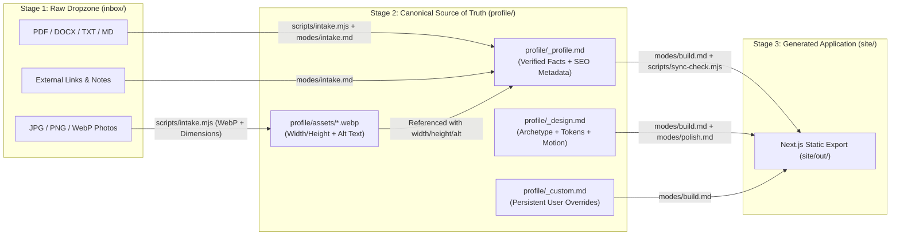

# FolioOps Data Contract (`DATA_CONTRACT.md`)

> **Status:** Canonical Specification (v0.2.0 — Sprint 1)  
> **Related ADRs:** [`ADR-0001`](./docs/architecture/adr/0001-career-ops-mode-driven-pipeline-architecture.md), [`ADR-0002`](./docs/architecture/adr/0002-two-stage-user-data-layer-inbox-and-profile.md), [`ADR-0003`](./docs/architecture/adr/0003-portfolio-frontend-stack-nextjs-static-export.md), [`ADR-0004`](./docs/architecture/adr/0004-multi-stage-quality-and-anti-slop-verification-gates.md)  
> **Scope:** Defines the strict boundary between the **System Layer (`PROJECT_ROOT`)** and the **User Data Layer (`DATA_ROOT`)**, the canonical schemas for `profile/_profile.md`, `profile/_design.md`, `profile/_custom.md`, `config/profile.yml`, and the asset optimization invariants in `profile/assets/`.

---

## 1. Layer Isolation: System Layer (`PROJECT_ROOT`) vs. User Data Layer (`DATA_ROOT`)

Inspired by the `career-ops` workspace architecture, FolioOps enforces a strict separation between **engine code** (which can be upgraded from upstream) and **personal user data** (which belongs exclusively to the professional building their portfolio).

### 1.1 Directory Ownership Matrix

| Path | Layer | Mutated By | Upstream Update Policy (`modes/update.md`) | Git Tracking Policy |
| :--- | :--- | :--- | :--- | :--- |
| `AGENTS.md`, `CLAUDE.md`, `GEMINI.md` | **System (`PROJECT_ROOT`)** | FolioOps Maintainers | **Replaced / Updated** on framework upgrade | Tracked |
| `DATA_CONTRACT.md` | **System (`PROJECT_ROOT`)** | FolioOps Maintainers | **Replaced / Updated** on framework upgrade | Tracked |
| `modes/*.md` | **System (`PROJECT_ROOT`)** | FolioOps Maintainers | **Replaced / Updated** on framework upgrade | Tracked |
| `rules/*.md` | **System (`PROJECT_ROOT`)** | FolioOps Maintainers | **Replaced / Updated** on framework upgrade | Tracked |
| `scripts/*.mjs` | **System (`PROJECT_ROOT`)** | FolioOps Maintainers | **Replaced / Updated** on framework upgrade | Tracked |
| `templates/**` | **System (`PROJECT_ROOT`)** | FolioOps Maintainers | **Replaced / Updated** on framework upgrade | Tracked |
| `config/profile.yml.example` | **System (`PROJECT_ROOT`)** | FolioOps Maintainers | **Replaced / Updated** on framework upgrade | Tracked |
| `config/profile.yml` | **User (`DATA_ROOT`)** | User / `modes/intake.md` | **NEVER TOUCHED** (Schema-validated only) | Ignored (User-local) |
| `inbox/*` | **User (`DATA_ROOT`)** | User (Raw Dropzone) | **NEVER TOUCHED** (Read-only input to `intake`) | Ignored (except `README.md`) |
| `profile/_profile.md` | **User (`DATA_ROOT`)** | `modes/intake.md`, `modes/add.md` | **NEVER TOUCHED** by framework updates | User-configurable (Ignored in core repo) |
| `profile/_design.md` | **User (`DATA_ROOT`)** | `modes/brainstorm.md` | **NEVER TOUCHED** by framework updates | User-configurable (Ignored in core repo) |
| `profile/_custom.md` | **User (`DATA_ROOT`)** | User / AI Agent | **NEVER TOUCHED** by framework updates | User-configurable (Ignored in core repo) |
| `profile/assets/*.webp` | **User (`DATA_ROOT`)** | `scripts/intake.mjs`, `modes/add.md` | **NEVER TOUCHED** by framework updates | User-configurable (Ignored in core repo) |
| `site/**` | **Generated (`DATA_ROOT`)** | `modes/build.md`, `modes/polish.md` | **NEVER OVERWRITTEN** without user confirmation | User-configurable (Ignored in core repo) |
| `reports/**` | **Diagnostic (`DATA_ROOT`)** | `scripts/audit-*.mjs`, `modes/verify.md` | Ephemeral / Regenerated on every audit | Ignored (except `.gitkeep`) |

---

## 2. Two-Stage Data Flow (`inbox/` → `profile/` → `site/`)



---

## 3. Canonical Schema: `config/profile.yml`

Located at `config/profile.yml` (copied from `config/profile.yml.example`), this file stores global workspace preferences, language settings, and deployment targets.

### 3.1 Schema Definition

```yaml
# FolioOps Workspace Configuration (config/profile.yml)
version: "1.0"

language:
  # Language used by the AI Agent when chatting with the user and generating reports
  output: "pt-BR"        # Any BCP 47 tag (e.g., "pt-BR", "en-US", "es-ES", "fr-FR")
  # Language(s) of the generated public Web portfolio
  portfolio: "pt-BR"     # Primary language tag for <html lang="..."> and OG locale
  secondary: []          # Optional secondary locales for multilingual portfolios (e.g., ["en-US"])

site:
  # Canonical public URL used for sitemap.xml, robots.txt, canonical tags, and JSON-LD
  url: "https://example.com"
  base_path: ""          # Optional subpath for GitHub Pages project sites (e.g., "/portfolio")

deploy:
  # Target zero-cost hosting provider ("github-pages" | "vercel" | "cloudflare-pages" | "custom")
  target: "github-pages"
```

---

## 4. Canonical Schema: `profile/_profile.md` (Professional Identity & Content)

`profile/_profile.md` is the **Single Source of Truth** for all factual content rendered in the portfolio, Open Graph tags, and `Schema.org` JSON-LD (`Person`, `ProfilePage`, `ProfessionalService`).

### 4.1 Anti-Hallucination & Source Traceability Rules
1. **Zero Fabrication:** Every role, credential, metric, publication, project, or testimonial in `profile/_profile.md` **MUST** originate from a file in `inbox/` or an explicit user answer during the `modes/intake.md` gap interview.
2. **Source Attribution (`source_ref`):** Each structured item must record its provenance (`inbox/<filename>` or `user-interview`) so `scripts/sync-check.mjs` can audit data integrity.
3. **No Invented Percentages:** The AI must never invent skill percentage bars (e.g., `"React 95%"`, `"Litigation 90%"`) or placeholder metrics (`"Increased revenue by X%"`).

### 4.2 Schema Structure (`YAML Frontmatter + Markdown Body`)

```markdown
---
schema_version: "1.0"
last_updated: "2026-10-29"
language: "pt-BR"

identity:
  full_name: "Dr. Helena Vasconcelos"
  display_name: "Helena Vasconcelos"
  headline: "Arquiteta Urbanista & Consultora em Restauro Patrimonial"
  tagline: "Preservando a memória arquitetônica brasileira com engenharia contemporânea."
  field_category: "architecture-urbanism" # e.g., healthcare, law, architecture-urbanism, design, engineering, arts, academia
  location:
    city: "Curitiba"
    region: "PR"
    country: "BR"
  availability:
    status: "available" # "available" | "selective" | "unavailable"
    label: "Disponível para projetos de restauro e consultoria técnica"
  avatar:
    src: "/assets/helena-portrait.webp"
    width: 800
    height: 1000
    alt: "Retrato de Helena Vasconcelos em frente a uma fachada histórica restaurada em Curitiba"

contact:
  email: "contato@helenavasconcelos.arq.br"
  phone_display: "+55 (41) 99999-0000"
  whatsapp_url: "https://wa.me/5541999990000"
  booking_url: ""
  primary_cta:
    label: "Agendar Consulta Técnica"
    href: "mailto:contato@helenavasconcelos.arq.br"
  socials:
    - platform: "LinkedIn"
      url: "https://www.linkedin.com/in/example"
      handle: "@helenavasconcelos"
    - platform: "Instagram"
      url: "https://www.instagram.com/example"
      handle: "@helenavasconcelos.arq"

seo:
  title: "Helena Vasconcelos | Arquitetura & Restauro Patrimonial em Curitiba"
  description: "Portfólio de projetos de restauro histórico, reabilitação urbana e consultoria arquitetônica liderados por Helena Vasconcelos (CAU/BR)."
  canonical_url: "https://helenavasconcelos.arq.br"
  og_image:
    src: "/assets/og-cover.webp"
    width: 1200
    height: 630
    alt: "Cartão de apresentação do portfólio de Helena Vasconcelos — Arquitetura & Restauro"
  schema_org:
    type: "Person" # "Person" | "ProfessionalService"
    job_title: "Urban Architect & Heritage Restoration Consultant"
    alumni_of:
      - "Universidade Federal do Paraná (UFPR)"
    knows_about:
      - "Restauro Arquitetônico"
      - "Patrimônio Histórico"
      - "Reabilitação Urbana"
      - "BIM para Patrimônio (HBIM)"

highlights:
  - value: "14 anos"
    label: "Atuação em restauro de bens tombados"
    source_ref: "inbox/curriculo-helena.pdf"
  - value: "22 obras"
    label: "Projetos aprovados em órgãos de patrimônio (IPHAN / CPC)"
    source_ref: "inbox/curriculo-helena.pdf"

experience:
  - id: "exp-estudio-hv"
    role: "Arquiteta Titular & Diretora Técnica"
    organization: "Estúdio HV Restauro & Arquitetura"
    location: "Curitiba, PR"
    start_date: "2018-03"
    end_date: "present"
    summary: "Liderança de projetos executivos de restauro, diagnóstico patológico de edificações históricas e compatibilização complementar em HBIM."
    achievements:
      - "Coordenação do restauro integral do Palacete São Francisco (1.850 m²)."
      - "Implantação de metodologia de escaneamento a laser 3D para levantamento cadastral."
    source_ref: "inbox/curriculo-helena.pdf"

projects:
  - id: "proj-palacete-sao-francisco"
    title: "Restauro do Palacete São Francisco"
    subtitle: "Reabilitação estrutural e adaptação para centro cultural"
    category: "Patrimônio Tombado"
    year: "2024"
    featured: true
    summary: "Intervenção conservativa e restauro de fachada eclética do século XIX, integrando acessibilidade universal e climatização invisível."
    outcome: "Obra entregue dentro do cronograma de 18 meses e premiada pelo IAB-PR."
    tags:
      - "Restauro de Fachada"
      - "Acessibilidade Universal"
      - "HBIM"
    links:
      - label: "Estudo de Caso Completo"
        url: "#proj-palacete-sao-francisco"
    media:
      - src: "/assets/palacete-fachada.webp"
        width: 1600
        height: 1067
        alt: "Fachada restaurada do Palacete São Francisco iluminada ao entardecer"
    source_ref: "inbox/portfolio-obras.pdf"

education:
  - degree: "Mestrado em Conservação e Restauro"
    institution: "Universidade Federal da Bahia (UFBA)"
    year: "2016"
    source_ref: "inbox/curriculo-helena.pdf"
  - degree: "Graduação em Arquitetura e Urbanismo"
    institution: "Universidade Federal do Paraná (UFPR)"
    year: "2012"
    source_ref: "inbox/curriculo-helena.pdf"

credentials:
  - title: "Registro Profissional CAU/BR A00000-0"
    issuer: "Conselho de Arquitetura e Urbanismo do Brasil"
    year: "2012"
    source_ref: "user-interview"

skills:
  - group: "Especialidades Técnicas"
    items:
      - "Diagnóstico de Patologias em Edificações Históricas"
      - "Projetos de Restauro (IPHAN / CONDEPHAAT / CPC)"
      - "Modelagem HBIM e Nuvem de Pontos"
      - "Acessibilidade em Bens Culturais Tombados"

testimonials: []
publications: []
---

## Biografia Estendida (About)

Arquiteta e urbanista formada pela UFPR e mestre em Conservação e Restauro pela UFBA, dedico minha carreira à preservação ativa do patrimônio edificado brasileiro...

## Filosofia de Trabalho

Cada edifício histórico carrega uma camada insubstituível da memória coletiva. Nosso trabalho une rigor científico no diagnóstico de materiais à sensibilidade contemporânea de uso...
```

---

## 5. Canonical Schema: `profile/_design.md` (Visual Direction & Anti-Slop Tokens)

Generated and locked by `modes/brainstorm.md` (with interactive previews powered by `scripts/style-picker.mjs`), `profile/_design.md` translates the design principles from `impeccable` and `frontend-design` into a deterministic configuration consumed by `modes/build.md` and audited by `modes/polish.md`.

### 5.1 Supported Archetypes & Surface Modes

1. **Archetypes (`archetype.id`):**
   - `editorial-serif`: High-contrast editorial typography, warm paper or deep ink surfaces, generous whitespace, magazine-inspired asymmetric grids (ideal for law, healthcare, literature, journalism, consulting, architecture).
   - `swiss-minimal`: Crisp neo-brutalist Swiss grids, exposed hairline borders (`1px`), tabular numerals, mathematical alignment, stark contrast (ideal for architecture, industrial design, research, finance, photography).
   - `interactive-bento`: Modular asymmetric Bento cards, tactile micro-interactions, rich media previews, focal hierarchy (ideal for product designers, creatives, multi-disciplinary founders, agencies).
   - `high-craft-dark`: Deep carbon/obsidian surfaces (never pure `#000000` with neon), subtle specular borders, monospace technical accents, precision lighting (ideal for software engineers, security researchers, AI/ML specialists, audiovisual artists).
2. **`impeccable` Surface Modes (`surface_mode`):**
   - `Experience`: Craft/emotion-first, spacious viewport budget (max 2 component groups visible without scrolling, `>= 25%` open canvas).
   - `Persuade`: Conversion/clarity-first, clear focal point + single primary CTA in Hero, strong social proof and outcome hierarchy.
   - `Read`: Long-form editorial legibility, `60ch–70ch` measure, comfortable line height (`1.6–1.75`), zero visual distractions.

### 5.2 Anti-Slop Token Rules
- **Disciplined Palette (4–6 Hex Tokens):** Must define exact hex values for `bg`, `surface`, `text`, `text_muted`, `accent`, and `border`.
- **Forbidden AI-Slop Palettes:** Never use the generic warm-cream + terracotta AI default (`#F4F1EA` paired with `#D97757` / `#C86D51`) or cyberpunk neon-cyan/magenta on pitch black (`#00FFFF` / `#FF00FF` on `#000000`), unless explicitly requested and overridden in `profile/_custom.md`.
- **Forbidden Default Font Stacks:** Never pair generic default `Inter` + `Roboto` without a distinctive display or serif voice (`--font-display`).

### 5.3 Schema Structure (`profile/_design.md`)

```markdown
---
schema_version: "1.0"
last_updated: "2026-10-29"

archetype:
  id: "editorial-serif" # "editorial-serif" | "swiss-minimal" | "interactive-bento" | "high-craft-dark"
  surface_mode: "Experience" # "Experience" | "Persuade" | "Read"
  theme_polarity: "light-high-craft" # "light-high-craft" | "dark-high-craft"

tokens:
  colors:
    bg: "#FBF9F5"          # Primary canvas background
    surface: "#F2EFE9"     # Elevated surface / subtle card container
    text: "#181615"        # Primary ink (WCAG AAA contrast against bg)
    text_muted: "#5C5752"  # Secondary metadata & captions (WCAG AA >= 4.5:1)
    accent: "#2C4A3E"      # Deep architectural mineral green focal accent
    border: "#E2DDD5"      # Hairline structural divider token
  typography:
    font_display: "Instrument Serif"
    font_sans: "Plus Jakarta Sans"
    font_mono: "JetBrains Mono"
    scale_ratio: "1.25"    # Fluid clamp() modular scale ratio
    body_measure: "65ch"

layout:
  hero_variant: "editorial-split" # "editorial-split" | "typographic-statement" | "architectural-frame"
  grid_system: "asymmetric-12-col"
  max_width: "1200px"
  viewport_budget:
    max_visible_groups_above_fold: 2
    min_whitespace_ratio: 0.28
  section_order:
    - "hero"
    - "highlights"
    - "projects"
    - "experience"
    - "about"
    - "credentials"
    - "contact"

motion:
  level: "editorial" # "subtle" | "editorial" | "reduced"
  respect_reduced_motion: true
  page_transitions: true
---

## Aesthetic Rationale & Creative Direction

Inspired by architectural monographs and museum exhibition catalogs, this visual direction pairs **Instrument Serif** headlines with **Plus Jakarta Sans** body copy on a warm mineral limestone canvas (`#FBF9F5`) anchored by deep forest slate (`#2C4A3E`). Dividers and typographic rhythm replace heavy drop-shadowed cards.
```

---

## 6. Canonical Schema: `profile/_custom.md` (Persistent User Overrides)

`profile/_custom.md` is an optional file where the user (or the AI on the user's behalf) records persistent rules, custom sections, or design overrides that must survive any `modes/build.md` or `modes/polish.md` execution.

```markdown
---
schema_version: "1.0"
override_anti_slop_palette: false
custom_domain: "helenavasconcelos.arq.br"
analytics:
  provider: "none" # "none" | "plausible" | "umami" | "vercel"
---

## Persistent Instructions for the AI Agent

- Never abbreviate institution names on first mention.
- Keep the WhatsApp CTA button visible in the footer contact section, but do not use a floating bottom-right chat bubble.
```

---

## 7. Asset Contract (`profile/assets/`)

All visual media extracted from `inbox/` (or added via `modes/add.md`) must be processed into `profile/assets/` and copied to `site/public/assets/` during build:

1. **Format:** Strictly `.webp` (or `.svg` for vector diagrams/logos).
2. **File Naming:** Lowercase `kebab-case` without spaces or accents (e.g., `palacete-fachada.webp`).
3. **Dimension Budgets:**
   - Portraits / Avatars: max `1000px` on longest edge (`<= 150 KB`).
   - Project / Case Study Media: max `1920px` width (`<= 300 KB`).
   - Open Graph Cover (`og-cover.webp`): exact `1200x630` (`<= 200 KB`).
4. **Mandatory Metadata in `profile/_profile.md`:** Every image reference **MUST** include integer `width`, integer `height`, and non-empty descriptive `alt` text (unless explicitly marked decorative).

---

## 8. Functional Invariants (EARS Specification)

To ensure deterministic behavior across all `modes/*.md` and `scripts/*.mjs`, the FolioOps engine enforces the following **EARS (Easy Approach to Requirements Syntax)** invariants:

- **`INV-DATA-01` (Ubiquitous — Layer Isolation):** The FolioOps system **shall** store all user-specific career facts, design tokens, and media assets exclusively inside `DATA_ROOT` (`inbox/`, `profile/`, `config/profile.yml`, `site/`, `reports/`).
- **`INV-DATA-02` (Event-Driven — Safe Framework Upgrade):** **When** `modes/update.md` is executed to pull framework updates, the system **shall** preserve `inbox/`, `profile/`, `config/profile.yml`, and `site/` without modification or data loss.
- **`INV-DATA-03` (State-Driven — Anti-Hallucination):** **While** generating or updating `profile/_profile.md` or `site/`, the AI Agent **shall** include only facts, metrics, and credentials that have a valid `source_ref` pointing to `inbox/*` or `user-interview`.
- **`INV-DATA-04` (Unwanted Behavior — Missing Image Metadata):** **If** an image referenced in `profile/_profile.md` lacks explicit `width`, `height`, or `alt` attributes, **then** `scripts/sync-check.mjs` **shall** fail with a non-zero exit code and report the offending asset key before `modes/build.md` proceeds.
- **`INV-DATA-05` (Unwanted Behavior — Content Drift):** **If** a project title, role, or organization present in `profile/_profile.md` is missing from the rendered output in `site/`, **then** `scripts/sync-check.mjs` **shall** flag the discrepancy as a blocking synchronization error.
- **`INV-DATA-06` (Where-Driven — Anti-Slop Palette Guardrail):** **Where** `override_anti_slop_palette` is `false` in `profile/_custom.md`, `modes/polish.md` **shall** reject any `profile/_design.md` or CSS stylesheet that uses forbidden AI-slop color combinations or unstyled default font stacks.
