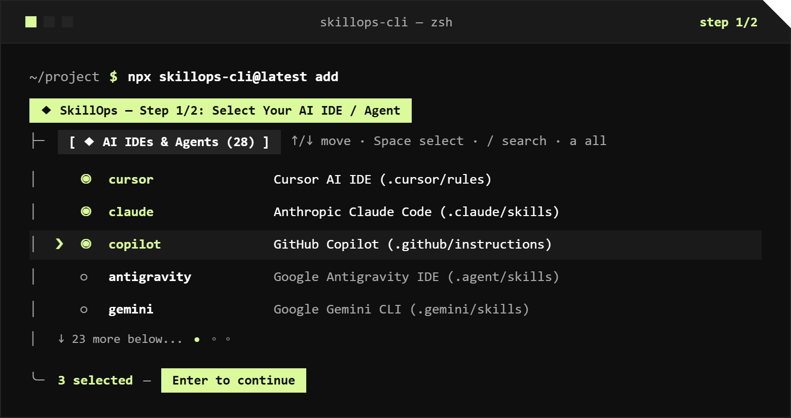
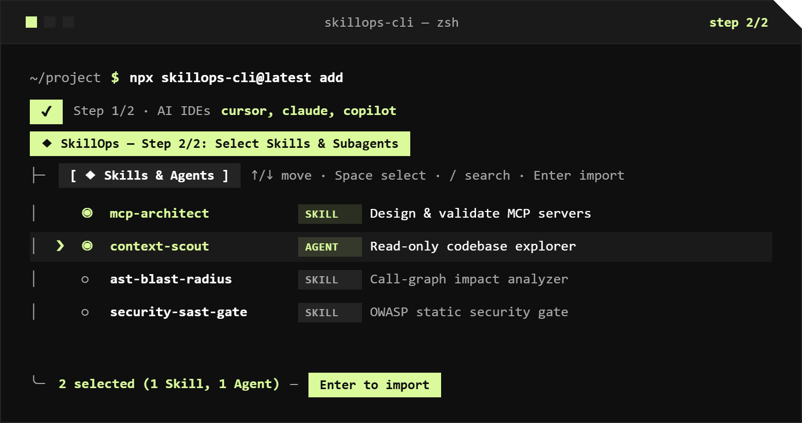
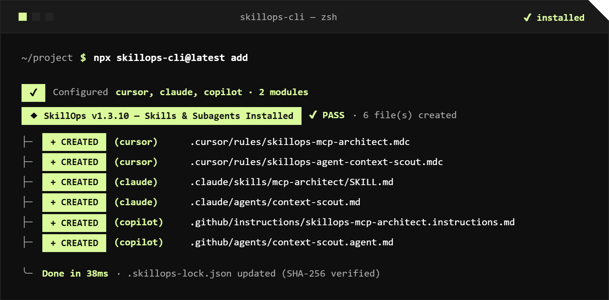

<div align="center">


<p>
  <a href="./README.md"></a>
  <a href="./docs/README.pt-BR.md"></a>
  <a href="./docs/README.es.md"></a>
</p>

<p>
  <a href="https://www.npmjs.com/package/skillops-cli"></a>
  <a href="https://github.com/skillops-toolkit/SkillOps/actions/workflows/ai-ci.yml"></a>
  <a href="https://github.com/skillops-toolkit/SkillOps/actions/workflows/codeql.yml"></a>
  <a href="#supported-ai-ides--clis-28"></a>
  <a href="LICENSE"></a>
</p>

<p>
  <strong>One open-source library of Skills (<code>SKILL.md</code>) and Subagents (<code>SUBAGENT.md</code>). Native installation for 28 AI tools.</strong><br>
  Cursor, Claude Code, GitHub Copilot, Antigravity, Windsurf, Codex, Gemini CLI, Cline, Roo Code, Kiro, and more — 100% local, zero API keys.
</p>

</div>

---

## Quick Start

Run inside any repository to launch the interactive 2-step TUI:

```bash
npx skillops-cli@latest add
```

| 1. Select Your AI IDE / Agent | 2. Select Skills & Subagents |
| :---: | :---: |
|  |  |

<div align="center">
  <p><strong>3. Native Transpilation &amp; Installation Report</strong></p>
  
</div>

### CLI Reference

Install globally (`npm i -g skillops-cli`) or run directly with `npx skillops-cli@latest`:

| Command | Action |
| :--- | :--- |
| `skillops add` | Open the interactive TUI (select target AI IDEs → select Skills & Subagents) |
| `skillops add <name...> -t cursor,claude` | Non-interactive install into specific targets (`-t all` for all 28 tools) |
| `skillops status` (`list`, `ls`) | Inspect installed Skills, Subagents, and SHA-256 health across AI harnesses |
| `skillops update [name...]` (`sync`, `upgrade`) | Refresh installed modules to the latest catalog version while preserving local edits |
| `skillops remove [name...]` | Interactively or directly uninstall managed artifacts and update `.skillops-lock.json` |

> **Flags:** `--all` selects every item in the catalog, `--dry-run` previews target file paths without writing to disk, and `--force` overwrites locally modified files.

---

## Why SkillOps?

<table>
<tr>
<td width="33%" valign="top">

### ◆ 28-IDE Native Transpiler
Author once in `catalog/`. SkillOps compiles each `SKILL.md` (plus bundled `scripts/` & `references/`) and `SUBAGENT.md` into the exact folder hierarchy and frontmatter required by each IDE or CLI.

</td>
<td width="33%" valign="top">

### ⚡ 3-Tier Token Budget
Prevents context-window bloat: **L1** YAML routing (`≤ 160` tokens), **L2** workflow instructions (`≤ 250` lines), and **L3** deterministic Python tools (`0` idle tokens). Subagents run in isolated child contexts (`≤ 400` output tokens).

</td>
<td width="34%" valign="top">

### 🔒 SHA-256 Drift Protection
Every generated file is tracked in `.skillops-lock.json` with a cryptographic digest. Manual edits in `.cursor/`, `.claude/`, or `.github/` are never overwritten or deleted unless `--force` is passed.

</td>
</tr>
</table>

---

## Supported AI IDEs & CLIs (28)

| Target ID | AI IDE / CLI | Skills Output Path | Subagents Output Path |
| :--- | :--- | :--- | :--- |
| `cursor` | **Cursor AI IDE** | `.cursor/rules/skillops-<name>.mdc` | `.cursor/rules/skillops-agent-<name>.mdc` |
| `claude` | **Anthropic Claude Code** | `.claude/skills/<name>/SKILL.md` | `.claude/agents/<name>.md` |
| `copilot` | **GitHub Copilot** | `.github/instructions/skillops-<name>.instructions.md` | `.github/agents/<name>.agent.md` |
| `antigravity` | **Google Antigravity IDE** | `.agent/skills/<name>/SKILL.md` | `.agent/agents/<name>.md` |
| `windsurf` | **Windsurf AI IDE** | `.windsurf/rules/skillops-<name>.md` | `.windsurf/workflows/skillops-agent-<name>.md` |
| `codex` | **OpenAI Codex CLI** | `.codex/skills/<name>/SKILL.md` + `AGENTS.md` | `.codex/agents/<name>.md` |
| `gemini` | **Google Gemini CLI** | `.gemini/skills/<name>/SKILL.md` | `.gemini/agents/<name>.md` |
| `cline` | **Cline** | `.clinerules/skillops-<name>.md` | `.clinerules/workflows/skillops-agent-<name>.md` |
| `roocode` | **Roo Code** | `.roo/rules/skillops-<name>.md` | `.roo/rules-architect/skillops-agent-<name>.md` |
| `kiro` | **AWS Kiro IDE** | `.kiro/steering/skillops-<name>.md` | `.kiro/agents/<name>.md` |

<details>
<summary><b>View all 18 additional supported AI IDEs &amp; CLIs (28 total)</b></summary>

| Target ID | AI IDE / CLI | Skills Output Path | Subagents Output Path |
| :--- | :--- | :--- | :--- |
| `kilocode` | **Kilo Code** | `.kilocode/rules/skillops-<name>.md` | `.kilocode/workflows/skillops-agent-<name>.md` |
| `zed` | **Zed AI** | `.zed/rules/skillops-<name>.md` | `.zed/rules/skillops-agent-<name>.md` |
| `continue` | **Continue.dev** | `.continue/rules/skillops-<name>.md` | `.continue/prompts/skillops-agent-<name>.prompt` |
| `aider` | **Aider** | `.aider/conventions/skillops-<name>.md` | `.aider/conventions/skillops-agent-<name>.md` |
| `trae` | **Trae AI IDE** | `.trae/rules/skillops-<name>.md` | `.trae/agents/<name>.md` |
| `augment` | **Augment Code** | `.augment/rules/skillops-<name>.md` | `.augment/agents/<name>.md` |
| `factory` | **Factory AI Droid** | `.factory/skills/<name>/SKILL.md` | `.factory/droids/<name>.md` |
| `qwen` | **Qwen Code CLI** | `.qwen/skills/<name>/SKILL.md` | `.qwen/agents/<name>.md` |
| `opencode` | **OpenCode CLI** | `.opencode/skills/<name>/SKILL.md` | `.opencode/agent/<name>.md` |
| `openhands` | **OpenHands** | `.openhands/microagents/skillops-<name>.md` | `.openhands/microagents/skillops-agent-<name>.md` |
| `amp` | **Sourcegraph Amp** | `.amp/skills/<name>/SKILL.md` | `.amp/agents/<name>.md` |
| `goose` | **Block Goose** | `.goose/skills/<name>/SKILL.md` | `.goose/agents/<name>.md` |
| `warp` | **Warp AI Terminal** | `.warp/skills/<name>/SKILL.md` | `.warp/agents/<name>.md` |
| `crush` | **Charmbracelet Crush** | `.crush/skills/<name>/SKILL.md` | `.crush/agents/<name>.md` |
| `vibe` | **Mistral Vibe CLI** | `.vibe/skills/<name>/SKILL.md` | `.vibe/agents/<name>.md` |
| `junie` | **JetBrains Junie** | `.junie/skills/skillops-<name>.md` | `.junie/agents/<name>.md` |
| `amazonq` | **Amazon Q Developer** | `.amazonq/rules/skillops-<name>.md` | `.amazonq/cli-agents/<name>.md` |
| `idx` | **Firebase Studio (IDX)** | `.idx/rules/skillops-<name>.md` | `.idx/agents/<name>.md` |

</details>

---

## Security & Trust Model (5-Pillar Defense-in-Depth)

Installing AI Skills and executable helper scripts into your IDE requires strict supply-chain guarantees. **SkillOps** enforces a **5-Pillar Security Architecture** ([`.github/SECURITY.md`](./.github/SECURITY.md) & `INV-SKILL-06` in [`SKILL_CONTRACT.md`](./SKILL_CONTRACT.md)) so no unreviewed or malicious skill can enter the catalog:

| Pillar | Guarantee | How It Is Enforced |
| :--- | :--- | :--- |
| **1. 100% Curated & Maintainer-Reviewed Catalog** | Zero arbitrary remote URL fetching; every Skill and Subagent is reviewed line-by-line by a human maintainer before merge. | Protected `main` ruleset + [`.github/CODEOWNERS`](./.github/CODEOWNERS) (`require_code_owner_review: true` & automatic stale-review dismissal on new commits). |
| **2. Deterministic AST & CodeQL Script Gate (`INV-SKILL-06`)** | Bundled scripts run offline using the standard library—never exfiltrating data or executing arbitrary shell strings. | [`src/auditor/security.ts`](./src/auditor/security.ts) + [`.github/workflows/ai-ci.yml`](./.github/workflows/ai-ci.yml) + **GitHub CodeQL SAST** block outbound network clients (`urllib.request`, `http.client`, `socket`, `requests`, `curl \| sh`), `eval()`/`exec()`/`pickle`, and `os.system()`/`shell=True`. |
| **3. Anti-Trojan Unicode & Boundary Guards** | Protects PR reviewers and LLMs from invisible prompt injection, binary droppers, and path traversal. | Blocks CVE-2021-42574 bidirectional Unicode (`U+202A..U+202E`), LLM invisible Unicode Tags (`U+E0000..U+E007F`), symlinks, opaque binaries/archives (`.exe`, `.dll`, `.so`, `.pyc`, `.zip`), and `..` path escapes (`resolveSafeRepoTargetPath`). |
| **4. Cryptographic NPM Provenance** | Every published `skillops-cli` release is cryptographically linked to its exact GitHub commit and CI build. | Published via GitHub Actions with `npm publish --provenance` (verifiable via `npm audit signatures`). |
| **5. Local `--dry-run` & SHA-256 Lockfile** | Preview every planned file before writing to disk and detect unauthorized local modifications. | `npx skillops-cli add <name> --dry-run` + cryptographic SHA-256 digests in `.skillops-lock.json`. |

---

## Contributing (Two-Track Open Source)

SkillOps uses a two-track contribution workflow so the community can add new **Skills** and **Subagents** with zero friction:

| Track | Scope | Issue Required? | How to Contribute |
| :--- | :--- | :---: | :--- |
| **Track A — Library (`catalog/`)** | New or improved **Skills (`SKILL.md`)** and **Subagents (`SUBAGENT.md`)** | **No — Direct PR** | Add your folder under `catalog/<track>/<slug>/` or `catalog/subagents/<slug>/` and open a PR directly |
| **Track B — Core CLI (`src/`)** | CLI commands, TUI components, 28-IDE transpiler, or schemas | **Yes — Issue First** | Open an Issue to align scope before submitting a Pull Request |

- 🛡️ [**Security Policy & Trust Model (`.github/SECURITY.md`)**](./.github/SECURITY.md)
- 📖 [**Contribution Guide (`CONTRIBUTING.md`)**](./CONTRIBUTING.md)
- 📜 [**Skill & Subagent Contract (`SKILL_CONTRACT.md`)**](./SKILL_CONTRACT.md)
- ⚖️ Licensed under the [**MIT License**](./LICENSE) — Built by [**@OdevMatheus**](https://github.com/OdevMatheus)
