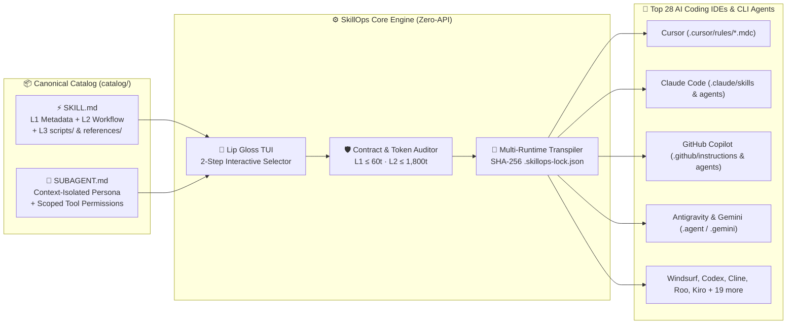

<!-- readme-gen:start:hero -->
<div align="center">


</div>
<!-- readme-gen:end:hero -->

<!-- readme-gen:start:badges -->
<div align="center">

[](https://github.com/OdevMatheus/SkillOps/actions/workflows/ai-ci.yml)
[](https://github.com/OdevMatheus/SkillOps/actions/workflows/codeql.yml)
[](https://www.npmjs.com/package/skillops-cli)
[](https://nodejs.org/)
[](https://www.typescriptlang.org/)
[](#-supported-ai-coding-ides--agents-top-28)
[](./LICENSE)

<br />


<br />

[**Quick Start**](#-quick-start) · [**Core Commands**](#-core-cli-commands) · [**Architecture**](#️-architecture--progressive-disclosure) · [**28 AI Targets**](#-supported-ai-coding-ides--agents-top-28) · [**Project Structure**](#-project-structure) · [**Contributing**](#-contributing)

</div>
<!-- readme-gen:end:badges -->

---

<!-- readme-gen:start:overview -->
## ⚡ Overview

Modern engineering teams use multiple AI coding assistants—**Cursor**, **Claude Code**, **GitHub Copilot**, **Google Antigravity**, **Windsurf**, **Codex CLI**, **Gemini CLI**, **Cline**, **Roo Code**, **Aider**, and more—yet every tool demands its own incompatible directory layout, YAML frontmatter, and instruction format.

**SkillOps** (`skillops-cli`) is a **Zero-API package manager and multi-runtime transpiler** for **Progressive-Disclosure AI Skills (`SKILL.md`)** and **Context-Isolated Subagents (`SUBAGENT.md`)**. Powered by a **Charmbracelet Lip Gloss TrueColor TUI**, SkillOps lets you browse, select, and install modular AI engineering skills and specialist subagents into any project across the **Top 28 AI Coding IDEs & CLI Agents** in seconds—backed by deterministic SHA-256 lockfiles (`.skillops-lock.json`) and strict token-budget governance.
<!-- readme-gen:end:overview -->

<!-- readme-gen:start:features -->
## ✨ Key Features

<table>
  <tr>
    <td width="50%" valign="top">
      <h3>🎨 Charmbracelet Lip Gloss TUI</h3>
      <p>Interactive 2-step terminal wizard with TrueColor pills, <code>Skills</code> / <code>Agents</code> tabs, a <code>★ Install ALL</code> batch toggle, real-time <code>/</code> keyword filtering, and a single-page popularity-sorted selector for all 28 AI IDEs.</p>
    </td>
    <td width="50%" valign="top">
      <h3>🔌 Write Once, Transpile to 28 AI Tools</h3>
      <p>Automatically compiles canonical <code>SKILL.md</code> (with Level 3 scripts & references) and <code>SUBAGENT.md</code> files into native rules, workflows, microagents, steering docs, and custom agents across 28 harnesses.</p>
    </td>
  </tr>
  <tr>
    <td width="50%" valign="top">
      <h3>🧠 3-Tier Progressive Disclosure</h3>
      <p>Protects your context window by splitting skills into <strong>L1</strong> YAML discovery metadata (<code>≤ 60</code> tokens), <strong>L2</strong> procedural workflows (<code>≤ 1,800</code> tokens), and <strong>L3</strong> on-demand reference docs & deterministic scripts.</p>
    </td>
    <td width="50%" valign="top">
      <h3>🔒 Zero-API & SHA-256 Lockfile Integrity</h3>
      <p>Runs 100% locally with zero external LLM API keys required. Tracks every generated file in <code>.skillops-lock.json</code> with SHA-256 checksums to prevent accidental overwrites of local customizations.</p>
    </td>
  </tr>
</table>
<!-- readme-gen:end:features -->

---

<!-- readme-gen:start:quickstart -->
## 🚀 Quick Start

Run the interactive **2-step TUI installer** directly in any repository with `npx` (no global install required):

```bash
npx skillops-cli@latest add
```

```text
╭─  SkillOps  Step 1/2: Select Skills & Subagents
│  Choose what to install (next step: select target AI IDEs)
│
│   ⚡ Skills (1)    🤖 Agents (1)
│  Space toggle · a all · ←/→ tab · / search · Enter next
│
│  ❯ ◯ ★ Install ALL Skills (1 available)  Select every item in this tab
│    ◯ mcp-architect                       Use when designing, implementing, or auditing MCP...
│
╰─ 1 selected (1 Skills, 0 Agents) — Enter to Next: Choose AI IDEs
```

<details>
<summary><b>📦 Optional Global Installation (npm / pnpm / bun)</b></summary>

#### npm
```bash
npm install -g skillops-cli
```

#### pnpm
```bash
pnpm add -g skillops-cli
```

#### bun
```bash
bun add -g skillops-cli
```

#### From Source (Local Development)
```bash
git clone https://github.com/OdevMatheus/SkillOps.git
cd SkillOps
npm ci && npm run build && npm install -g .
```
</details>
<!-- readme-gen:end:quickstart -->

---

<!-- readme-gen:start:usage -->
## 💻 Core CLI Commands

SkillOps focuses on **5 essential day-to-day commands** for discovering, inspecting, installing, and removing AI Skills & Subagents:

| Command | Description | Interactive TUI |
| :--- | :--- | :---: |
| `skillops add [name...]` | Install Skills or Subagents into your project across chosen AI IDEs | ✅ **2-Step Wizard** |
| `skillops remove [name...]` | Surgically uninstall Skills or Subagents tracked in `.skillops-lock.json` | ✅ **Installed Picker** |
| `skillops list [query]` | List all available Skills and Subagents in the catalog | — |
| `skillops search <query>` | Search the catalog by keyword, stack, domain, or tag | — |
| `skillops info <name>` | Inspect a Skill or Subagent card, L1/L2 token metrics, and IDE invocation guide | — |

### 1. Install Skills & Subagents (`add`)

```bash
# Launch the interactive 2-step TUI (Step 1: Skills/Agents -> Step 2: Target AI IDEs)
skillops add

# Install specific items directly into Cursor, Claude Code, and GitHub Copilot
skillops add mcp-architect context-scout --targets cursor,claude,copilot

# Install every Skill and Subagent in the catalog across all 28 supported AI IDEs
skillops add --all --targets all
```

### 2. Browse, Search & Inspect (`list`, `search`, `info`)

```bash
# Browse the full catalog of Skills and Subagents
skillops list

# Search by technology, domain, or keyword
skillops search mcp

# Inspect full metadata, token footprint, bundled scripts, and how to invoke in your IDE
skillops info mcp-architect
```

### 3. Uninstall Cleanly (`remove`)

```bash
# Launch the interactive uninstaller showing only items installed in the current repo
skillops remove

# Remove a specific Skill or Subagent
skillops remove mcp-architect

# Remove all SkillOps-managed artifacts from the project
skillops remove --all
```

<details>
<summary><b>🛠️ Advanced Authoring, Governance & Diagnostics Commands</b></summary>

In addition to the 5 core package-management commands, SkillOps includes built-in tooling for skill authors and CI pipelines:

| Command | Purpose |
| :--- | :--- |
| `skillops create <name>` | Scaffold a compliant `SKILL.md` directory (with `scripts/` & `references/`) or `--type subagent` (`SUBAGENT.md`) |
| `skillops audit` | Validate YAML frontmatter contracts, 3-level token budgets, and TF-IDF + Jaccard semantic collisions |
| `skillops eval` | Execute offline TDD trigger assertions (`should_trigger` / `should_not_trigger`) against catalog descriptions |
| `skillops tokens` | Inspect L1/L2/L3 token utilization against the repository's `8,000`-token active context budget |
| `skillops doctor` | Run environment diagnostics (Node.js 20+, Python 3.12+, lockfile integrity, and detected AI harnesses) |
| `skillops harnesses` | List all 28 supported AI coding harnesses and auto-detect which ones are active in the workspace |
| `skillops mcp-setup` | Bootstrap `.mcp.json`, `.cursor/mcp.json`, `.vscode/mcp.json`, `.agent/mcp_config.json`, and `.codex/config.toml` |
| `skillops mcp` | Start the built-in Model Context Protocol (`stdio` JSON-RPC 2.0) server |

</details>
<!-- readme-gen:end:usage -->

---

<!-- readme-gen:start:architecture -->
## 🏗️ Architecture & Progressive Disclosure

SkillOps prevents **Context Rot** by enforcing a strict 3-tier **Progressive Disclosure** architecture and compiling a single canonical source into 28 native AI runtime formats:



### The 3-Level Context Budget (`SKILL_CONTRACT.md`)

| Tier | Artifact | Token Budget | When Loaded by the AI Agent |
| :--- | :--- | :--- | :--- |
| **Level 1 (Discovery)** | YAML `name` + `description` (`40–110` words starting with `"Use when..."`) | **`≤ 60 tokens`** (`160` hard cap) | Loaded at session startup so the agent knows *when* to activate the skill |
| **Level 2 (Instructions)** | Markdown body of `SKILL.md` (`≤ 350` lines) | **`≤ 1,800 tokens`** | Loaded on demand *only* when the user's task matches the skill |
| **Level 3 (Resources)** | `references/*.md` deep-dives & `scripts/*.py` deterministic validators | **On-Demand (`0` idle cost)** | Executed or read selectively when referenced by a Level 2 workflow step |
<!-- readme-gen:end:architecture -->

---

<!-- readme-gen:start:ai-targets -->
## 🌐 Supported AI Coding IDEs & Agents (Top 28)

Every target below is configured strictly according to its official vendor documentation and ordered by popularity in the interactive TUI (`skillops add`):

| # | Target ID | AI IDE / Agent | Category | Skills Output Path | Subagents Output Path |
| :-: | :--- | :--- | :--- | :--- | :--- |
| 1 | `cursor` | **Cursor AI IDE** | AI IDE | `.cursor/rules/skillops-<name>.mdc` | `.cursor/rules/skillops-agent-<name>.mdc` |
| 2 | `claude` | **Anthropic Claude Code** | CLI Agent | `.claude/skills/<name>/SKILL.md` | `.claude/agents/<name>.md` |
| 3 | `copilot` | **GitHub Copilot** | IDE Extension | `.github/instructions/skillops-<name>.instructions.md` | `.github/agents/<name>.agent.md` |
| 4 | `antigravity` | **Google Antigravity IDE** | AI IDE | `.agent/skills/<name>/SKILL.md` | `.agent/agents/<name>.md` |
| 5 | `windsurf` | **Windsurf AI IDE** | AI IDE | `.windsurf/rules/skillops-<name>.md` | `.windsurf/workflows/skillops-agent-<name>.md` |
| 6 | `codex` | **OpenAI Codex CLI** | CLI Agent | `.codex/skills/<name>/SKILL.md` + `AGENTS.md` | `.codex/agents/<name>.md` |
| 7 | `gemini` | **Google Gemini CLI** | CLI Agent | `.gemini/skills/<name>/SKILL.md` | `.gemini/agents/<name>.md` |
| 8 | `cline` | **Cline** | IDE Extension | `.clinerules/skillops-<name>.md` | `.clinerules/workflows/skillops-agent-<name>.md` |
| 9 | `roocode` | **Roo Code** | IDE Extension | `.roo/rules/skillops-<name>.md` | `.roo/rules-architect/skillops-agent-<name>.md` |
| 10 | `kilocode` | **Kilo Code** | IDE Extension | `.kilocode/rules/skillops-<name>.md` | `.kilocode/workflows/skillops-agent-<name>.md` |
| 11 | `zed` | **Zed AI** | AI IDE | `.zed/rules/skillops-<name>.md` | `.zed/rules/skillops-agent-<name>.md` |
| 12 | `continue` | **Continue.dev** | IDE Extension | `.continue/rules/skillops-<name>.md` | `.continue/prompts/skillops-agent-<name>.prompt` |
| 13 | `aider` | **Aider** | CLI Agent | `.aider/conventions/skillops-<name>.md` | `.aider/conventions/skillops-agent-<name>.md` |
| 14 | `kiro` | **AWS Kiro IDE** | AI IDE | `.kiro/steering/skillops-<name>.md` | `.kiro/agents/<name>.md` |
| 15 | `trae` | **Trae AI IDE** | AI IDE | `.trae/rules/skillops-<name>.md` | `.trae/agents/<name>.md` |
| 16 | `augment` | **Augment Code** | IDE Extension | `.augment/rules/skillops-<name>.md` | `.augment/agents/<name>.md` |
| 17 | `factory` | **Factory AI Droid** | CLI Agent | `.factory/skills/<name>/SKILL.md` | `.factory/droids/<name>.md` |
| 18 | `qwen` | **Qwen Code CLI** | CLI Agent | `.qwen/skills/<name>/SKILL.md` | `.qwen/agents/<name>.md` |
| 19 | `opencode` | **OpenCode CLI** | CLI Agent | `.opencode/skills/<name>/SKILL.md` | `.opencode/agent/<name>.md` |
| 20 | `openhands` | **OpenHands** | Autonomous SWE | `.openhands/microagents/skillops-<name>.md` | `.openhands/microagents/skillops-agent-<name>.md` |
| 21 | `amp` | **Sourcegraph Amp** | CLI Agent | `.amp/skills/<name>/SKILL.md` | `.amp/agents/<name>.md` |
| 22 | `goose` | **Block Goose** | CLI Agent | `.goose/skills/<name>/SKILL.md` | `.goose/agents/<name>.md` |
| 23 | `warp` | **Warp AI Terminal** | CLI Agent | `.warp/skills/<name>/SKILL.md` | `.warp/agents/<name>.md` |
| 24 | `crush` | **Charmbracelet Crush** | CLI Agent | `.crush/skills/<name>/SKILL.md` | `.crush/agents/<name>.md` |
| 25 | `vibe` | **Mistral Vibe CLI** | CLI Agent | `.vibe/skills/<name>/SKILL.md` | `.vibe/agents/<name>.md` |
| 26 | `junie` | **JetBrains Junie** | IDE Extension | `.junie/skills/skillops-<name>.md` | `.junie/agents/<name>.md` |
| 27 | `amazonq` | **Amazon Q Developer** | IDE Extension | `.amazonq/rules/skillops-<name>.md` | `.amazonq/cli-agents/<name>.md` |
| 28 | `idx` | **Firebase Studio (IDX)** | AI IDE | `.idx/rules/skillops-<name>.md` | `.idx/agents/<name>.md` |
<!-- readme-gen:end:ai-targets -->

---

<!-- readme-gen:start:structure -->
## 📂 Project Structure

```text
📦 SkillOps
├── 📂 catalog/                        # Canonical Skills & Context-Isolated Subagents
│   ├── 📂 ai-engineering/
│   │   └── 📂 mcp-architect/          # Reference Hybrid Skill (SKILL.md + scripts/ + references/ + evals/)
│   └── 📂 subagents/
│       └── 📂 context-scout/          # Reference Subagent (SUBAGENT.md + evals/triggers.json)
├── 📂 src/                            # TypeScript 5.8 Strict Zero-API Engine
│   ├── 📄 cli.ts                      # CLI entrypoint & interactive command dispatcher
│   ├── 📄 models.ts                   # Zod schemas, token estimators & 28 AI harness specs
│   ├── 📂 ui/                         # Charmbracelet Lip Gloss TrueColor TUI & multi-select prompt
│   ├── 📂 sync/                       # Multi-runtime transpiler & SHA-256 .skillops-lock.json manager
│   ├── 📂 auditor/                    # SKILL.md / SUBAGENT.md parser & TF-IDF collision auditor
│   ├── 📂 router/                     # Deterministic repo fingerprinter & bundle compiler
│   ├── 📂 eval/                       # Offline TDD trigger & token budget evaluator
│   └── 📂 mcp/                        # Built-in JSON-RPC 2.0 stdio MCP server & bootstrapper
├── 📂 tests/                          # Vitest test suites (38 tests across 6 suites)
├── 📄 SKILL_CONTRACT.md               # Normative specification for Skills & Subagents
├── 📄 AGENTS.md                       # Canonical architecture & AI agent instructions
└── 📄 CONTRIBUTING.md                 # Contribution workflow, branch rules & PR governance
```
<!-- readme-gen:end:structure -->

---

<!-- readme-gen:start:scorecard -->
## 📊 Repository Health Scorecard

```text
Tests          ██████████ 100%  (38/38 Vitest unit & integration tests passing)
CI/CD          ██████████ 100%  (GitHub Actions AI CI, CodeQL SAST & PR Governance)
Type Safety    ██████████ 100%  (TypeScript 5.8 strict mode + Zod runtime contracts)
Documentation  ██████████ 100%  (README, SKILL_CONTRACT, AGENTS & CONTRIBUTING)
Security       ██████████ 100%  (100% offline Zero-API engine + SHA-256 lockfile verification)
```
<!-- readme-gen:end:scorecard -->

---

<!-- readme-gen:start:contributing -->
## 🤝 Contributing

We welcome new **Progressive-Disclosure Skills (`SKILL.md`)**, **Context-Isolated Subagents (`SUBAGENT.md`)**, and **AI Harness Transpiler improvements**!

All contribution workflows, branch naming conventions, commit guidelines, and validation checks are documented in our dedicated guide:

- 📖 [**Contribution Guide (`CONTRIBUTING.md`)**](./CONTRIBUTING.md)
- 📜 [**Normative Skill & Subagent Specification (`SKILL_CONTRACT.md`)**](./SKILL_CONTRACT.md)
- 🛡️ [**Security Policy (`SECURITY.md`)**](./SECURITY.md)
<!-- readme-gen:end:contributing -->

---

<!-- readme-gen:start:license -->
## 📄 License

Distributed under the **MIT License**. See [`LICENSE`](./LICENSE) for full details.
<!-- readme-gen:end:license -->

<!-- readme-gen:start:footer -->
<div align="center">


</div>
<!-- readme-gen:end:footer -->
