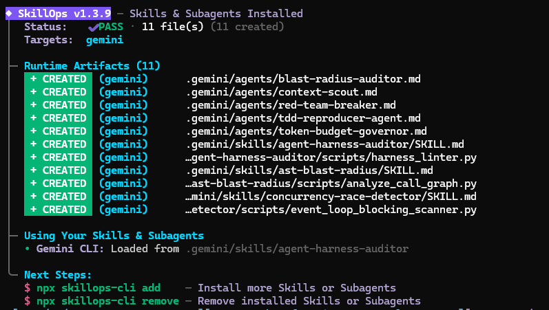
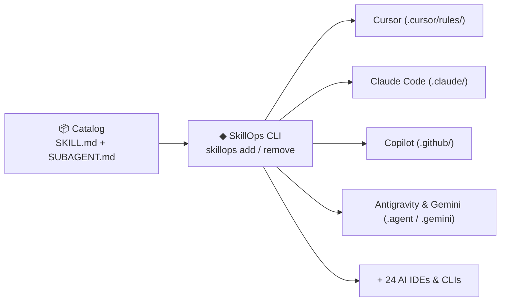

<div align="center">


<p>
  <a href="https://github.com/OdevMatheus/SkillOps/actions/workflows/ai-ci.yml"></a>
  <a href="https://github.com/OdevMatheus/SkillOps/actions/workflows/codeql.yml"></a>
  <a href="https://www.npmjs.com/package/skillops-cli"></a>
  <a href="#supported-ai-ides--clis-28"></a>
  <a href="LICENSE"></a>
</p>

<p>
  <strong>One library of Skills (<code>SKILL.md</code>) and Subagents (<code>SUBAGENT.md</code>). Native installation for 28 AI tools.</strong><br>
  Cursor, Claude Code, GitHub Copilot, Antigravity, Windsurf, Codex, Gemini CLI, Cline, Roo Code, Kiro, and more — 100% local, zero API keys.
</p>

</div>

---

## Quick Start

Run inside any project repository:

```bash
npx skillops-cli@latest add
```

Or install globally to use the `skillops` command anywhere:

```bash
npm i -g skillops-cli
skillops add
```

### Interactive 2-Step TUI Flow

| 1. Select Your AI IDE / Agent | 2. Select Skills & Subagents |
| :---: | :---: |
|  |  |

<div align="center">
  <p><strong>3. Native Transpilation &amp; Installation Report</strong></p>
  
</div>

---

## Commands

| Command | Description |
| :--- | :--- |
| `skillops add` | Launch the interactive 2-step TUI (select AI IDEs → select Skills & Agents) |
| `skillops add <name...> -t cursor,claude` | Install specific Skills or Subagents directly into target AI IDEs |
| `skillops add --all -t all` | Install all catalog Skills & Subagents across all 28 supported AI tools |
| `skillops remove` | Launch interactive selector to uninstall Skills or Subagents from your project |
| `skillops remove <name...>` | Remove specific installed Skills or Subagents and update `.skillops-lock.json` |
| `skillops remove --all` | Surgically remove all SkillOps-managed files from the repository |

> **Aliases:** `install` / `i` for `add`, and `uninstall` / `rm` for `remove`. Pass `--dry-run` to preview changes or `--force` to overwrite local edits.

---

## How It Works



- **Native Transpilation:** Compiles each `SKILL.md` (plus Level 3 `scripts/` & `references/`) and `SUBAGENT.md` into the exact folder layout and frontmatter expected by each IDE or CLI.
- **3-Tier Token Economy:** Keeps context windows lean with **L1** YAML discovery (`≤ 60` tokens), **L2** core workflow (`≤ 1,800` tokens), and **L3** on-demand scripts (`0` idle tokens).
- **SHA-256 Drift Protection:** Tracks generated files in `.skillops-lock.json` so manual local edits are never overwritten or deleted without `--force`.

---

## Supported AI IDEs & CLIs (28)

<p>
  
  
  
  
  
  
  
  
  
  
  
  
  
  
</p>

<details>
<summary><b>View full list of 28 supported targets &amp; output paths</b></summary>

| # | Target ID | AI IDE / Agent | Skills Output Path | Subagents Output Path |
| :-: | :--- | :--- | :--- | :--- |
| 1 | `cursor` | **Cursor AI IDE** | `.cursor/rules/skillops-<name>.mdc` | `.cursor/rules/skillops-agent-<name>.mdc` |
| 2 | `claude` | **Anthropic Claude Code** | `.claude/skills/<name>/SKILL.md` | `.claude/agents/<name>.md` |
| 3 | `copilot` | **GitHub Copilot** | `.github/instructions/skillops-<name>.instructions.md` | `.github/agents/<name>.agent.md` |
| 4 | `antigravity` | **Google Antigravity IDE** | `.agent/skills/<name>/SKILL.md` | `.agent/agents/<name>.md` |
| 5 | `windsurf` | **Windsurf AI IDE** | `.windsurf/rules/skillops-<name>.md` | `.windsurf/workflows/skillops-agent-<name>.md` |
| 6 | `codex` | **OpenAI Codex CLI** | `.codex/skills/<name>/SKILL.md` + `AGENTS.md` | `.codex/agents/<name>.md` |
| 7 | `gemini` | **Google Gemini CLI** | `.gemini/skills/<name>/SKILL.md` | `.gemini/agents/<name>.md` |
| 8 | `cline` | **Cline** | `.clinerules/skillops-<name>.md` | `.clinerules/workflows/skillops-agent-<name>.md` |
| 9 | `roocode` | **Roo Code** | `.roo/rules/skillops-<name>.md` | `.roo/rules-architect/skillops-agent-<name>.md` |
| 10 | `kilocode` | **Kilo Code** | `.kilocode/rules/skillops-<name>.md` | `.kilocode/workflows/skillops-agent-<name>.md` |
| 11 | `zed` | **Zed AI** | `.zed/rules/skillops-<name>.md` | `.zed/rules/skillops-agent-<name>.md` |
| 12 | `continue` | **Continue.dev** | `.continue/rules/skillops-<name>.md` | `.continue/prompts/skillops-agent-<name>.prompt` |
| 13 | `aider` | **Aider** | `.aider/conventions/skillops-<name>.md` | `.aider/conventions/skillops-agent-<name>.md` |
| 14 | `kiro` | **AWS Kiro IDE** | `.kiro/steering/skillops-<name>.md` | `.kiro/agents/<name>.md` |
| 15 | `trae` | **Trae AI IDE** | `.trae/rules/skillops-<name>.md` | `.trae/agents/<name>.md` |
| 16 | `augment` | **Augment Code** | `.augment/rules/skillops-<name>.md` | `.augment/agents/<name>.md` |
| 17 | `factory` | **Factory AI Droid** | `.factory/skills/<name>/SKILL.md` | `.factory/droids/<name>.md` |
| 18 | `qwen` | **Qwen Code CLI** | `.qwen/skills/<name>/SKILL.md` | `.qwen/agents/<name>.md` |
| 19 | `opencode` | **OpenCode CLI** | `.opencode/skills/<name>/SKILL.md` | `.opencode/agent/<name>.md` |
| 20 | `openhands` | **OpenHands** | `.openhands/microagents/skillops-<name>.md` | `.openhands/microagents/skillops-agent-<name>.md` |
| 21 | `amp` | **Sourcegraph Amp** | `.amp/skills/<name>/SKILL.md` | `.amp/agents/<name>.md` |
| 22 | `goose` | **Block Goose** | `.goose/skills/<name>/SKILL.md` | `.goose/agents/<name>.md` |
| 23 | `warp` | **Warp AI Terminal** | `.warp/skills/<name>/SKILL.md` | `.warp/agents/<name>.md` |
| 24 | `crush` | **Charmbracelet Crush** | `.crush/skills/<name>/SKILL.md` | `.crush/agents/<name>.md` |
| 25 | `vibe` | **Mistral Vibe CLI** | `.vibe/skills/<name>/SKILL.md` | `.vibe/agents/<name>.md` |
| 26 | `junie` | **JetBrains Junie** | `.junie/skills/skillops-<name>.md` | `.junie/agents/<name>.md` |
| 27 | `amazonq` | **Amazon Q Developer** | `.amazonq/rules/skillops-<name>.md` | `.amazonq/cli-agents/<name>.md` |
| 28 | `idx` | **Firebase Studio (IDX)** | `.idx/rules/skillops-<name>.md` | `.idx/agents/<name>.md` |

</details>

---

## Repository Structure

```text
SkillOps/
├── catalog/                         # Skills (SKILL.md) & Subagents (SUBAGENT.md) library
│   ├── ai-engineering/mcp-architect/
│   └── subagents/context-scout/
├── src/
│   ├── cli.ts                       # CLI entrypoint (`add` / `remove`) & interactive flow
│   ├── models.ts                    # Manifest schemas & 28 AI harness specifications
│   ├── ui/                          # Lip Gloss TrueColor TUI (`lipgloss.ts`, `prompt.ts`, `terminal.ts`)
│   ├── sync/                        # Multi-runtime transpiler & `.skillops-lock.json` manager
│   └── auditor/                     # Catalog SKILL.md / SUBAGENT.md parser
└── tests/                           # Vitest unit, TUI & multi-runtime sync tests
```

---

## Contributing & License

- 📖 [**Contribution Guide (`CONTRIBUTING.md`)**](./CONTRIBUTING.md)
- 📜 [**Skill & Subagent Contract (`SKILL_CONTRACT.md`)**](./SKILL_CONTRACT.md)
- ⚖️ Licensed under the [**MIT License**](./LICENSE) — Created by [**@OdevMatheus**](https://github.com/OdevMatheus)
