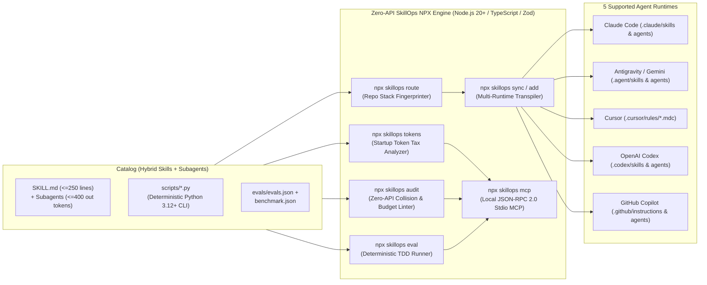

# SkillOps (`npx skillops@latest`)

> **The Zero-API Node.js 20+ / TypeScript Engine & Benchmark-Verified Library for AI Coding Agent Skills & Context-Isolated Subagents**  
> *Stop installing unverified Markdown prompt essays that bloat your Startup Token Tax. Audit semantic collisions offline, quantify token economy savings (`npx skillops tokens`), dynamically route context-aware skill + subagent bundles across 5 agent runtimes (`npx skillops sync`), and prove positive task lift (`with_skill` vs. `without_skill`) with 100% deterministic, zero-API AST & subprocess TDD evaluations.*

[](./AGENTS.md)
[](./package.json)
[](./tsconfig.json)
[](./SKILL_CONTRACT.md)
[](https://modelcontextprotocol.io/)
[](./LICENSE)

---

## Quick Start (`npx skillops@latest`)

Run **SkillOps** in any repository with zero global installation or API keys:

```bash
# 1. Audit your repository's Startup Token Tax (CLAUDE.md, AGENTS.md, .cursor/rules, .mcp.json)
npx skillops@latest tokens

# 2. List all Hybrid Executable Skills & Context-Isolated Subagents with token budgets
npx skillops@latest list

# 3. Audit a catalog for semantic routing collisions & 3-level progressive disclosure compliance
npx skillops@latest audit --catalog catalog --strict --require-layout

# 4. Fingerprint a target repository and transpile an optimal bundle across 5 AI runtimes
npx skillops@latest sync --repo . --targets claude,antigravity,cursor,codex,copilot

# 5. Surgically install a single Skill or Context-Isolated Subagent
npx skillops@latest add mcp-architect --repo .

# 6. Run 100% offline deterministic with_skill vs without_skill TDD evaluations
npx skillops@latest eval --catalog catalog --strict
```

---

## Why SkillOps Exists (The 2026 Agent Harness & Token Economy Crisis)

As AI-native engineering teams scale their agent customizations across **Claude Code**, **Antigravity / Gemini CLI**, **Cursor**, **OpenAI Codex CLI**, and **GitHub Copilot**, two critical failure modes documented in 2026 empirical AI systems research break production workflows:

1. **Implicit Routing Collapse (*Lost in Implicit Routing*, `arXiv:2610.18522`):**  
   Dumping 50–100+ skills with overlapping natural-language descriptions into an agent's workspace causes **semantic routing recall to collapse from `73.6%` to `27.4%`**, while burning **8,000–15,000+ context tokens** before the developer writes a single prompt.
2. **Skill-Induced Regressions & Startup Token Tax (*Agent Skills Can Be Harmful*, `arXiv:2608.11888`):**  
   Static, prose-heavy `SKILL.md` files without deterministic verification scripts or comparative `with_skill` vs. `without_skill` benchmarks frequently **degrade pass rates** on complex engineering tasks while inflating token overhead by **30%–200%**.

**SkillOps** is a **100% Zero-API, Offline-First Skill Engineering & Token Economy Platform** built in strict **Node.js 20+ / TypeScript** (`zod` + `yaml` — zero API keys or HTTP servers required) that solves both problems:
- **Pillar 1 — The `npx skillops@latest` Core Engine (`src/`):** A pure local CLI and JSON-RPC 2.0 `stdio` MCP Server that analyzes repository Startup Token Tax (`skillops tokens`), lints 3-level progressive disclosure budgets and pairwise semantic collisions (`skillops audit`), fingerprints repositories to compile optimal `<= 12` skill + subagent bundles (`skillops route`), transpiles artifacts across 5 runtimes (`skillops sync` / `skillops add`), and runs deterministic AST & subprocess `with_skill` vs. `without_skill` benchmarks (`skillops eval`).
- **Pillar 2 — The Benchmark-Verified Catalog (`catalog/`):** **Hybrid Executable Skills** and **Context-Isolated Subagents**, where every skill pairs a concise `<= 250`-line `SKILL.md` with a zero-hallucination **Python 3.12+ CLI tool (`scripts/*.py --json`)** and a **TDD evaluation suite (`evals/evals.json` + `evals/benchmark.json`)**.

---

## System Architecture



---

## Core CLI Capabilities (`npx skillops@latest`)

| Command | Purpose | Key Invariants Enforced |
| :--- | :--- | :--- |
| **`npx skillops init`** | Scaffolds `.skillops.yml` and `catalog/` tracks (`ai-engineering`, `python-backend`, `arch-quality`, `subagents`). | Validates workspace config via `SkillOpsConfigSchema`. |
| **`npx skillops list`** | Lists all discovered Hybrid Skills and Context-Isolated Subagents with L1/L2 token metrics and script counts. | Supports `--format table\|json` and `--catalog`. |
| **`npx skillops tokens`** | Audits repository Startup Token Tax (`CLAUDE.md`, `AGENTS.md`, `GEMINI.md`, `.cursor/rules/*.mdc`, `.mcp.json`) and quantifies Progressive Disclosure savings. | Default strict budget `<= 2,500 tokens`; flags oversized always-on files (`> 700 tokens`). |
| **`npx skillops audit`** | Audits any catalog for pairwise semantic description overlap and 3-level + subagent token budget compliance with zero external APIs. | Level 1 `40–110 words` (`<= 160 tokens`), Level 2 `<= 250 lines`, cosine similarity `< 0.72` (high-risk) / `< 0.85` (error), subagent `max_output_tokens <= 400`. |
| **`npx skillops route`** | Fingerprints a target repository (`package.json`, `pyproject.toml`, `Cargo.toml`, `go.mod`, `Dockerfile`, AST/files) and selects an optimal collision-free bundle. | Emits `<= 12` skills (`<= 1,500` L1 tokens) guaranteed free of semantic collisions + matched Subagents. |
| **`npx skillops sync`** | Transpiles and installs a routed skill + subagent bundle across **Claude Code, Antigravity, Cursor, Codex CLI, and GitHub Copilot**. | Writes deterministic runtime artifacts and `.skillops-lock.json` SHA-256 drift protection. |
| **`npx skillops add <name>`** | Surgically installs a single Skill or Context-Isolated Subagent into the target repository across selected runtimes. | Updates `.skillops-lock.json` without touching unmanaged files. |
| **`npx skillops eval`** | Runs 100% offline deterministic `with_skill` vs. `without_skill` AST & subprocess TDD evaluation scenarios. | Requires $\Delta\text{PassRate} \ge +15\%$ and zero critical regressions (`INV-SKILL-05`). |
| **`npx skillops mcp`** | Starts a local **Model Context Protocol (MCP)** server over `stdio` exposing 6 `SkillOps` tools (`audit_catalog`, `analyze_repo_tokens`, `route_repo_skills`, `run_skill_script`, `get_skill_benchmark`, `list_catalog_items`). | Compatible with Claude Code, Antigravity, Cursor, and Codex MCP clients. |

---

## Documentation & Architecture Index

- **[`SKILL_CONTRACT.md`](./SKILL_CONTRACT.md):** Normative specification for hybrid skills, context-isolated subagents, 3-level token budgets, `evals.json` & `benchmark.json` schemas, and CLI exit codes.
- **[`docs/architecture/README.md`](./docs/architecture/README.md):** High-level system architecture and component overview.
  - **[`ADR-0001`](./docs/architecture/adr/0001-hybrid-executable-skills-architecture.md):** Hybrid Executable Skills Architecture (`SKILL.md` + `scripts/*.py` + `evals/`).
  - **[`ADR-0002`](./docs/architecture/adr/0002-semantic-collision-auditor-and-token-budgeting.md):** Semantic Collision Auditor & 3-Level Progressive Disclosure Token Budgeting.
  - **[`ADR-0003`](./docs/architecture/adr/0003-context-aware-dynamic-router-and-multi-runtime-sync.md):** Context-Aware Dynamic Router & Multi-Runtime Sync (`skillops route` & `skillops sync`).
  - **[`ADR-0004`](./docs/architecture/adr/0004-tdd-skill-evaluation-engine-openai-agents-sdk.md):** Zero-API Deterministic TDD Skill Evaluation Engine & Stdio MCP (`skillops eval`, `skillops mcp`).
- **[`AGENTS.md`](./AGENTS.md):** Agentic Engineering Governance Contract (`1 Issue = 1 PR`, Sprints & Milestones).
- **[`CONTRIBUTING.md`](./CONTRIBUTING.md):** Contribution workflow, Conventional Commits, and quality gates.

---

## License

Released under the [MIT License](./LICENSE). Maintained by [@OdevMatheus](https://github.com/OdevMatheus).
