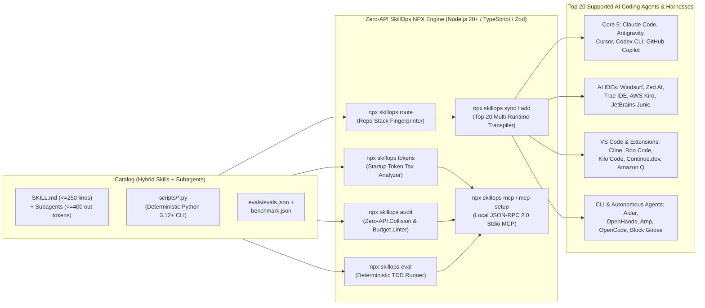

# SkillOps (`npx skillops-cli@latest`)

> **The Zero-API Node.js 20+ / TypeScript Engine & Benchmark-Verified Library for AI Coding Agent Skills & Context-Isolated Subagents (`v1.2.0`)**  
> *Stop installing unverified Markdown prompt essays that bloat your Startup Token Tax. Audit semantic collisions offline, quantify token economy savings across the Top 20 AI coding agents (`npx skillops-cli@latest tokens`), dynamically route context-aware skill + subagent bundles across all 20 AI harnesses (`npx skillops-cli@latest sync --targets all`), register the local MCP server automatically (`npx skillops-cli@latest mcp-setup`), and prove positive task lift (`with_skill` vs. `without_skill`) with 100% deterministic, zero-API AST & subprocess TDD evaluations.*

[](./AGENTS.md)
[](./package.json)
[](./package.json)
[](./tsconfig.json)
[](./SKILL_CONTRACT.md)
[](./SKILL_CONTRACT.md)
[](https://modelcontextprotocol.io/)
[](./LICENSE)

---

## Quick Start (`npx skillops-cli@latest`)

Run **SkillOps** in any repository with zero global installation or API keys (or install globally via `npm install -g skillops-cli` to use the `skillops` command directly):

```bash
# 1. Inspect the Top 20 supported AI coding agents & auto-detect active harnesses in your repo
npx skillops-cli@latest harnesses

# 2. Audit your repository's Startup Token Tax across all 20 AI coding agents & 13 MCP formats
npx skillops-cli@latest tokens

# 3. Audit a catalog for semantic routing collisions & 3-level progressive disclosure compliance
npx skillops-cli@latest audit --catalog catalog --strict --require-layout

# 4. Fingerprint a target repository and transpile an optimal bundle across auto-detected or all 20 AI runtimes
npx skillops-cli@latest sync --repo . --targets auto

# 5. Automatically register the SkillOps JSON-RPC 2.0 stdio MCP server across MCP-capable IDEs & agents
npx skillops-cli@latest mcp-setup --repo . --targets auto

# 6. Run 100% offline deterministic with_skill vs without_skill TDD evaluations
npx skillops-cli@latest eval --catalog catalog --strict
```

---

## Why SkillOps Exists (The 2026 Agent Harness & Token Economy Crisis)

As AI-native engineering teams scale their agent customizations across the **Top 20 AI Coding Agents, IDEs, and CLI Harnesses** (**Claude Code**, **Antigravity / Gemini CLI**, **Cursor**, **OpenAI Codex CLI**, **GitHub Copilot**, **Windsurf**, **Cline**, **Roo Code**, **Kilo Code**, **Zed AI**, **Continue.dev**, **Aider**, **OpenHands**, **Sourcegraph Amp**, **OpenCode**, **Block Goose**, **AWS Kiro**, **Trae IDE**, **JetBrains Junie**, and **Amazon Q Developer**), two critical failure modes documented in 2026 empirical AI systems research break production workflows:

1. **Implicit Routing Collapse (*Lost in Implicit Routing*, `arXiv:2610.18522`):**  
   Dumping 50–100+ skills with overlapping natural-language descriptions into an agent's workspace causes **semantic routing recall to collapse from `73.6%` to `27.4%`**, while burning **8,000–15,000+ context tokens** before the developer writes a single prompt.
2. **Skill-Induced Regressions & Startup Token Tax (*Agent Skills Can Be Harmful*, `arXiv:2608.11888`):**  
   Static, prose-heavy `SKILL.md` files without deterministic verification scripts or comparative `with_skill` vs. `without_skill` benchmarks frequently **degrade pass rates** on complex engineering tasks while inflating token overhead by **30%–200%**.

**SkillOps** is a **100% Zero-API, Offline-First Skill Engineering & Token Economy Platform** built in strict **Node.js 20+ / TypeScript** (`zod` + `yaml` — zero API keys or HTTP servers required) that solves both problems:
- **Pillar 1 — The `npx skillops@latest` Core Engine (`src/`):** A pure local CLI and JSON-RPC 2.0 `stdio` MCP Server that analyzes repository Startup Token Tax across all 20 AI harnesses (`skillops tokens`), lints 3-level progressive disclosure budgets and pairwise semantic collisions (`skillops audit`), fingerprints repositories to compile optimal `<= 12` skill + subagent bundles (`skillops route`), transpiles artifacts across all 20 runtimes (`skillops sync` / `skillops add`), configures local MCP servers idempotently (`skillops mcp-setup`), and runs deterministic AST & subprocess `with_skill` vs. `without_skill` benchmarks (`skillops eval`).
- **Pillar 2 — The Benchmark-Verified Catalog (`catalog/`):** **Hybrid Executable Skills** and **Context-Isolated Subagents**, where every skill pairs a concise `<= 250`-line `SKILL.md` with a zero-hallucination **Python 3.12+ CLI tool (`scripts/*.py --json`)** and a **TDD evaluation suite (`evals/evals.json` + `evals/benchmark.json`)**.

---

## System Architecture



---

## Universal Top-20 AI Coding Agents & Harnesses Matrix

| # | Target ID | AI Coding Agent / IDE | Category | Native Transpiled Skill / Rule Output | Native Subagent Output | Project MCP Config (`mcp-setup`) |
| :--- | :--- | :--- | :--- | :--- | :--- | :--- |
| 1 | `claude` | **Claude Code (Anthropic)** | CLI Agent | `.claude/skills/<name>/SKILL.md` | `.claude/agents/<name>.md` | `.mcp.json` |
| 2 | `antigravity` | **Google Antigravity / Gemini CLI** | Agentic IDE | `.agent/skills/<name>/SKILL.md` | `.agent/agents/<name>.md` | `.gemini/settings.json` |
| 3 | `cursor` | **Cursor IDE** | AI IDE | `.cursor/rules/<name>.mdc` | `.cursor/rules/agent-<name>.mdc` | `.cursor/mcp.json` |
| 4 | `codex` | **OpenAI Codex CLI** | CLI Agent | `.codex/skills/<name>/SKILL.md` + `AGENTS.md` | `.codex/agents/<name>.md` | `.codex/config.toml` |
| 5 | `copilot` | **GitHub Copilot (VS Code)** | IDE Extension | `.github/instructions/<name>.instructions.md` | `.github/agents/<name>.agent.md` | `.vscode/mcp.json` |
| 6 | `windsurf` | **Windsurf (Codeium Cascade)** | AI IDE | `.windsurf/rules/<name>.md` (`trigger: model_decision`) | `.windsurf/workflows/agent-<name>.md` | — |
| 7 | `cline` | **Cline** | IDE Extension | `.clinerules/<name>.md` | `.clinerules/workflows/agent-<name>.md` | — |
| 8 | `roocode` | **Roo Code** | IDE Extension | `.roo/rules/<name>.md` | `.roo/rules-architect/agent-<name>.md` | `.roo/mcp.json` |
| 9 | `kilocode` | **Kilo Code** | IDE Extension | `.kilocode/rules/<name>.md` | `.kilocode/workflows/agent-<name>.md` | `.kilocode/mcp.json` |
| 10 | `zed` | **Zed AI** | AI IDE | `.zed/rules/<name>.md` + `.rules` | `.zed/prompts/agent-<name>.md` | `.zed/settings.json` |
| 11 | `continue` | **Continue.dev** | IDE Extension | `.continue/rules/<name>.md` | `.continue/prompts/agent-<name>.prompt` | `.continue/mcpServers/skillops.yaml` |
| 12 | `aider` | **Aider CLI** | CLI Agent | `.aider/skills/<name>/SKILL.md` + `CONVENTIONS.md` | `.aider/agents/<name>.md` | — |
| 13 | `openhands` | **OpenHands (All Hands AI)** | Autonomous Agent | `.openhands/microagents/<name>.md` | `.openhands/microagents/agent-<name>.md` | — |
| 14 | `amp` | **Sourcegraph Amp** | CLI Agent | `.amp/skills/<name>/SKILL.md` | `.amp/agents/<name>.md` | `.amp/settings.json` |
| 15 | `opencode` | **OpenCode CLI** | CLI Agent | `.opencode/skills/<name>/SKILL.md` | `.opencode/agent/<name>.md` | `opencode.json` |
| 16 | `goose` | **Block Goose** | CLI Agent | `.goose/skills/<name>/SKILL.md` + `.goosehints` | `.goose/agents/<name>.md` | — |
| 17 | `kiro` | **AWS Kiro IDE** | AI IDE | `.kiro/steering/<name>.md` (`inclusion: fileMatch`) | `.kiro/agents/<name>.md` | `.kiro/settings/mcp.json` |
| 18 | `trae` | **Trae IDE (ByteDance)** | AI IDE | `.trae/rules/<name>.md` | `.trae/agents/<name>.md` | — |
| 19 | `junie` | **JetBrains Junie** | IDE Extension | `.junie/skills/<name>/SKILL.md` + `.junie/guidelines.md` | `.junie/agents/<name>.md` | — |
| 20 | `amazonq` | **Amazon Q Developer** | IDE Extension | `.amazonq/rules/<name>.md` | `.amazonq/cli-agents/<name>.md` | `.amazonq/mcp.json` |

---

## Core CLI Capabilities (`npx skillops@latest`)

| Command | Purpose | Key Invariants Enforced |
| :--- | :--- | :--- |
| **`npx skillops init`** | Scaffolds `.skillops.yml` and `catalog/` tracks (`ai-engineering`, `python-backend`, `arch-quality`, `subagents`). | Validates workspace config via `SkillOpsConfigSchema`. |
| **`npx skillops list`** | Lists all discovered Hybrid Skills and Context-Isolated Subagents with L1/L2 token metrics and script counts. | Supports `--format table\|json` and `--catalog`. |
| **`npx skillops harnesses`** | Lists all 20 supported AI coding agents with auto-detection status, output directories, and MCP support. | Supports `--format table\|json\|markdown` and `--repo`. |
| **`npx skillops tokens`** | Audits repository Startup Token Tax across 22 always-on instruction files (`CLAUDE.md`, `AGENTS.md`, `GEMINI.md`, `.windsurfrules`, `.clinerules`, `.goosehints`, `CONVENTIONS.md`, etc.) and 13 MCP server configs. | Default strict budget `<= 2,500 tokens`; flags oversized always-on files (`> 700 tokens`). |
| **`npx skillops audit`** | Audits any catalog for pairwise semantic description overlap and 3-level + subagent token budget compliance with zero external APIs. | Level 1 `40–110 words` (`<= 160 tokens`), Level 2 `<= 250 lines`, cosine similarity `< 0.72` (high-risk) / `< 0.85` (error), subagent `max_output_tokens <= 400`. |
| **`npx skillops route`** | Fingerprints a target repository (`package.json`, `pyproject.toml`, `Cargo.toml`, `go.mod`, `Dockerfile`, AST/files) and selects an optimal collision-free bundle. | Emits `<= 12` skills (`<= 1,500` L1 tokens) guaranteed free of semantic collisions + matched Subagents. |
| **`npx skillops sync`** | Transpiles and installs a routed skill + subagent bundle across any of the **Top 20 AI coding agents** (`--targets all\|auto\|core\|<list>`). | Writes deterministic runtime artifacts and `.skillops-lock.json` SHA-256 drift protection. |
| **`npx skillops add <name>`** | Surgically installs a single Skill or Context-Isolated Subagent into the target repository across selected runtimes. | Updates `.skillops-lock.json` without touching unmanaged files. |
| **`npx skillops remove <name>`** | Surgically uninstalls a single synced Skill or Subagent from active runtimes and updates managed index blocks and `.skillops-lock.json`. | Refuses to delete locally edited files unless `--force` is passed. |
| **`npx skillops clean`** | Removes all SkillOps-managed runtime artifacts tracked in `.skillops-lock.json` across all 20 harnesses and deletes the lockfile. | Preserves unmanaged files and non-generated index file content. |
| **`npx skillops doctor`** / **`status`** | Diagnoses Node/Python runtimes, `.skillops.yml` schema validity, `.skillops-lock.json` SHA-256 artifact drift, Startup Token Tax, and auto-detected AI harnesses. | Supports `--format table\|json\|markdown\|github` and `--strict`. |
| **`npx skillops eval`** | Runs 100% offline deterministic `with_skill` vs. `without_skill` AST & subprocess TDD evaluation scenarios. | Requires $\Delta\text{PassRate} \ge +15\%$ and zero critical regressions (`INV-SKILL-05`). |
| **`npx skillops mcp`** | Starts a local **Model Context Protocol (MCP)** server over `stdio` exposing 8 `SkillOps` tools (`audit_catalog`, `analyze_repo_tokens`, `route_repo_skills`, `run_skill_script`, `get_skill_benchmark`, `list_catalog_items`, `diagnose_repo`, `list_supported_harnesses`). | Compatible with all 13 MCP-capable IDEs and CLI agents. |
| **`npx skillops mcp-setup`** | Idempotently registers the `skillops` stdio MCP server across all 13 MCP-capable AI coding agents (`--targets all\|auto\|core\|<list>`, `--dry-run`). | Preserves existing MCP servers in JSON, TOML, and YAML config files. |

---

## Documentation & Architecture Index

- **[`docs/BENCHMARKS.md`](./docs/BENCHMARKS.md):** `v1.0.0` Token Economy Case Study (`95.53%` Startup Token Tax reduction), 10-Skill Deterministic TDD Matrix (`+39.1%` pass-rate lift, `-51.05%` token delta), and 9-Subagent Context-Isolation Matrix.
- **[`SKILL_CONTRACT.md`](./SKILL_CONTRACT.md):** Normative specification for hybrid skills, context-isolated subagents, 3-level token budgets, `evals.json` & `benchmark.json` schemas, and CLI exit codes.
- **[`docs/architecture/README.md`](./docs/architecture/README.md):** High-level system architecture and component overview.
  - **[`ADR-0001`](./docs/architecture/adr/0001-hybrid-executable-skills-architecture.md):** Hybrid Executable Skills Architecture (`SKILL.md` + `scripts/*.py` + `evals/`).
  - **[`ADR-0002`](./docs/architecture/adr/0002-semantic-collision-auditor-and-token-budgeting.md):** Semantic Collision Auditor & 3-Level Progressive Disclosure Token Budgeting.
  - **[`ADR-0003`](./docs/architecture/adr/0003-context-aware-dynamic-router-and-multi-runtime-sync.md):** Context-Aware Dynamic Router & Multi-Runtime Sync (`skillops route` & `skillops sync`).
  - **[`ADR-0004`](./docs/architecture/adr/0004-zero-api-tdd-evaluation-and-stdio-mcp.md):** Zero-API Deterministic TDD Skill Evaluation Engine & Stdio MCP (`skillops eval`, `skillops mcp`).
- **[`AGENTS.md`](./AGENTS.md):** Agentic Engineering Governance Contract (`1 Issue = 1 PR`, Sprints & Milestones).
- **[`CONTRIBUTING.md`](./CONTRIBUTING.md):** Contribution workflow, Conventional Commits, and quality gates.

---

## License

Released under the [MIT License](./LICENSE). Maintained by [@OdevMatheus](https://github.com/OdevMatheus).
