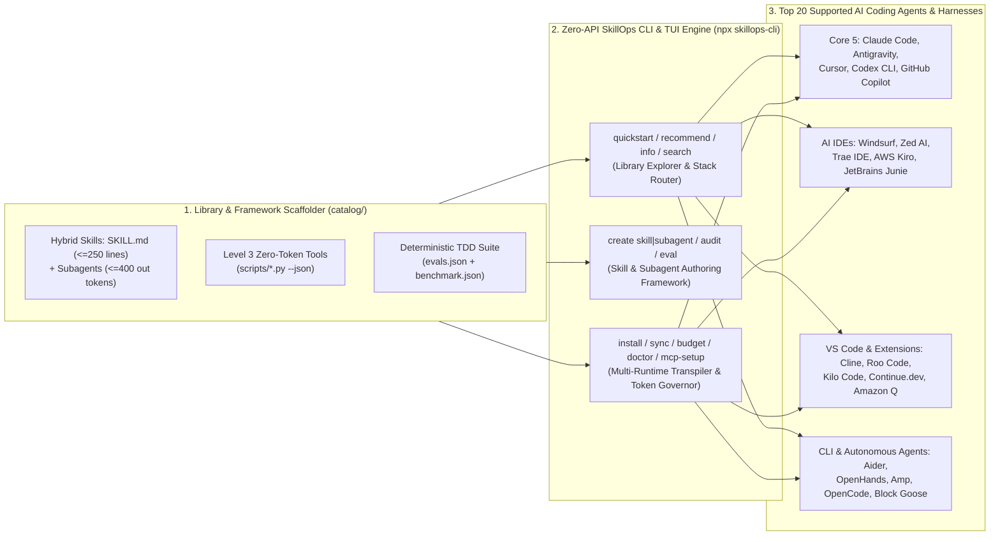

# SkillOps (`npx skillops-cli@latest`)

> **The Zero-API Framework & Benchmark-Verified Library for High-End AI Coding Skills & Context-Isolated Subagents (`v1.3.3`)**  
> *Explore, search, inspect, and install benchmark-verified AI Coding Skills and Context-Isolated Subagents in 10 seconds (`npx skillops-cli@latest quickstart`), scaffold and certify your own custom Skills & Subagents (`npx skillops-cli@latest create skill <name>`), enforce Startup Token Tax budgets (`npx skillops-cli@latest budget`), and transpile natively across the Top 20 AI coding agents & IDEs — 100% offline with zero API keys.*

[](./AGENTS.md)
[](./.github/workflows/codeql.yml)
[](https://www.npmjs.com/package/skillops-cli)
[](./package.json)
[](./tsconfig.json)
[](./SKILL_CONTRACT.md)
[](./SKILL_CONTRACT.md)
[](https://modelcontextprotocol.io/)
[](./CITATION.cff)
[](./LICENSE)

---

## 🚀 10-Second Quickstart (`Library + Framework`)

Run **SkillOps** in any repository with zero global installation or API keys (or install globally via `npm install -g skillops-cli` to use `skillops` directly):

```bash
# 1. One-Command Quickstart: detect repo stack + active AI IDEs, install optimal Skills/Subagents & wire MCP
npx skillops-cli@latest quickstart

# 2. Explore the Library: search by keyword or inspect a Skill/Subagent card & how to invoke it in your AI
npx skillops-cli@latest search "securityowasp"
npx skillops-cli@latest info security-sast-gate

# 3. Install a specific Skill or Context-Isolated Subagent into your active AI coding harnesses
npx skillops-cli@latest install security-sast-gate context-scout

# 4. Build with the Framework: scaffold a custom Skill (SKILL.md + Python L3 CLI + TDD evals) or Subagent
npx skillops-cli@latest create skill api-rate-limiter --track python-backend
npx skillops-cli@latest create subagent schema-migration-reviewer

# 5. Audit & Certify: check Startup Token Tax budgets, semantic collisions, and deterministic TDD lift
npx skillops-cli@latest budget
npx skillops-cli@latest audit --strict
npx skillops-cli@latest eval --strict
```

---

## 🎯 What Is SkillOps? (The 3-Pillar Architecture)

As engineering teams adopt the **Top 20 AI Coding Agents, IDEs, and CLI Harnesses** (**Claude Code**, **Antigravity / Gemini CLI**, **Cursor**, **OpenAI Codex CLI**, **GitHub Copilot**, **Windsurf**, **Cline**, **Roo Code**, **Kilo Code**, **Zed AI**, **Continue.dev**, **Aider**, **OpenHands**, **Sourcegraph Amp**, **OpenCode**, **Block Goose**, **AWS Kiro**, **Trae IDE**, **JetBrains Junie**, and **Amazon Q Developer**), two systemic failure modes documented in 2026 empirical AI research break production workflows:

1. **Implicit Routing Collapse (_Lost in Implicit Routing_, `arXiv:2610.18522`):**  
   Dumping 50–100+ skills with overlapping natural-language descriptions into an agent's workspace causes **semantic routing recall to collapse from `73.6%` to `27.4%`**, while burning **8,000–15,000+ context tokens** before the developer writes a single prompt.
2. **Skill-Induced Regressions & Startup Token Tax (_Agent Skills Can Be Harmful_, `arXiv:2608.11888`):**  
   Static, prose-heavy `SKILL.md` files without deterministic verification scripts or comparative `with_skill` vs. `without_skill` benchmarks frequently **degrade pass rates** on complex engineering tasks while inflating token overhead by **30%–200%**.

**SkillOps** solves both problems by uniting **three pillars** in a single 100% offline, zero-API Node.js 20+ / TypeScript engine:

### 📚 Pillar 1 — The Benchmark-Verified Library of Skills & Subagents

- **10 Hybrid Executable Skills (`catalog/<track>/<name>/`):** Every skill pairs a concise `<= 250`-line `SKILL.md` (`40–110` word L1 trigger description) with a zero-hallucination **Python 3.12+ Level 3 CLI tool (`scripts/*.py --json`)** and a **deterministic TDD evaluation suite (`evals/evals.json` + `evals/benchmark.json`)** proving `CERTIFIED_IMPROVEMENT` ($\Delta\text{PassRate} \ge +15\%$).
- **9 Context-Isolated Subagents (`catalog/subagents/` & `.github/agents/`):** Specialized read-only scouts and auditors that execute heavy AST/codebase exploration in an isolated context window and return a strict `<= 400`-token structured digest (`INV-SKILL-04`) to the parent agent.
- **Interactive Library Explorer:** Discover, filter, inspect, and install artifacts via `skillops list`, `skillops search <query>`, `skillops info <name>`, `skillops recommend`, and `skillops install <name>`.

### 🛠️ Pillar 2 — The Framework for Building Custom Skills & Subagents

- **1-Command Scaffolder (`skillops create skill|subagent <name>`):** Generates contract-compliant `SKILL.md` manifests (automatically meeting `INV-SKILL-01..04` word and token budgets), executable Python 3.12+ `--json` Level 3 AST/CLI scripts, and `with_skill` vs. `without_skill` TDD evaluation suites (`evals/evals.json`), or context-isolated `SUBAGENT.md` manifests (`max_output_tokens: 400`).
- **Zero-API Semantic Collision & Budget Linter (`skillops audit`):** Computes TF-IDF + char-trigram cosine similarity and MinHash Jaccard across your catalog to catch routing collisions (`>= 0.72` warning, `>= 0.85` error) and enforce 3-level progressive disclosure budgets before deployment.
- **Deterministic TDD Evaluation Runner (`skillops eval`):** Executes comparative `with_skill` vs. `without_skill` evaluations offline and generates `table`, `markdown`, `json`, or interactive `html` benchmark dashboards.

### ⚙️ Pillar 3 — Universal Multi-Runtime Sync, Token Economy & MCP Engine

- **Universal Top-20 AI Harness Transpiler (`skillops quickstart`, `sync`, `install`, `uninstall`, `clean`):** Transpiles Skills and Subagents into the native progressive-disclosure or scoped rule formats of all 20 AI coding agents with `.skillops-lock.json` SHA-256 drift protection.
- **Startup Token Tax Analyzer (`skillops budget` / `tokens`):** Audits 22 always-on instruction files (`CLAUDE.md`, `AGENTS.md`, `GEMINI.md`, `.windsurfrules`, `.clinerules`, `.goosehints`, `CONVENTIONS.md`, etc.) and 13 MCP config formats against a strict `<= 2,500`-token startup budget.
- **Local JSON-RPC 2.0 Stdio MCP Server (`skillops mcp-setup` & `mcp`):** Exposes 8 native tools (`audit_catalog`, `analyze_repo_tokens`, `route_repo_skills`, `run_skill_script`, `get_skill_benchmark`, `list_catalog_items`, `diagnose_repo`, `list_supported_harnesses`) across 13 MCP-capable IDEs and CLI agents.

---

## 🏗️ System Architecture



---

## 💻 Complete CLI Reference (`npx skillops-cli@latest`)

> 💡 **Tip:** Run `npx skillops-cli --help` for the colorized 3-pillar terminal help screen, or `npx skillops-cli <command> --help` for detailed flags and copy-paste examples for any command. Both `--project` (`-p`) and `--repo`, as well as `--harness` (`-t`) and `--targets`, work interchangeably across all commands.

### 📚 1. Library Commands (Explore, Search, Recommend & Install)

| Command                                    | Aliases           | Purpose & Key Flags                                                                                                                                                                                                                                                |
| :----------------------------------------- | :---------------- | :----------------------------------------------------------------------------------------------------------------------------------------------------------------------------------------------------------------------------------------------------------------- |
| **`npx skillops-cli quickstart`**          | `setup`           | **1-Command Onboarding:** Auto-detects repo stack & active AI harnesses, routes optimal collision-free Skills + Subagents, transpiles runtime files, registers MCP, and prints how to invoke them (`--project <dir>`, `--harness <list\|auto\|all>`, `--dry-run`). |
| **`npx skillops-cli list`**                | `ls`              | Lists all catalog Skills and Context-Isolated Subagents with a visual L1 Token Budget Meter (`--type skill\|subagent`, `--format table\|json`).                                                                                                                    |
| **`npx skillops-cli search <query>`**      | `find`            | Searches the Library by keyword, domain tag, track, or trigger phrase (`--type skill\|subagent`, `--format table\|json\|markdown`).                                                                                                                                |
| **`npx skillops-cli info <name>`**         | `show`, `inspect` | Renders a detailed TUI inspection card for a Skill or Subagent: L1/L2 token metrics, Level 3 scripts, TDD benchmark lift, and **how to invoke it in your AI IDE**.                                                                                                 |
| **`npx skillops-cli install <name...>`**   | `add`, `i`        | Installs one or more Skills or Subagents into your active AI coding harnesses (`--harness claude,cursor,windsurf`, `--dry-run`, `--force`).                                                                                                                        |
| **`npx skillops-cli uninstall <name...>`** | `remove`, `rm`    | Surgically removes synced Skills or Subagents from active AI harnesses while respecting `.skillops-lock.json` SHA-256 drift protection.                                                                                                                            |
| **`npx skillops-cli recommend`**           | `route`           | Fingerprints your repository (`package.json`, `pyproject.toml`, `Cargo.toml`, `go.mod`, `Dockerfile`, AST) and recommends an optimal `<= 12` Skill bundle (`--task "<prompt>"`, `--top <n>`).                                                                      |

### 🛠️ 2. Framework Commands (Scaffold, Audit & Certify Custom Skills/Subagents)

| Command                                     | Aliases | Purpose & Key Flags                                                                                                                                                                                                                                                 |
| :------------------------------------------ | :------ | :------------------------------------------------------------------------------------------------------------------------------------------------------------------------------------------------------------------------------------------------------------------ |
| **`npx skillops-cli create <type> <name>`** | `new`   | Scaffolds a contract-compliant custom **Skill** (`create skill <name> --track <track>`) with `SKILL.md`, `scripts/<name>_check.py --json`, and `evals/evals.json`, or a **Context-Isolated Subagent** (`create subagent <name>`).                                   |
| **`npx skillops-cli audit`**                | —       | Audits any catalog for pairwise TF-IDF/MinHash semantic routing collisions (`< 0.72` / `< 0.85`), 3-level progressive disclosure token budgets, and subagent `max_output_tokens <= 400` (`--strict`, `--require-layout`, `--format table\|json\|markdown\|github`). |
| **`npx skillops-cli eval`**                 | —       | Runs 100% offline deterministic `with_skill` vs. `without_skill` AST & subprocess TDD evaluations and enforces $\Delta\text{PassRate} \ge +15\%$ (`--skill <name>`, `--output <path>`, `--format table\|json\|markdown\|html\|github`).                             |
| **`npx skillops-cli init`**                 | —       | Initializes a declarative `.skillops.yml` workspace configuration and empty `catalog/` tracks (`ai-engineering`, `python-backend`, `arch-quality`, `subagents`).                                                                                                    |

### ⚙️ 3. Universal Runtime Sync, Token Economy & Diagnostics

| Command                          | Aliases  | Purpose & Key Flags                                                                                                                                                                                                                          |
| :------------------------------- | :------- | :------------------------------------------------------------------------------------------------------------------------------------------------------------------------------------------------------------------------------------------- |
| **`npx skillops-cli budget`**    | `tokens` | Audits repository Startup Token Tax across 22 always-on instruction files (`CLAUDE.md`, `AGENTS.md`, `GEMINI.md`, `.windsurfrules`, `.clinerules`, etc.) and 13 MCP server configs with a visual budget meter (`--budget 2500`, `--strict`). |
| **`npx skillops-cli sync`**      | —        | Fingerprints the repository and transpiles the full routed Skill + Subagent bundle across selected harnesses (`--harness auto\|all\|core\|<list>`, `--task "<prompt>"`, `--dry-run`, `--force`).                                             |
| **`npx skillops-cli clean`**     | —        | Removes all SkillOps-managed runtime artifacts tracked in `.skillops-lock.json` across all 20 harnesses and cleans managed index blocks.                                                                                                     |
| **`npx skillops-cli doctor`**    | `status` | Diagnoses Node.js/Python runtimes, `.skillops.yml` schema validity, `.skillops-lock.json` SHA-256 artifact drift (`healthy`, `drifted`, `missing`), Startup Token Tax, and detected AI harnesses.                                            |
| **`npx skillops-cli harnesses`** | —        | Lists all 20 supported AI coding agents with auto-detection status, target directories, and MCP support (`--format table\|json\|markdown`).                                                                                                  |
| **`npx skillops-cli mcp-setup`** | —        | Idempotently registers the `skillops` stdio MCP server across all 13 MCP-capable IDEs and CLI agents (`--harness auto\|all\|<list>`, `--dry-run`).                                                                                           |
| **`npx skillops-cli mcp`**       | —        | Starts the local JSON-RPC 2.0 `stdio` Model Context Protocol server exposing 8 SkillOps tools.                                                                                                                                               |

---

## 🌐 Universal Top-20 AI Coding Agents & Harnesses Matrix

| #   | Target ID     | AI Coding Agent / IDE               | Category         | Native Transpiled Skill / Rule Output                    | Native Subagent Output                   | Project MCP Config (`mcp-setup`)     |
| :-- | :------------ | :---------------------------------- | :--------------- | :------------------------------------------------------- | :--------------------------------------- | :----------------------------------- |
| 1   | `claude`      | **Claude Code (Anthropic)**         | CLI Agent        | `.claude/skills/<name>/SKILL.md`                         | `.claude/agents/<name>.md`               | `.mcp.json`                          |
| 2   | `antigravity` | **Google Antigravity / Gemini CLI** | Agentic IDE      | `.agent/skills/<name>/SKILL.md`                          | `.agent/agents/<name>.md`                | `.gemini/settings.json`              |
| 3   | `cursor`      | **Cursor IDE**                      | AI IDE           | `.cursor/rules/<name>.mdc`                               | `.cursor/rules/agent-<name>.mdc`         | `.cursor/mcp.json`                   |
| 4   | `codex`       | **OpenAI Codex CLI**                | CLI Agent        | `.codex/skills/<name>/SKILL.md` + `AGENTS.md`            | `.codex/agents/<name>.md`                | `.codex/config.toml`                 |
| 5   | `copilot`     | **GitHub Copilot (VS Code)**        | IDE Extension    | `.github/instructions/<name>.instructions.md`            | `.github/agents/<name>.agent.md`         | `.vscode/mcp.json`                   |
| 6   | `windsurf`    | **Windsurf (Codeium Cascade)**      | AI IDE           | `.windsurf/rules/<name>.md` (`trigger: model_decision`)  | `.windsurf/workflows/agent-<name>.md`    | —                                    |
| 7   | `cline`       | **Cline**                           | IDE Extension    | `.clinerules/<name>.md`                                  | `.clinerules/workflows/agent-<name>.md`  | —                                    |
| 8   | `roocode`     | **Roo Code**                        | IDE Extension    | `.roo/rules/<name>.md`                                   | `.roo/rules-architect/agent-<name>.md`   | `.roo/mcp.json`                      |
| 9   | `kilocode`    | **Kilo Code**                       | IDE Extension    | `.kilocode/rules/<name>.md`                              | `.kilocode/workflows/agent-<name>.md`    | `.kilocode/mcp.json`                 |
| 10  | `zed`         | **Zed AI**                          | AI IDE           | `.zed/rules/<name>.md` + `.rules`                        | `.zed/prompts/agent-<name>.md`           | `.zed/settings.json`                 |
| 11  | `continue`    | **Continue.dev**                    | IDE Extension    | `.continue/rules/<name>.md`                              | `.continue/prompts/agent-<name>.prompt`  | `.continue/mcpServers/skillops.yaml` |
| 12  | `aider`       | **Aider CLI**                       | CLI Agent        | `.aider/skills/<name>/SKILL.md` + `CONVENTIONS.md`       | `.aider/agents/<name>.md`                | —                                    |
| 13  | `openhands`   | **OpenHands (All Hands AI)**        | Autonomous Agent | `.openhands/microagents/<name>.md`                       | `.openhands/microagents/agent-<name>.md` | —                                    |
| 14  | `amp`         | **Sourcegraph Amp**                 | CLI Agent        | `.amp/skills/<name>/SKILL.md`                            | `.amp/agents/<name>.md`                  | `.amp/settings.json`                 |
| 15  | `opencode`    | **OpenCode CLI**                    | CLI Agent        | `.opencode/skills/<name>/SKILL.md`                       | `.opencode/agent/<name>.md`              | `opencode.json`                      |
| 16  | `goose`       | **Block Goose**                     | CLI Agent        | `.goose/skills/<name>/SKILL.md` + `.goosehints`          | `.goose/agents/<name>.md`                | —                                    |
| 17  | `kiro`        | **AWS Kiro IDE**                    | AI IDE           | `.kiro/steering/<name>.md` (`inclusion: fileMatch`)      | `.kiro/agents/<name>.md`                 | `.kiro/settings/mcp.json`            |
| 18  | `trae`        | **Trae IDE (ByteDance)**            | AI IDE           | `.trae/rules/<name>.md`                                  | `.trae/agents/<name>.md`                 | —                                    |
| 19  | `junie`       | **JetBrains Junie**                 | IDE Extension    | `.junie/skills/<name>/SKILL.md` + `.junie/guidelines.md` | `.junie/agents/<name>.md`                | —                                    |
| 20  | `amazonq`     | **Amazon Q Developer**              | IDE Extension    | `.amazonq/rules/<name>.md`                               | `.amazonq/cli-agents/<name>.md`          | `.amazonq/mcp.json`                  |

---

## 📖 Documentation & Architecture Index

- **[`docs/BENCHMARKS.md`](./docs/BENCHMARKS.md):** Token Economy Case Study (`95.53%` Startup Token Tax reduction), 10-Skill Deterministic TDD Matrix (`+39.1%` pass-rate lift, `-51.05%` token delta), and 9-Subagent Context-Isolation Matrix.
- **[`SKILL_CONTRACT.md`](./SKILL_CONTRACT.md):** Normative specification for hybrid skills, context-isolated subagents, 3-level token budgets, `evals.json` & `benchmark.json` schemas, and CLI exit codes.
- **[`docs/architecture/README.md`](./docs/architecture/README.md):** High-level system architecture and component overview.
  - **[`ADR-0001`](./docs/architecture/adr/0001-hybrid-executable-skills-architecture.md):** Hybrid Executable Skills Architecture (`SKILL.md` + `scripts/*.py` + `evals/`).
  - **[`ADR-0002`](./docs/architecture/adr/0002-semantic-collision-auditor-and-token-budgeting.md):** Semantic Collision Auditor & 3-Level Progressive Disclosure Token Budgeting.
  - **[`ADR-0003`](./docs/architecture/adr/0003-context-aware-dynamic-router-and-multi-runtime-sync.md):** Context-Aware Dynamic Router & Multi-Runtime Sync (`skillops route` & `skillops sync`).
  - **[`ADR-0004`](./docs/architecture/adr/0004-zero-api-tdd-evaluation-and-stdio-mcp.md):** Zero-API Deterministic TDD Skill Evaluation Engine & Stdio MCP (`skillops eval`, `skillops mcp`).
- **[`AGENTS.md`](./AGENTS.md):** Agentic Engineering Governance Contract (`1 Issue = 1 PR`, Sprints & Milestones).
- **[`CONTRIBUTING.md`](./CONTRIBUTING.md):** Contribution workflow, Conventional Commits, and 5-Minute Skill Authoring Cookbook.

---

## License

Released under the [MIT License](./LICENSE). Maintained by [@OdevMatheus](https://github.com/OdevMatheus).
