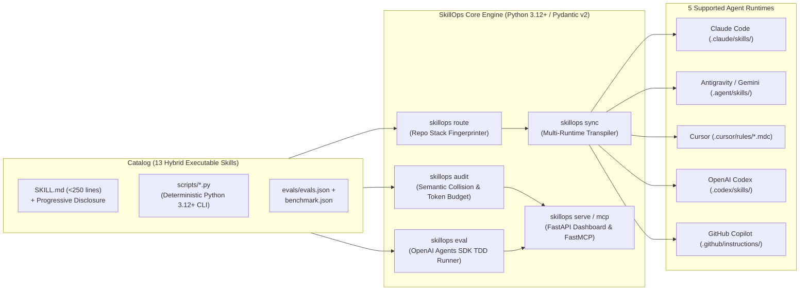

# SkillOps

> **The Python 3.12+ Engine & Benchmark-Verified Library for AI Coding Agent Skills & Subagents**  
> *Stop installing unverified Markdown prompt essays. Audit semantic collisions, dynamically route context-aware skill bundles across 5 agent runtimes, and prove positive task lift (`with_skill` vs. `without_skill`) with TDD evaluations powered by the OpenAI Agents SDK.*

---

## Why SkillOps Exists (The 2026 Agent Harness Crisis)

As AI-native engineering teams scale their agent customizations across **Claude Code**, **Antigravity / Gemini CLI**, **Cursor**, **OpenAI Codex CLI**, and **GitHub Copilot**, two critical failure modes documented in 2026 empirical AI systems research break production workflows:

1. **Implicit Routing Collapse (*Lost in Implicit Routing*, `arXiv:2610.18522`):**  
   Dumping 50–100+ skills with overlapping natural-language descriptions into an agent's workspace causes **semantic routing recall to collapse from `73.6%` to `27.4%`**, while burning **8,000–15,000+ context tokens** before the developer writes a single prompt.
2. **Skill-Induced Regressions (*Agent Skills Can Be Harmful*, `arXiv:2608.11888`):**  
   Static, prose-heavy `SKILL.md` files without deterministic verification scripts or comparative `with_skill` vs. `without_skill` benchmarks frequently **degrade pass rates** on complex engineering tasks while inflating token overhead by **30%–200%**.

**SkillOps** is an end-to-end **Skill Engineering & Harness Operations Platform** built in strict **Python 3.12+** that solves both problems:
- **Pillar 1 — The `SkillOps` Core Engine (`src/skillops/`):** A CLI, FastAPI Benchmark Viewer, and FastMCP Server that lints 3-level progressive disclosure budgets, detects pairwise semantic collisions (`skillops audit`), fingerprints repositories to compile optimal 5–12 skill bundles (`skillops route`), transpiles skills across 5 runtimes (`skillops sync`), and runs TDD `with_skill` vs. `without_skill` benchmarks (`skillops eval`).
- **Pillar 2 — The Elite Executable Skill Catalog (`catalog/`):** 13 benchmark-verified **Hybrid Executable Skills** across 3 specialized tracks (`ai-engineering`, `python-backend`, `arch-quality`), where every skill pairs a concise `< 250`-line `SKILL.md` with a zero-hallucination **Python 3.12+ CLI tool (`scripts/*.py`)** and a **TDD evaluation suite (`evals/evals.json` + `evals/benchmark.json`)**.

---

## System Architecture

---

## Core CLI Capabilities (`skillops`)

| Command | Purpose | Key Invariants Enforced |
| :--- | :--- | :--- |
| **`skillops audit`** | Audits any skill catalog for pairwise semantic description overlap and 3-level token budget compliance. | Level 1 `<= 90 tokens/skill` (`<= 1,500 tokens` bundle), Level 2 `<= 250 lines`, cosine similarity `< 0.78` (warn) / `< 0.85` (error). |
| **`skillops route`** | Fingerprints a target repository (`pyproject.toml`, `package.json`, `Dockerfile`, AST/files) and selects an optimal collision-free bundle. | Emits `5 to 12` highest-scoring skills guaranteed free of semantic collisions. |
| **`skillops sync`** | Transpiles and installs a routed skill bundle across **Claude Code, Antigravity, Cursor, Codex CLI, and GitHub Copilot**. | Writes `.skillops-lock.json` with SHA-256 digests for idempotent updates. |
| **`skillops eval`** | Runs parallel `with_skill` vs. `without_skill` TDD evaluation scenarios (`deterministic` offline mode or `live` OpenAI Agents SDK mode). | Requires $\Delta\text{PassRate} \ge +15\%$ and zero critical regressions. |
| **`skillops serve`** | Launches a **FastAPI** web dashboard visualizing catalog health, collision heatmaps, and `with_skill` vs. `without_skill` benchmarks. | Interactive REST API (`/api/v1/catalog`, `/api/v1/benchmarks`, `/api/v1/audit`). |
| **`skillops mcp`** | Starts a native **Model Context Protocol (FastMCP)** server exposing `SkillOps` audit, routing, and script execution tools to AI agents. | Compatible with Claude Desktop, Claude Code, Cursor, and Antigravity MCP clients. |

---

## The Elite Catalog: 13 Hybrid Executable Skills (`catalog/`)

Every skill in `catalog/` adheres to **[`SKILL_CONTRACT.md`](./SKILL_CONTRACT.md)** and ships with an executable Python 3.12+ diagnostic CLI (`scripts/*.py`) and a TDD benchmark suite (`evals/`):

### Track 1 — AI & Agentic Systems Engineering (`catalog/ai-engineering/`)
| Skill ID | Executable Micro-Tool (`scripts/`) | Core Engineering Capability |
| :--- | :--- | :--- |
| `mcp-architect` | `mcp_inspector.py` | Designs and validates Model Context Protocol (FastMCP) servers, JSON-RPC schemas, transport layers, and tool pagination. |
| `agent-harness-auditor` | `harness_linter.py` | Audits multi-agent harnesses, subagent boundaries, tool definitions, and context budgets against Anthropic & 2026 routing research. |
| `graphrag-hybrid-search` | `retrieval_evaluator.py` | Implements hybrid retrieval (`pgvector` HNSW + BM25 + Reciprocal Rank Fusion + cross-encoder reranking) and computes MRR/Recall@K. |
| `llm-eval-tdd` | `eval_matrix_runner.py` | Builds deterministic + LLM-as-Judge evaluation harnesses with Pydantic v2 Structured Outputs and statistical variance analysis. |
| `prompt-red-teaming` | `injection_scanner.py` | Audits system prompts and agent tool pipelines against indirect prompt injection, tool-output poisoning, and OWASP LLM Top 10 vectors. |

### Track 2 — High-Performance Python 3.12+ Backend (`catalog/python-backend/`)
| Skill ID | Executable Micro-Tool (`scripts/`) | Core Engineering Capability |
| :--- | :--- | :--- |
| `python-312-strict` | `typing_audit.py` | Enforces PEP 695 type parameter syntax, `mypy --strict`, `Pydantic v2` `ConfigDict(strict=True)`, and zero-any boundary contracts. |
| `fastapi-production` | `openapi_linter.py` | Audits FastAPI lifespan state, async dependency injection, RFC 9457 Problem Details error handlers, and OpenAPI schema completeness. |
| `postgres-query-doctor` | `sql_hazard_detector.py` | Detects N+1 ORM patterns, missing composite/partial indexes, non-sargable predicates, and unsafe lock-inducing DDL migrations. |
| `async-concurrency-guard` | `event_loop_blocking_scanner.py` | Scans Python `async def` call graphs via AST to catch blocking synchronous I/O, unmanaged background tasks, and missing `asyncio.TaskGroup` bounds. |

### Track 3 — Architecture, Security & Code Quality (`catalog/arch-quality/`)
| Skill ID | Executable Micro-Tool (`scripts/`) | Core Engineering Capability |
| :--- | :--- | :--- |
| `ast-blast-radius` | `blast_radius_analyzer.py` | Builds a repository import/call dependency graph via AST to quantify the blast radius of modified symbols before refactoring. |
| `bug-reproducer-tdd` | `repro_harness_check.py` | Enforces hypothesis-driven root-cause isolation and verifies a failing minimal reproduction test (`Red`) before allowing production fixes (`Green`). |
| `security-sast-gate` | `owasp_ast_scanner.py` | Scans code diffs for SQL injection, SSRF, command injection, hardcoded secrets, and missing auth guards with CWE mappings. |
| `adr-enforcer` | `architecture_boundary_check.py` | Validates MADR 4.0 Architecture Decision Records and checks codebase import boundaries against declared architectural rules. |

---

## Documentation & Architecture Index

- **[`SKILL_CONTRACT.md`](./SKILL_CONTRACT.md):** Normative specification for hybrid skills, 3-level token budgets, `evals.json` & `benchmark.json` schemas, and CLI exit codes.
- **[`docs/architecture/README.md`](./docs/architecture/README.md):** High-level system architecture and component overview.
  - **[`ADR-0001`](./docs/architecture/adr/0001-hybrid-executable-skills-architecture.md):** Hybrid Executable Skills Architecture (`SKILL.md` + `scripts/*.py` + `evals/`).
  - **[`ADR-0002`](./docs/architecture/adr/0002-semantic-collision-auditor-and-token-budgeting.md):** Semantic Collision Auditor & 3-Level Progressive Disclosure Token Budgeting.
  - **[`ADR-0003`](./docs/architecture/adr/0003-context-aware-dynamic-router-and-multi-runtime-sync.md):** Context-Aware Dynamic Router & Multi-Runtime Sync (`skillops route` & `skillops sync`).
  - **[`ADR-0004`](./docs/architecture/adr/0004-tdd-skill-evaluation-engine-openai-agents-sdk.md):** TDD Skill Evaluation Engine via OpenAI Agents SDK (`skillops eval`, `skillops serve`, `skillops mcp`).
- **[`AGENTS.md`](./AGENTS.md):** Agentic Engineering Governance Contract (`1 Issue = 1 PR`, Sprints & Milestones).
- **[`CONTRIBUTING.md`](./CONTRIBUTING.md):** Contribution workflow, Conventional Commits, and quality gates.

---

## Engineering Roadmap (Sprints 0–5)

| Sprint / Milestone | Version | Scope & Deliverables | Status |
| :--- | :--- | :--- | :--- |
| **Sprint 0** (`Milestone #1`–`#4`) | `v0.1.0` | Repository governance, `AGENTS.md`, PR templates, CI governance workflows, and GitHub agent profiles. | ✅ Completed |
| **Sprint 1** (`Milestone #10` / `Epic #43`) | `v0.2.0` | Rebrand to **SkillOps**, `SKILL_CONTRACT.md`, `ADR-0001`–`0004`, Python 3.12+ package (`pyproject.toml`), Typer CLI, Pydantic v2 models, and Python CI (`ruff`, `mypy --strict`, `pytest`). | 🚧 In Progress |
| **Sprint 2** (`Milestone #11` / `Epic #48`) | `v0.3.0` | Semantic Collision Auditor (`skillops audit`), 3-level token budget linter, and Rich terminal / JSON / Markdown reporting. | 📋 Planned |
| **Sprint 3** (`Milestone #12` / `Epic #53`) | `v0.4.0` | Context-Aware Repo Stack Fingerprinter (`skillops route`) & Multi-Runtime Sync (`skillops sync` for Claude, Antigravity, Cursor, Codex, Copilot). | 📋 Planned |
| **Sprint 4** (`Milestone #13` / `Epic #58`) | `v0.5.0` | TDD Skill Evaluation Engine (`skillops eval` via OpenAI Agents SDK), FastAPI Benchmark Viewer (`skillops serve`), and FastMCP Server (`skillops mcp`). | 📋 Planned |
| **Sprint 5** (`Milestone #14` / `Epic #63`) | `v1.0.0` | Elite Executable Skill Catalog (13 Hybrid Skills across Tracks 1, 2, and 3) + Full Catalog Benchmark Matrix & `v1.0.0` Release. | 📋 Planned |

---

## License

Released under the [MIT License](./LICENSE). Maintained by [@OdevMatheus](https://github.com/OdevMatheus).
