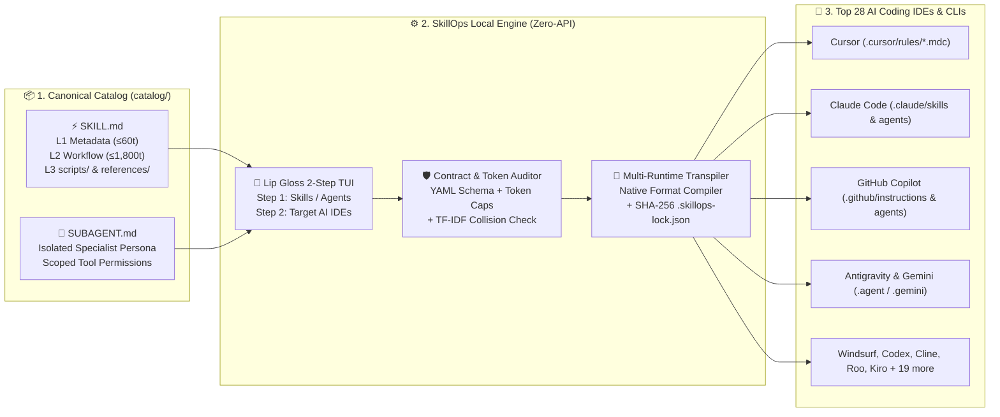

<!-- readme-gen:start:hero -->
<div align="center">


</div>

<!-- readme-gen:end:hero -->

<!-- readme-gen:start:badges -->
<p align="center">
  <a href="https://github.com/OdevMatheus/SkillOps/actions/workflows/ai-ci.yml"></a>
  <a href="https://github.com/OdevMatheus/SkillOps/actions/workflows/codeql.yml"></a>
  <a href="https://www.npmjs.com/package/skillops-cli"></a>
  <a href="#supported-ai-coding-clis--ides-top-28"></a>
  <a href="LICENSE"></a>
</p>

<p align="center">
  Created by <a href="https://github.com/OdevMatheus"><strong>@OdevMatheus</strong></a> · Built for engineers who use more than one AI coding tool
</p>

<p align="center">
  <strong>Every AI coding assistant speaks a different&nbsp;dialect.</strong><br>
  Cursor wants <code>.cursor/rules/*.mdc</code>. Claude Code wants <code>.claude/skills/</code>.<br>
  Copilot wants <code>.github/instructions/</code>. Antigravity wants <code>.agent/skills/</code>.
</p>

<p align="center">
  <strong>28&nbsp;AI&nbsp;tools. 28&nbsp;folder&nbsp;layouts. Zero&nbsp;shared&nbsp;standard.</strong><br>
  Until now, switching or combining AI tools meant rewriting the same prompts by&nbsp;hand.
</p>

<p align="center">
  Pick a Skill or Subagent in your terminal. Choose your AI&nbsp;IDEs.<br>
  SkillOps transpiles, validates, and locks every file on your&nbsp;machine. <strong>Zero&nbsp;API&nbsp;keys.</strong>
</p>

<p align="center">
  <a href="#your-turn">Try it in one command&nbsp;↓</a> · <a href="#what-skillops-does-for-you">What it does&nbsp;↓</a> · <a href="#usage">Usage &amp; Commands&nbsp;↓</a> · <a href="#supported-ai-coding-clis--ides-top-28">28 Supported AI Tools&nbsp;↓</a> · <a href="#faq">FAQ&nbsp;↓</a>
</p>

<p align="center">⭐ <strong>If SkillOps saves you time configuring AI agents, a star helps other engineers find&nbsp;it.</strong></p>
<!-- readme-gen:end:badges -->

---

<!-- readme-gen:start:overview -->
## Your turn

Run one command inside any repository. Select the Skills or Subagents you want, pick your AI coding IDEs on a single screen, and hit `Enter`.

```bash
npx skillops-cli@latest add
```

<p align="center"><sub>Open source. 100% local. Zero API keys or telemetry. Works with the AI IDE or CLI you already use.</sub></p>

---

## What SkillOps does for you

Pick a Skill. Pick your AI tools. It wires everything into your repository in seconds.

- **Using more than one AI tool?** Write or select a canonical `SKILL.md` or `SUBAGENT.md` once. SkillOps compiles it into the exact native file format, frontmatter, and folder layout required by **28 AI IDEs and CLIs**—strictly following each vendor's official documentation.
- **Want an interactive terminal workflow?** `skillops add` launches a **Charmbracelet Lip Gloss TrueColor TUI** in two steps: first pick `Skills` or `Agents` (or toggle `★ Install ALL`), then pick your target AI IDEs sorted by popularity with live `/` search.
- **Worried about Context Rot?** Every skill follows a strict **3-Tier Progressive Disclosure** contract: **L1** discovery metadata (`≤ 60` tokens), **L2** core instructions (`≤ 1,800` tokens), and **L3** on-demand reference docs and deterministic scripts (`0` idle tokens).
- **Edited a generated rule by hand?** Every synced file is recorded in `.skillops-lock.json` with a **SHA-256 checksum**. If you customize a file locally, SkillOps detects the drift and protects your changes unless you explicitly pass `--force`.
- **Want to clean up later?** Run `skillops remove` to interactively uninstall specific Skills or Subagents, or `skillops remove --all` to surgically remove every managed file without touching the rest of your repository.

## What SkillOps will not do

- **Require an LLM API key or burn your tokens.** The entire CLI—TUI, transpiler, token-budget auditor, collision detector, and evaluation runner—is 100% deterministic local code.
- **Phone home.** There is no telemetry, no analytics server, and no background network calls. Everything stays in your local repository.
- **Clobber your existing repository instructions.** For shared files like `AGENTS.md`, SkillOps updates only its bounded `<!-- SKILLOPS:START --> ... <!-- SKILLOPS:END -->` block and leaves your handwritten documentation untouched.
- **Guess how an AI tool works.** No undocumented hacks. Every single target adapter (`cursor`, `claude`, `copilot`, `antigravity`, `windsurf`, `codex`, `gemini`, `kiro`, etc.) is built directly from official specification docs.
<!-- readme-gen:end:overview -->

---

<!-- readme-gen:start:features -->
## Features

| Feature | Description |
| :--- | :--- |
| **Charmbracelet Lip Gloss TUI** | 2-step interactive terminal wizard with TrueColor badges, horizontal `Skills` / `Agents` tabs, `★ Install ALL` batch toggle, pagination dots, and instant `/` keyword search. |
| **28-Runtime Native Transpiler** | Compiles canonical `SKILL.md` (plus Level 3 scripts & references) and `SUBAGENT.md` files into `.mdc` rules, `.instructions.md`, `.prompt`, microagents, steering docs, and custom agents across 28 AI tools. |
| **3-Tier Progressive Disclosure** | Enforces strict context budgets (`INV-SKILL-01`–`05`): L1 YAML discovery (`40–110` words starting with `"Use when..."`, `≤ 60` tokens), L2 workflow body (`≤ 1,800` tokens), and L3 zero-idle-cost scripts. |
| **Context-Isolated Subagents** | Packages specialist subagents (`SUBAGENT.md`) with dedicated system prompts, scoped tool permissions (`read_file`, `grep_search`, etc.), and capped output token budgets (`≤ 400` tokens) so parent agents stay lean. |
| **SHA-256 Lockfile & Drift Guard** | `.skillops-lock.json` tracks every generated artifact by target, item name, and SHA-256 hash—preventing accidental overwrites of local edits and powering surgical `skillops remove`. |
| **Zero-API Offline Execution** | Runs anywhere Node.js 20+ is installed with zero external dependencies on OpenAI, Anthropic, or Google APIs. |

<details>
<summary><b>Everything else it does</b></summary>

| Feature | Description |
| :--- | :--- |
| **Startup Token Tax Analyzer** | `skillops tokens` calculates the exact startup context tax across all 28 AI coding harnesses in your workspace and compares monolithic vs. progressive-disclosure token savings. |
| **Semantic Collision Auditor** | `skillops audit` runs pairwise TF-IDF cosine similarity and Jaccard token overlap checks (`< 0.72` threshold) across all catalog items to prevent ambiguous routing between skills. |
| **Offline TDD Trigger Evals** | `skillops eval` validates `should_trigger` and `should_not_trigger` prompt assertions and generates a standalone HTML benchmark dashboard (`with_skill` vs. `without_skill`). |
| **Skill & Subagent Scaffolder** | `skillops create <name>` scaffolds a contract-compliant `SKILL.md` (with `scripts/`, `references/`, and `evals/`) or `--type subagent` (`SUBAGENT.md`) in one command. |
| **Universal MCP Bootstrapper** | `skillops mcp-setup` automatically configures the SkillOps MCP server across 20 MCP-capable IDEs and CLIs (`.mcp.json`, `.cursor/mcp.json`, `.vscode/mcp.json`, `.codex/config.toml`, etc.). |
| **Built-in Stdio MCP Server** | `skillops mcp` exposes catalog search, skill inspection, and repository diagnostics over JSON-RPC 2.0 `stdio` for any MCP client. |
| **GitHub Actions Native Output** | Pass `--format github` to `audit`, `tokens`, `eval`, or `doctor` to emit native GitHub Actions `::error` and `::notice` workflow annotations in CI. |

</details>
<!-- readme-gen:end:features -->

---

<!-- readme-gen:start:architecture -->
## How It Works



```text
╭─  SkillOps  Step 1/2: Select Skills & Subagents
│  Choose what to install (next step: select target AI IDEs)
│
│   ⚡ Skills (1)    🤖 Agents (1)
│  Space toggle · a all · ←/→ tab · / search · Enter next
│
│  ❯ ◉ ★ Install ALL Skills (1 available)  Select every item in this tab
│    ◉ mcp-architect                       Use when designing, implementing, or auditing MCP...
│
╰─ 1 selected (1 Skills, 0 Agents) — Enter to Next: Choose AI IDEs
```

```text
╭─  SkillOps  Step 2/2: Select Target AI Coding IDEs & Agents
│  Installing 1 item(s): mcp-architect — choose target AI tools
│
│  Space toggle · a all · / search · Enter install · Esc cancel
│
│  ❯ ◉ cursor       Cursor AI IDE (.cursor/rules)
│    ◉ claude       Anthropic Claude Code (.claude/skills)
│    ◉ copilot      GitHub Copilot (.github/instructions)
│    ◯ antigravity  Google Antigravity IDE (.agent/skills)
│    ◯ windsurf     Windsurf AI IDE (.windsurf/rules)
│  ↓ 23 more below...  ●○○○
│
╰─ 3 selected — Enter to Install
```
<!-- readme-gen:end:architecture -->

---

<!-- readme-gen:start:quickstart -->
## Quick Start

**Fastest way, one command:**

```bash
npx skillops-cli@latest add
```

> 💡 `npx` ships with [Node.js](https://nodejs.org): it runs SkillOps directly without installing anything globally. Already using Claude Code, Codex CLI, or Gemini CLI? Then you already have Node.js installed.

**What happens on launch:**
1. **Step 1/2 (Skills & Subagents):** Browse the `⚡ Skills` and `🤖 Agents` tabs with `←`/`→` or `Tab`. Press `Space` to select individual items or `★ Install ALL` to select everything in the tab. Press `Enter`.
2. **Step 2/2 (Target AI IDEs):** Pick one or more of the **28 supported AI IDEs & CLIs** (ordered from most popular, with `/` live search). Press `Enter` to transpile and write the files into your repository.

<details>
<summary><b>Prefer to set it up manually or contribute? (git clone)</b></summary>

```bash
git clone https://github.com/OdevMatheus/SkillOps.git
cd SkillOps
npm ci
npm run build

# Run the interactive installer from your local build
node dist/cli.js add

# Or install your local checkout globally as `skillops`
npm install -g .
```

</details>

### Global install

```bash
npm i -g skillops-cli
```

This installs the `skillops` binary globally so you can run `skillops add`, `skillops list`, `skillops info`, and `skillops remove` in any repository without typing `npx skillops-cli@latest`.

**Which one should you use?**
- `npx skillops-cli@latest add` — Best for quick, zero-footprint setups in any project.
- `npm i -g skillops-cli` — Best if you use `skillops` daily across multiple repositories and want instant startup.
<!-- readme-gen:end:quickstart -->

---

<!-- readme-gen:start:usage -->
## Usage

Once `skillops add` finishes, your selected Skills and Subagents live natively inside your repository's AI configuration folders. You don't run a wrapper binary to use them—**your AI IDE or CLI discovers them automatically.**

### How your AI IDE or CLI uses installed Skills & Subagents

| AI IDE / CLI | How `Skills` activate | How `Subagents` are invoked |
| :--- | :--- | :--- |
| **Claude Code** | Auto-routed by description from `.claude/skills/<name>/SKILL.md` | Delegate via `@<subagent-name>` (e.g., `@context-scout`) |
| **Cursor** | Auto-attached by file globs / description from `.cursor/rules/skillops-<name>.mdc` | Reference `@skillops-agent-<name>` in Composer / Agent chat |
| **GitHub Copilot** | Auto-applied via `.github/instructions/skillops-<name>.instructions.md` | Select `@<subagent-name>` from `.github/agents/<name>.agent.md` |
| **Antigravity & Gemini CLI** | Auto-discovered from `.agent/skills/<name>/` or `.gemini/skills/<name>/` | Invoke via `.agent/agents/<name>.md` or `.gemini/agents/<name>.md` |
| **Codex, OpenCode, Amp, Crush, Vibe, Qwen** | Auto-discovered from `.codex/skills/`, `.opencode/skills/`, etc. | Ask in plain language or invoke agent profile from `agents/` |
| **Windsurf, Cline, Roo Code, Kilo Code** | Auto-loaded from `.windsurf/rules/`, `.clinerules/`, `.roo/rules/`, `.kilocode/rules/` | Trigger via `/skillops-agent-<name>` workflow or Architect mode |

### The everyday commands

| Command | What it does |
| :--- | :--- |
| `skillops add` | Launch the interactive 2-step TUI to select **Skills / Subagents** and **Target AI IDEs** |
| `skillops add <name> -t cursor,claude` | Non-interactively install specific items into chosen AI targets (or `--all -t all` for everything) |
| `skillops remove` | Launch the interactive uninstaller showing only items currently installed in your repo (`.skillops-lock.json`) |
| `skillops list` | Browse all available Skills and Subagents in the catalog with L1/L2 token metrics |
| `skillops search <query>` | Filter the catalog by keyword, technology stack, domain, or tag |
| `skillops info <name>` | Inspect a Skill or Subagent card, its exact trigger description, bundled L3 scripts, and IDE usage examples |

<details>
<summary><b>All commands, by stage of the workflow</b></summary>

**Discover & Inspect**

| Command | What it does |
| :--- | :--- |
| `skillops list [query]` | List every Skill and Subagent in `catalog/` (supports `--format json`) |
| `skillops search <query>` | Search catalog entries by name, description, track, or tag |
| `skillops info <name>` | Show full manifest details, token footprint, L3 scripts, and per-IDE invocation hints |
| `skillops harnesses` | List all 28 supported AI coding harnesses and show which ones are detected in the current repository |

**Install & Uninstall**

| Command | What it does |
| :--- | :--- |
| `skillops add [name...]` | Interactive 2-step installer (`--all` installs every catalog item; `-t, --targets` selects IDEs; `--dry-run` previews) |
| `skillops remove [name...]` | Interactive or direct uninstaller (`--all` removes all SkillOps-managed artifacts recorded in `.skillops-lock.json`) |
| `skillops clean` | Remove all SkillOps-managed files across all targets and delete `.skillops-lock.json` |

**Author & Scaffold**

| Command | What it does |
| :--- | :--- |
| `skillops create <name>` | Scaffold a new Progressive-Disclosure Skill directory (`SKILL.md`, `scripts/`, `references/`, `evals/`) |
| `skillops create <name> --type subagent` | Scaffold a new Context-Isolated Subagent (`SUBAGENT.md` + `evals/triggers.json`) |

**Audit, Token Budget & TDD Evaluation**

| Command | What it does |
| :--- | :--- |
| `skillops audit` | Validate YAML frontmatter contracts (`INV-SKILL-01`–`05`), token budgets, and TF-IDF semantic collisions (`< 0.72`) |
| `skillops tokens` | Analyze repository Startup Token Tax across all 28 AI harnesses and report progressive-disclosure savings |
| `skillops eval` | Run deterministic `should_trigger` / `should_not_trigger` TDD suites and export HTML benchmark reports |

**Diagnostics & MCP Integration**

| Command | What it does |
| :--- | :--- |
| `skillops doctor` | Verify Node.js 20+, Python 3.12+, `.skillops-lock.json` SHA-256 integrity, and active AI harnesses |
| `skillops mcp-setup` | Bootstrap SkillOps MCP server configuration across all 20 MCP-capable AI IDEs and CLIs |
| `skillops mcp` | Start the built-in Model Context Protocol (`stdio` JSON-RPC 2.0) server |

</details>
<!-- readme-gen:end:usage -->

---

<!-- readme-gen:start:ai-targets -->
## Supported AI Coding CLIs & IDEs (Top 28)

Every target below is configured strictly from official vendor documentation and ordered by popularity in `skillops add`:

| # | Target ID | AI IDE / Agent | Category | Skills Output Path | Subagents Output Path |
| :-: | :--- | :--- | :--- | :--- | :--- |
| 1 | `cursor` | **Cursor AI IDE** | AI IDE | `.cursor/rules/skillops-<name>.mdc` | `.cursor/rules/skillops-agent-<name>.mdc` |
| 2 | `claude` | **Anthropic Claude Code** | CLI Agent | `.claude/skills/<name>/SKILL.md` | `.claude/agents/<name>.md` |
| 3 | `copilot` | **GitHub Copilot** | IDE Extension | `.github/instructions/skillops-<name>.instructions.md` | `.github/agents/<name>.agent.md` |
| 4 | `antigravity` | **Google Antigravity IDE** | AI IDE | `.agent/skills/<name>/SKILL.md` | `.agent/agents/<name>.md` |
| 5 | `windsurf` | **Windsurf AI IDE** | AI IDE | `.windsurf/rules/skillops-<name>.md` | `.windsurf/workflows/skillops-agent-<name>.md` |
| 6 | `codex` | **OpenAI Codex CLI** | CLI Agent | `.codex/skills/<name>/SKILL.md` + `AGENTS.md` | `.codex/agents/<name>.md` |
| 7 | `gemini` | **Google Gemini CLI** | CLI Agent | `.gemini/skills/<name>/SKILL.md` | `.gemini/agents/<name>.md` |
| 8 | `cline` | **Cline** | IDE Extension | `.clinerules/skillops-<name>.md` | `.clinerules/workflows/skillops-agent-<name>.md` |
| 9 | `roocode` | **Roo Code** | IDE Extension | `.roo/rules/skillops-<name>.md` | `.roo/rules-architect/skillops-agent-<name>.md` |
| 10 | `kilocode` | **Kilo Code** | IDE Extension | `.kilocode/rules/skillops-<name>.md` | `.kilocode/workflows/skillops-agent-<name>.md` |
| 11 | `zed` | **Zed AI** | AI IDE | `.zed/rules/skillops-<name>.md` | `.zed/rules/skillops-agent-<name>.md` |
| 12 | `continue` | **Continue.dev** | IDE Extension | `.continue/rules/skillops-<name>.md` | `.continue/prompts/skillops-agent-<name>.prompt` |
| 13 | `aider` | **Aider** | CLI Agent | `.aider/conventions/skillops-<name>.md` | `.aider/conventions/skillops-agent-<name>.md` |
| 14 | `kiro` | **AWS Kiro IDE** | AI IDE | `.kiro/steering/skillops-<name>.md` | `.kiro/agents/<name>.md` |
| 15 | `trae` | **Trae AI IDE** | AI IDE | `.trae/rules/skillops-<name>.md` | `.trae/agents/<name>.md` |
| 16 | `augment` | **Augment Code** | IDE Extension | `.augment/rules/skillops-<name>.md` | `.augment/agents/<name>.md` |
| 17 | `factory` | **Factory AI Droid** | CLI Agent | `.factory/skills/<name>/SKILL.md` | `.factory/droids/<name>.md` |
| 18 | `qwen` | **Qwen Code CLI** | CLI Agent | `.qwen/skills/<name>/SKILL.md` | `.qwen/agents/<name>.md` |
| 19 | `opencode` | **OpenCode CLI** | CLI Agent | `.opencode/skills/<name>/SKILL.md` | `.opencode/agent/<name>.md` |
| 20 | `openhands` | **OpenHands** | Autonomous SWE | `.openhands/microagents/skillops-<name>.md` | `.openhands/microagents/skillops-agent-<name>.md` |
| 21 | `amp` | **Sourcegraph Amp** | CLI Agent | `.amp/skills/<name>/SKILL.md` | `.amp/agents/<name>.md` |
| 22 | `goose` | **Block Goose** | CLI Agent | `.goose/skills/<name>/SKILL.md` | `.goose/agents/<name>.md` |
| 23 | `warp` | **Warp AI Terminal** | CLI Agent | `.warp/skills/<name>/SKILL.md` | `.warp/agents/<name>.md` |
| 24 | `crush` | **Charmbracelet Crush** | CLI Agent | `.crush/skills/<name>/SKILL.md` | `.crush/agents/<name>.md` |
| 25 | `vibe` | **Mistral Vibe CLI** | CLI Agent | `.vibe/skills/<name>/SKILL.md` | `.vibe/agents/<name>.md` |
| 26 | `junie` | **JetBrains Junie** | IDE Extension | `.junie/skills/skillops-<name>.md` | `.junie/agents/<name>.md` |
| 27 | `amazonq` | **Amazon Q Developer** | IDE Extension | `.amazonq/rules/skillops-<name>.md` | `.amazonq/cli-agents/<name>.md` |
| 28 | `idx` | **Firebase Studio (IDX)** | AI IDE | `.idx/rules/skillops-<name>.md` | `.idx/agents/<name>.md` |
<!-- readme-gen:end:ai-targets -->

---

<!-- readme-gen:start:structure -->
## Project Structure

```text
SkillOps/
├── AGENTS.md                        # Canonical architecture & agent instructions
├── SKILL_CONTRACT.md                # Normative 3-tier token & schema contract (INV-SKILL-01..05)
├── CONTRIBUTING.md                  # Contribution workflow, branch rules & PR governance
├── catalog/                         # Canonical Skills & Context-Isolated Subagents
│   ├── ai-engineering/
│   │   └── mcp-architect/           # Reference Hybrid Skill (SKILL.md + scripts/ + references/ + evals/)
│   └── subagents/
│       └── context-scout/           # Reference Subagent (SUBAGENT.md + evals/triggers.json)
├── src/                             # TypeScript 5.8 Strict Zero-API Engine
│   ├── cli.ts                       # CLI entrypoint & interactive command router
│   ├── models.ts                    # Zod schemas, token estimators & 28 AI harness specs
│   ├── ui/                          # Charmbracelet Lip Gloss TrueColor TUI & multi-select state machine
│   ├── sync/                        # 28-target transpiler & SHA-256 .skillops-lock.json manager
│   ├── auditor/                     # SKILL.md / SUBAGENT.md parser & TF-IDF collision detector
│   ├── router/                      # Deterministic repository fingerprinter & bundle compiler
│   ├── eval/                        # Offline TDD trigger & token budget benchmark runner
│   └── mcp/                         # Built-in JSON-RPC 2.0 stdio MCP server & universal bootstrapper
└── tests/                           # 38 Vitest unit, TUI, token-economy & multi-runtime integration tests
```
<!-- readme-gen:end:structure -->

---

<!-- readme-gen:start:scorecard -->
## Tech Stack


- **Core Engine:** TypeScript 5.8 (`strict` mode) + Node.js 20+ + Zod runtime contract validation
- **Terminal UI:** Zero-dependency Charmbracelet Lip Gloss / Huh-inspired TrueColor TUI (`src/ui/lipgloss.ts`, `src/ui/prompt.ts`)
- **Level 3 Deterministic Scripts:** Python 3.12+ standard library tools bundled inside `catalog/<track>/<skill>/scripts/`
- **Lockfile & Integrity:** SHA-256 content addressing via `.skillops-lock.json`
- **Quality & Security Gates:** 38 Vitest tests across 6 suites + CodeQL SAST + Semantic PR Governance

<p align="center">
  <sub>Transpiles natively across all 28 supported AI coding IDEs &amp; CLIs:</sub><br>
  
  
  
  
  
  
  
  
  
  
  
  
  
  
  <br>
  
  
  
  
  
  
  
  
  
  
  
  
  
  
</p>
<!-- readme-gen:end:scorecard -->

---

## FAQ

**What is SkillOps?**
SkillOps (`skillops-cli`) is an open-source package manager and multi-runtime transpiler for AI coding assistants. It lets you maintain canonical **Skills (`SKILL.md`)** and **Subagents (`SUBAGENT.md`)** and install them across 28 different AI IDEs and CLIs without manually rewriting rules or blowing up your context window.

**What is the difference between a Skill (`SKILL.md`) and a Subagent (`SUBAGENT.md`)?**
- A **Skill (`SKILL.md`)** teaches your main AI coding agent *how* to perform a domain-specific workflow using **3-Tier Progressive Disclosure** (L1 discovery metadata, L2 step-by-step instructions, and L3 on-demand scripts/references).
- A **Subagent (`SUBAGENT.md`)** is a **context-isolated specialist** (such as `context-scout`) with its own system prompt, restricted read-only tools, and a strict output token cap (`≤ 400` tokens) so noisy exploration never pollutes your main session.

**Does SkillOps require an OpenAI, Anthropic, or Gemini API key?**
No. SkillOps is a **100% Zero-API engine**. Installing, transpiling, auditing token budgets, checking semantic collisions, and running evaluations all happen locally and deterministically on your machine at zero cost.

**What happens if I manually edit a generated rule in `.cursor/rules/` or `.claude/skills/`?**
SkillOps computes a **SHA-256 hash** for every file it generates and stores it in `.skillops-lock.json`. If you edit a generated file by hand, `skillops add` and `skillops remove` will detect the checksum mismatch and skip overwriting or deleting your modified file unless you explicitly pass `--force`.

**How do I create my own Skill or Subagent?**
Run `npx skillops-cli@latest create <your-skill-name>` (or add `--type subagent`). SkillOps scaffolds the complete directory structure and frontmatter template, which you can then validate locally with `npx skillops-cli@latest audit`. See [`SKILL_CONTRACT.md`](./SKILL_CONTRACT.md) for the full specification.

---

<!-- readme-gen:start:contributing -->
## Contributing

We welcome new **Progressive-Disclosure Skills (`SKILL.md`)**, **Context-Isolated Subagents (`SUBAGENT.md`)**, and **AI Harness Transpiler improvements**.

All contribution instructions, branch conventions, and validation checks live in our dedicated guide:

- 📖 [**Contribution Guide (`CONTRIBUTING.md`)**](./CONTRIBUTING.md)
- 📜 [**Normative Skill & Subagent Specification (`SKILL_CONTRACT.md`)**](./SKILL_CONTRACT.md)
- 🛡️ [**Security Policy (`SECURITY.md`)**](./SECURITY.md)

<a href="https://github.com/OdevMatheus/SkillOps/graphs/contributors">
  
</a>
<!-- readme-gen:end:contributing -->

---

<!-- readme-gen:start:license -->
## License

This software is licensed under the [**MIT License**](./LICENSE).

<p align="center"><sub>Created and maintained by <a href="https://github.com/OdevMatheus">Matheus Henrique</a> (<a href="https://github.com/OdevMatheus">@OdevMatheus</a>)</sub></p>
<!-- readme-gen:end:license -->

<!-- readme-gen:start:footer -->
<div align="center">


</div>
<!-- readme-gen:end:footer -->
