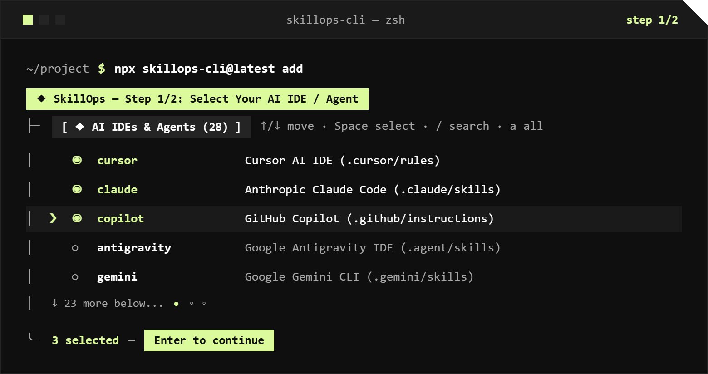
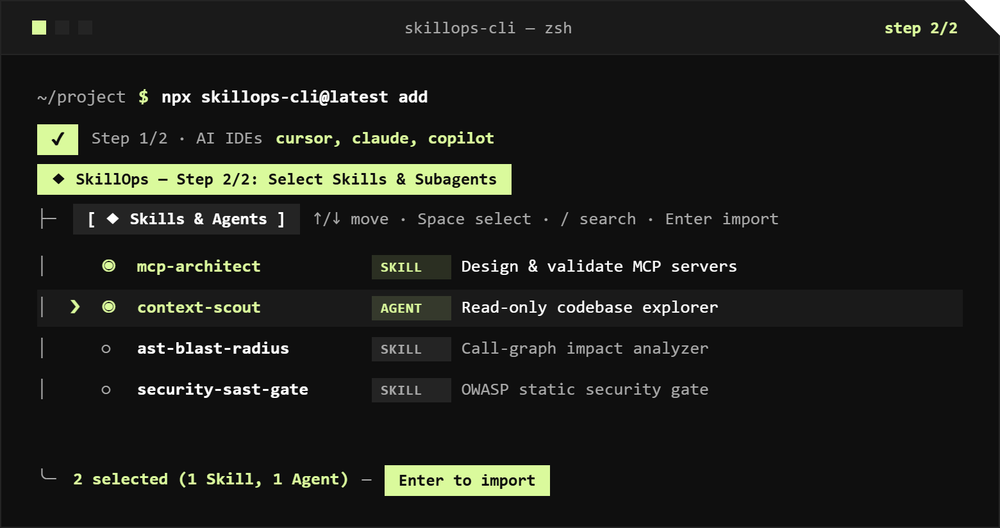
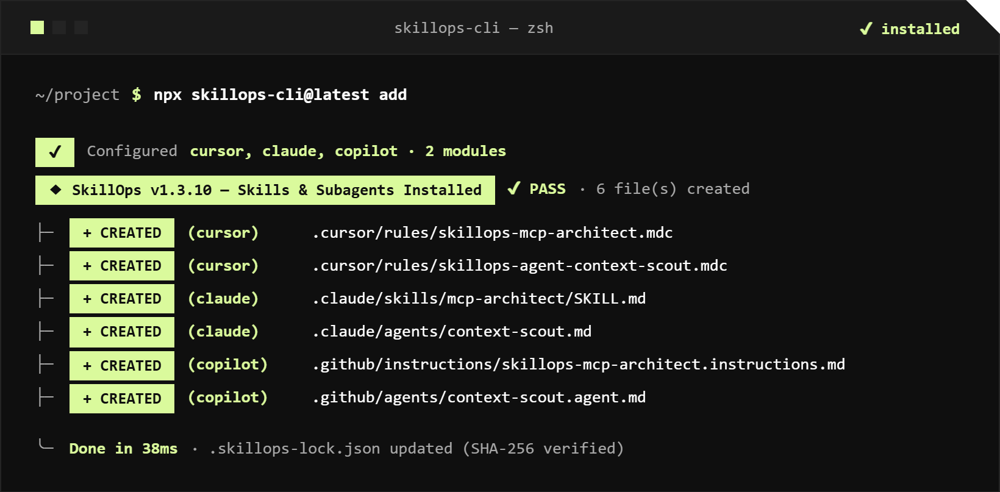

<div align="center">


<p>
  <a href="../README.md"></a>
  <a href="./README.pt-BR.md"></a>
  <a href="./README.es.md"></a>
</p>

<p>
  <a href="https://www.npmjs.com/package/skillops-cli"></a>
  <a href="https://github.com/skillops-toolkit/SkillOps/actions/workflows/ai-ci.yml"></a>
  <a href="https://github.com/skillops-toolkit/SkillOps/actions/workflows/codeql.yml"></a>
  <a href="#ides-y-clis-de-ia-compatibles-28"></a>
  <a href="../LICENSE"></a>
</p>

<p>
  <strong>Una biblioteca open-source de Skills (<code>SKILL.md</code>) y Subagents (<code>SUBAGENT.md</code>). Instalación nativa para 28 herramientas de IA.</strong><br>
  Cursor, Claude Code, GitHub Copilot, Antigravity, Windsurf, Codex, Gemini CLI, Cline, Roo Code, Kiro y más — 100% local, cero claves de API.
</p>

</div>

---

## Inicio Rápido

Ejecútalo dentro de cualquier repositorio para abrir la TUI interactiva en 2 pasos:

```bash
npx skillops-cli@latest add
```

| 1. Selecciona tu IDE / Agente de IA | 2. Selecciona Skills y Subagents |
| :---: | :---: |
|  |  |

<div align="center">
  <p><strong>3. Reporte de Transpilación Nativa e Instalación</strong></p>
  
</div>

### Referencia de la CLI

Instálalo globalmente (`npm i -g skillops-cli`) o ejecútalo directamente con `npx skillops-cli@latest`:

| Comando | Acción |
| :--- | :--- |
| `skillops add` | Abre la TUI interactiva (selecciona IDEs de IA de destino → selecciona Skills y Subagents) |
| `skillops add <name...> -t cursor,claude` | Instalación no interactiva en destinos específicos (`-t all` para las 28 herramientas) |
| `skillops status` (`list`, `ls`) | Inspecciona las Skills y Subagents instalados y la integridad SHA-256 en las IDEs |
| `skillops update [name...]` (`sync`, `upgrade`) | Actualiza los módulos instalados a la versión más reciente del catálogo preservando ediciones locales |
| `skillops remove [name...]` | Desinstala artefactos gestionados de forma interactiva o directa y actualiza `.skillops-lock.json` |

> **Flags:** `--all` selecciona todos los elementos del catálogo, `--dry-run` previsualiza las rutas de destino sin escribir en disco y `--force` sobrescribe archivos modificados localmente.

---

## ¿Por qué SkillOps?

<table>
<tr>
<td width="33%" valign="top">

### ◆ Transpilador Nativo para 28 IDEs
Escribe una sola vez en `catalog/`. SkillOps compila cada `SKILL.md` (incluyendo `scripts/` y `references/` integrados) y `SUBAGENT.md` en la jerarquía exacta de carpetas y frontmatter requerida por cada IDE o CLI.

</td>
<td width="33%" valign="top">

### ⚡ Presupuesto de Tokens en 3 Capas
Evita saturar la ventana de contexto: enrutamiento YAML **L1** (`≤ 160` tokens), instrucciones de flujo **L2** (`≤ 250` líneas) y herramientas deterministas en Python **L3** (`0` tokens en reposo). Los Subagents se ejecutan en contextos hijos aislados (`≤ 400` tokens de salida).

</td>
<td width="34%" valign="top">

### 🔒 Protección contra Conflictos SHA-256
Cada archivo generado se rastrea en `.skillops-lock.json` con un resumen criptográfico. Las ediciones manuales en `.cursor/`, `.claude/` o `.github/` nunca se sobrescriben ni eliminan a menos que se indique `--force`.

</td>
</tr>
</table>

---

## IDEs y CLIs de IA Compatibles (28)

| ID de Destino | IDE / CLI de IA | Ruta de Salida (Skills) | Ruta de Salida (Subagents) |
| :--- | :--- | :--- | :--- |
| `cursor` | **Cursor AI IDE** | `.cursor/rules/skillops-<name>.mdc` | `.cursor/rules/skillops-agent-<name>.mdc` |
| `claude` | **Anthropic Claude Code** | `.claude/skills/<name>/SKILL.md` | `.claude/agents/<name>.md` |
| `copilot` | **GitHub Copilot** | `.github/instructions/skillops-<name>.instructions.md` | `.github/agents/<name>.agent.md` |
| `antigravity` | **Google Antigravity IDE** | `.agent/skills/<name>/SKILL.md` | `.agent/agents/<name>.md` |
| `windsurf` | **Windsurf AI IDE** | `.windsurf/rules/skillops-<name>.md` | `.windsurf/workflows/skillops-agent-<name>.md` |
| `codex` | **OpenAI Codex CLI** | `.codex/skills/<name>/SKILL.md` + `AGENTS.md` | `.codex/agents/<name>.md` |
| `gemini` | **Google Gemini CLI** | `.gemini/skills/<name>/SKILL.md` | `.gemini/agents/<name>.md` |
| `cline` | **Cline** | `.clinerules/skillops-<name>.md` | `.clinerules/workflows/skillops-agent-<name>.md` |
| `roocode` | **Roo Code** | `.roo/rules/skillops-<name>.md` | `.roo/rules-architect/skillops-agent-<name>.md` |
| `kiro` | **AWS Kiro IDE** | `.kiro/steering/skillops-<name>.md` | `.kiro/agents/<name>.md` |

<details>
<summary><b>Ver las 18 IDEs y CLIs de IA adicionales compatibles (28 en total)</b></summary>

| ID de Destino | IDE / CLI de IA | Ruta de Salida (Skills) | Ruta de Salida (Subagents) |
| :--- | :--- | :--- | :--- |
| `kilocode` | **Kilo Code** | `.kilocode/rules/skillops-<name>.md` | `.kilocode/workflows/skillops-agent-<name>.md` |
| `zed` | **Zed AI** | `.zed/rules/skillops-<name>.md` | `.zed/rules/skillops-agent-<name>.md` |
| `continue` | **Continue.dev** | `.continue/rules/skillops-<name>.md` | `.continue/prompts/skillops-agent-<name>.prompt` |
| `aider` | **Aider** | `.aider/conventions/skillops-<name>.md` | `.aider/conventions/skillops-agent-<name>.md` |
| `trae` | **Trae AI IDE** | `.trae/rules/skillops-<name>.md` | `.trae/agents/<name>.md` |
| `augment` | **Augment Code** | `.augment/rules/skillops-<name>.md` | `.augment/agents/<name>.md` |
| `factory` | **Factory AI Droid** | `.factory/skills/<name>/SKILL.md` | `.factory/droids/<name>.md` |
| `qwen` | **Qwen Code CLI** | `.qwen/skills/<name>/SKILL.md` | `.qwen/agents/<name>.md` |
| `opencode` | **OpenCode CLI** | `.opencode/skills/<name>/SKILL.md` | `.opencode/agent/<name>.md` |
| `openhands` | **OpenHands** | `.openhands/microagents/skillops-<name>.md` | `.openhands/microagents/skillops-agent-<name>.md` |
| `amp` | **Sourcegraph Amp** | `.amp/skills/<name>/SKILL.md` | `.amp/agents/<name>.md` |
| `goose` | **Block Goose** | `.goose/skills/<name>/SKILL.md` | `.goose/agents/<name>.md` |
| `warp` | **Warp AI Terminal** | `.warp/skills/<name>/SKILL.md` | `.warp/agents/<name>.md` |
| `crush` | **Charmbracelet Crush** | `.crush/skills/<name>/SKILL.md` | `.crush/agents/<name>.md` |
| `vibe` | **Mistral Vibe CLI** | `.vibe/skills/<name>/SKILL.md` | `.vibe/agents/<name>.md` |
| `junie` | **JetBrains Junie** | `.junie/skills/skillops-<name>.md` | `.junie/agents/<name>.md` |
| `amazonq` | **Amazon Q Developer** | `.amazonq/rules/skillops-<name>.md` | `.amazonq/cli-agents/<name>.md` |
| `idx` | **Firebase Studio (IDX)** | `.idx/rules/skillops-<name>.md` | `.idx/agents/<name>.md` |

</details>

---

## Modelo de Seguridad y Confianza (Defensa en Profundidad en 5 Pilares)

Instalar Skills de IA y scripts auxiliares ejecutables en tu IDE exige garantías estrictas en la cadena de suministro. **SkillOps** aplica una **Arquitectura de Seguridad en 5 Pilares** ([`.github/SECURITY.md`](../.github/SECURITY.md) e `INV-SKILL-06` en [`SKILL_CONTRACT.md`](../SKILL_CONTRACT.md)) para que ninguna skill maliciosa o no revisada pueda entrar al catálogo:

| Pilar | Garantía | Cómo se Aplica |
| :--- | :--- | :--- |
| **1. Catálogo 100% Curado y Revisado por Mantenedor** | Cero descarga de URLs remotas arbitrarias; cada Skill y Subagent es revisada línea por línea por un mantenedor humano antes del merge. | Ruleset protegido en `main` + [`.github/CODEOWNERS`](../.github/CODEOWNERS) (`require_code_owner_review: true` y revocación automática de aprobaciones previas ante nuevos commits). |
| **2. Gate Determinista AST y CodeQL (`INV-SKILL-06`)** | Los scripts integrados se ejecutan offline usando la biblioteca estándar — sin exfiltrar datos ni ejecutar comandos arbitrarios de shell. | [`src/auditor/security.ts`](../src/auditor/security.ts) + [`.github/workflows/ai-ci.yml`](../.github/workflows/ai-ci.yml) + **GitHub CodeQL SAST** bloquean clientes de red (`urllib.request`, `http.client`, `socket`, `requests`, `curl \| sh`), `eval()`/`exec()`/`pickle` y `os.system()`/`shell=True`. |
| **3. Guardias Anti-Trojan Unicode y de Frontera** | Protege a los revisores de PR y a los LLMs contra prompt injection invisible, binarios ocultos y path traversal. | Bloquea Unicode bidireccional CVE-2021-42574 (`U+202A..U+202E`), Etiquetas Unicode invisibles para LLMs (`U+E0000..U+E007F`), symlinks, binarios/archivos comprimidos (`.exe`, `.dll`, `.so`, `.pyc`, `.zip`) y escapes de ruta `..` (`resolveSafeRepoTargetPath`). |
| **4. Procedencia Criptográfica en NPM** | Cada versión publicada de `skillops-cli` está vinculada criptográficamente a su commit exacto de GitHub y build de CI. | Publicado mediante GitHub Actions con `npm publish --provenance` (verificable con `npm audit signatures`). |
| **5. `--dry-run` Local y Lockfile SHA-256** | Previsualiza cada archivo planificado antes de escribir en disco y detecta modificaciones locales no autorizadas. | `npx skillops-cli add <name> --dry-run` + resúmenes criptográficos SHA-256 en `.skillops-lock.json`. |

---

## Cómo Contribuir (Open Source en Dos Vías)

SkillOps utiliza un flujo de contribución en dos vías para que la comunidad pueda añadir nuevas **Skills** y **Subagents** sin fricción:

| Vía | Alcance | ¿Requiere Issue? | Cómo Contribuir |
| :--- | :--- | :---: | :--- |
| **Vía A — Biblioteca (`catalog/`)** | Nuevas **Skills (`SKILL.md`)** y **Subagents (`SUBAGENT.md`)** o mejoras | **No — PR Directo** | Añade tu carpeta en `catalog/<track>/<slug>/` o `catalog/subagents/<slug>/` y abre un PR directamente |
| **Vía B — Core CLI (`src/`)** | Comandos de la CLI, componentes TUI, transpilador de las 28 IDEs o esquemas | **Sí — Issue Primero** | Abre un Issue para alinear el alcance antes de enviar un Pull Request |

- 🛡️ [**Política de Seguridad y Modelo de Confianza (`.github/SECURITY.md`)**](../.github/SECURITY.md)
- 📖 [**Guía de Contribución (`CONTRIBUTING.md`)**](../CONTRIBUTING.md)
- 📜 [**Contrato de Skills y Subagents (`SKILL_CONTRACT.md`)**](../SKILL_CONTRACT.md)
- ⚖️ Licenciado bajo la [**Licencia MIT**](../LICENSE) — Desarrollado por [**@OdevMatheus**](https://github.com/OdevMatheus)
