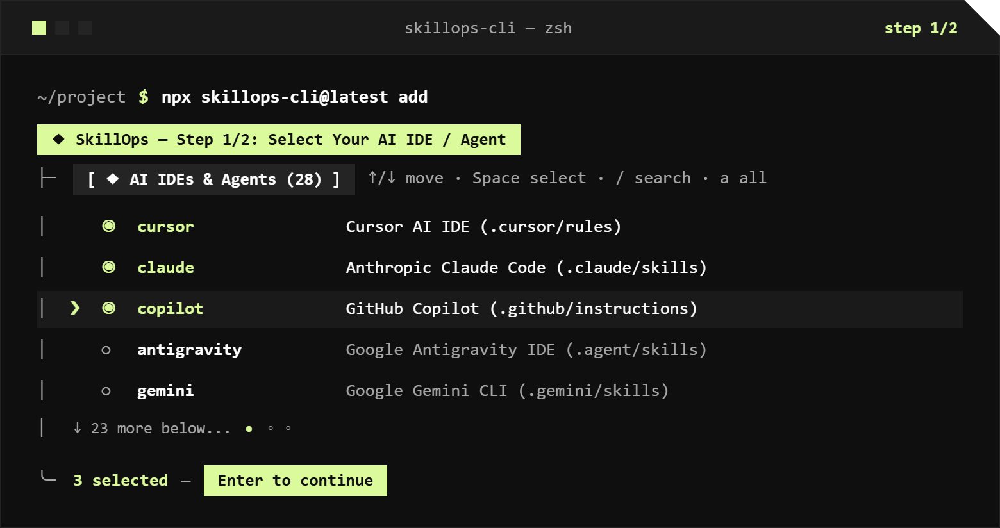
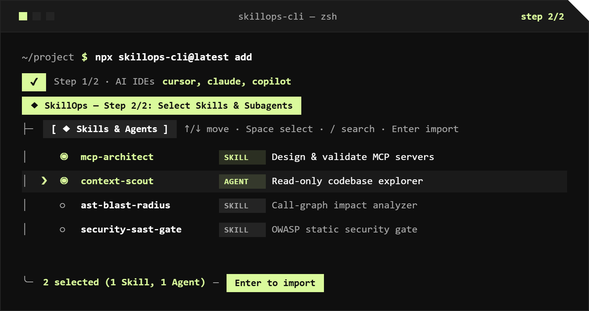
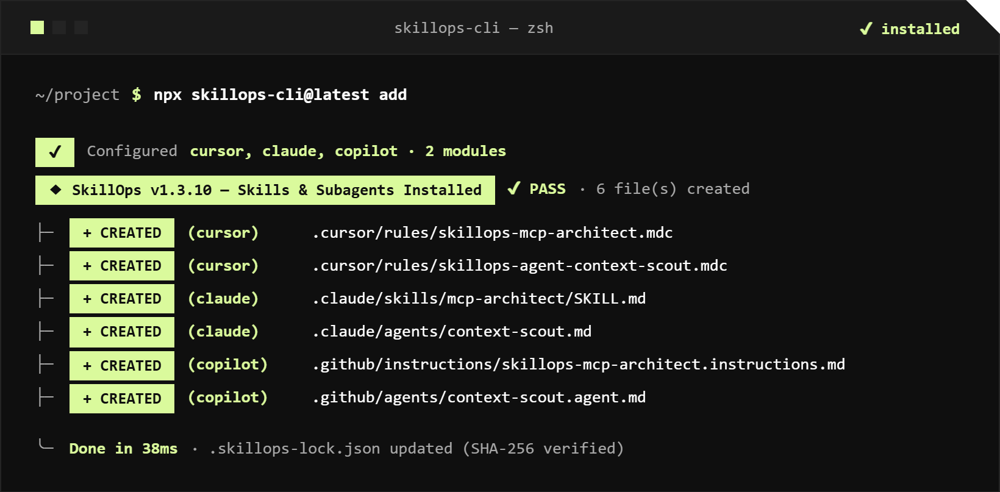

<div align="center">


<p>
  <a href="../README.md"></a>
  <a href="./README.pt-BR.md"></a>
  <a href="./README.es.md"></a>
</p>

<p>
  <a href="https://www.npmjs.com/package/skillops-cli"></a>
  <a href="https://github.com/OdevMatheus/SkillOps/actions/workflows/ai-ci.yml"></a>
  <a href="https://github.com/OdevMatheus/SkillOps/actions/workflows/codeql.yml"></a>
  <a href="#ides-e-clis-de-ia-suportados-28"></a>
  <a href="../LICENSE"></a>
</p>

<p>
  <strong>Uma biblioteca open-source de Skills (<code>SKILL.md</code>) e Subagents (<code>SUBAGENT.md</code>). Instalação nativa para 28 ferramentas de IA.</strong><br>
  Cursor, Claude Code, GitHub Copilot, Antigravity, Windsurf, Codex, Gemini CLI, Cline, Roo Code, Kiro e mais — 100% local, zero chaves de API.
</p>

</div>

---

## Início Rápido

Execute dentro de qualquer repositório para iniciar o TUI interativo em 2 passos:

```bash
npx skillops-cli@latest add
```

| 1. Selecione sua IDE / Agente de IA | 2. Selecione Skills e Subagents |
| :---: | :---: |
|  |  |

<div align="center">
  <p><strong>3. Relatório de Transpilação Nativa e Instalação</strong></p>
  
</div>

### Referência da CLI

Instale globalmente (`npm i -g skillops-cli`) ou execute diretamente com `npx skillops-cli@latest`:

| Comando | Ação |
| :--- | :--- |
| `skillops add` | Abre o TUI interativo (selecione as IDEs de IA de destino → selecione Skills e Subagents) |
| `skillops add <name...> -t cursor,claude` | Instalação não interativa em alvos específicos (`-t all` para todas as 28 ferramentas) |
| `skillops remove [name...]` | Desinstala artefatos gerenciados de forma interativa ou direta e atualiza o `.skillops-lock.json` |

> **Flags:** `--all` seleciona todos os itens do catálogo, `--dry-run` pré-visualiza os caminhos de destino sem gravar no disco e `--force` sobrescreve arquivos modificados localmente.

---

## Por que o SkillOps?

<table>
<tr>
<td width="33%" valign="top">

### ◆ Transpilador Nativo para 28 IDEs
Escreva uma única vez em `catalog/`. O SkillOps compila cada `SKILL.md` (incluindo `scripts/` e `references/` empacotados) e `SUBAGENT.md` na estrutura de pastas e frontmatter exatos exigidos por cada IDE ou CLI.

</td>
<td width="33%" valign="top">

### ⚡ Orçamento de Tokens em 3 Camadas
Evita o inchaço da janela de contexto: roteamento YAML **L1** (`≤ 160` tokens), instruções de workflow **L2** (`≤ 250` linhas) e ferramentas determinísticas em Python **L3** (`0` tokens em repouso). Subagents rodam em contextos filhos isolados (`≤ 400` tokens de saída).

</td>
<td width="34%" valign="top">

### 🔒 Proteção contra Conflitos SHA-256
Cada arquivo gerado é rastreado no `.skillops-lock.json` com um hash criptográfico. Edições manuais em `.cursor/`, `.claude/` ou `.github/` nunca são sobrescritas ou removidas, a menos que `--force` seja informado.

</td>
</tr>
</table>

---

## IDEs e CLIs de IA Suportados (28)

| ID do Alvo | IDE / CLI de IA | Caminho de Saída (Skills) | Caminho de Saída (Subagents) |
| :--- | :--- | :--- | :--- |
| `cursor` | **Cursor AI IDE** | `.cursor/rules/skillops-<name>.mdc` | `.cursor/rules/skillops-agent-<name>.mdc` |
| `claude` | **Anthropic Claude Code** | `.claude/skills/<name>/SKILL.md` | `.claude/agents/<name>.md` |
| `copilot` | **GitHub Copilot** | `.github/instructions/skillops-<name>.instructions.md` | `.github/agents/<name>.agent.md` |
| `antigravity` | **Google Antigravity IDE** | `.agent/skills/<name>/SKILL.md` | `.agent/agents/<name>.md` |
| `windsurf` | **Windsurf AI IDE** | `.windsurf/rules/skillops-<name>.md` | `.windsurf/workflows/skillops-agent-<name>.md` |
| `codex` | **OpenAI Codex CLI** | `.codex/skills/<name>/SKILL.md` + `AGENTS.md` | `.codex/agents/<name>.md` |
| `gemini` | **Google Gemini CLI** | `.gemini/skills/<name>/SKILL.md` | `.gemini/agents/<name>.md` |
| `cline` | **Cline** | `.clinerules/skillops-<name>.md` | `.clinerules/workflows/skillops-agent-<name>.md` |
| `roocode` | **Roo Code** | `.roo/rules/skillops-<name>.md` | `.roo/rules-architect/skillops-agent-<name>.md` |
| `kiro` | **AWS Kiro IDE** | `.kiro/steering/skillops-<name>.md` | `.kiro/agents/<name>.md` |

<details>
<summary><b>Ver todas as 18 IDEs e CLIs de IA adicionais suportadas (28 no total)</b></summary>

| ID do Alvo | IDE / CLI de IA | Caminho de Saída (Skills) | Caminho de Saída (Subagents) |
| :--- | :--- | :--- | :--- |
| `kilocode` | **Kilo Code** | `.kilocode/rules/skillops-<name>.md` | `.kilocode/workflows/skillops-agent-<name>.md` |
| `zed` | **Zed AI** | `.zed/rules/skillops-<name>.md` | `.zed/rules/skillops-agent-<name>.md` |
| `continue` | **Continue.dev** | `.continue/rules/skillops-<name>.md` | `.continue/prompts/skillops-agent-<name>.prompt` |
| `aider` | **Aider** | `.aider/conventions/skillops-<name>.md` | `.aider/conventions/skillops-agent-<name>.md` |
| `trae` | **Trae AI IDE** | `.trae/rules/skillops-<name>.md` | `.trae/agents/<name>.md` |
| `augment` | **Augment Code** | `.augment/rules/skillops-<name>.md` | `.augment/agents/<name>.md` |
| `factory` | **Factory AI Droid** | `.factory/skills/<name>/SKILL.md` | `.factory/droids/<name>.md` |
| `qwen` | **Qwen Code CLI** | `.qwen/skills/<name>/SKILL.md` | `.qwen/agents/<name>.md` |
| `opencode` | **OpenCode CLI** | `.opencode/skills/<name>/SKILL.md` | `.opencode/agent/<name>.md` |
| `openhands` | **OpenHands** | `.openhands/microagents/skillops-<name>.md` | `.openhands/microagents/skillops-agent-<name>.md` |
| `amp` | **Sourcegraph Amp** | `.amp/skills/<name>/SKILL.md` | `.amp/agents/<name>.md` |
| `goose` | **Block Goose** | `.goose/skills/<name>/SKILL.md` | `.goose/agents/<name>.md` |
| `warp` | **Warp AI Terminal** | `.warp/skills/<name>/SKILL.md` | `.warp/agents/<name>.md` |
| `crush` | **Charmbracelet Crush** | `.crush/skills/<name>/SKILL.md` | `.crush/agents/<name>.md` |
| `vibe` | **Mistral Vibe CLI** | `.vibe/skills/<name>/SKILL.md` | `.vibe/agents/<name>.md` |
| `junie` | **JetBrains Junie** | `.junie/skills/skillops-<name>.md` | `.junie/agents/<name>.md` |
| `amazonq` | **Amazon Q Developer** | `.amazonq/rules/skillops-<name>.md` | `.amazonq/cli-agents/<name>.md` |
| `idx` | **Firebase Studio (IDX)** | `.idx/rules/skillops-<name>.md` | `.idx/agents/<name>.md` |

</details>

---

## Modelo de Segurança e Confiança (Defesa em Profundidade em 5 Pilares)

Instalar Skills de IA e scripts auxiliares executáveis na sua IDE exige garantias rigorosas na cadeia de suprimentos. O **SkillOps** aplica uma **Arquitetura de Segurança em 5 Pilares** ([`.github/SECURITY.md`](../.github/SECURITY.md) e `INV-SKILL-06` em [`SKILL_CONTRACT.md`](../SKILL_CONTRACT.md)) para que nenhuma skill maliciosa ou não revisada entre no catálogo:

| Pilar | Garantia | Como é Aplicado |
| :--- | :--- | :--- |
| **1. Catálogo 100% Curado e Revisado por Mantenedor** | Zero download de URLs remotas arbitrárias; cada Skill e Subagent é revisada linha a linha por um mantenedor humano antes do merge. | Ruleset protegido na `main` + [`.github/CODEOWNERS`](../.github/CODEOWNERS) (`require_code_owner_review: true` e revogação automática de aprovações anteriores em novos commits). |
| **2. Gate Determinístico AST e CodeQL (`INV-SKILL-06`)** | Scripts empacotados rodam offline usando a biblioteca padrão — sem exfiltrar dados ou executar strings arbitrárias de shell. | [`src/auditor/security.ts`](../src/auditor/security.ts) + [`.github/workflows/ai-ci.yml`](../.github/workflows/ai-ci.yml) + **GitHub CodeQL SAST** bloqueiam clientes de rede (`urllib.request`, `http.client`, `socket`, `requests`, `curl \| sh`), `eval()`/`exec()`/`pickle` e `os.system()`/`shell=True`. |
| **3. Guardas Anti-Trojan Unicode e de Fronteira** | Protege revisores de PR e LLMs contra prompt injection invisível, binários ocultos e path traversal. | Bloqueia Unicode bidirecional CVE-2021-42574 (`U+202A..U+202E`), Tags Unicode invisíveis para LLMs (`U+E0000..U+E007F`), symlinks, binários/arquivos compactados (`.exe`, `.dll`, `.so`, `.pyc`, `.zip`) e escapes de caminho `..` (`resolveSafeRepoTargetPath`). |
| **4. Proveniência Criptográfica no NPM** | Cada versão publicada do `skillops-cli` é criptograficamente vinculada ao commit exato do GitHub e ao build de CI. | Publicado via GitHub Actions com `npm publish --provenance` (verificável via `npm audit signatures`). |
| **5. `--dry-run` Local e Lockfile SHA-256** | Pré-visualize cada arquivo planejado antes de gravar em disco e detecte modificações locais não autorizadas. | `npx skillops-cli add <name> --dry-run` + hashes criptográficos SHA-256 em `.skillops-lock.json`. |

---

## Como Contribuir (Open Source em Duas Trilhas)

O SkillOps utiliza um fluxo de contribuição em duas trilhas para que a comunidade possa adicionar novas **Skills** e **Subagents** sem burocracia:

| Trilha | Escopo | Exige Issue? | Como Contribuir |
| :--- | :--- | :---: | :--- |
| **Trilha A — Biblioteca (`catalog/`)** | Novas **Skills (`SKILL.md`)** e **Subagents (`SUBAGENT.md`)** ou melhorias | **Não — PR Direto** | Adicione sua pasta em `catalog/<track>/<slug>/` ou `catalog/subagents/<slug>/` e abra um PR diretamente |
| **Trilha B — Core CLI (`src/`)** | Comandos da CLI, componentes TUI, transpilador das 28 IDEs ou schemas | **Sim — Issue Primeiro** | Abra uma Issue para alinhar o escopo antes de enviar um Pull Request |

- 🛡️ [**Política de Segurança e Modelo de Confiança (`.github/SECURITY.md`)**](../.github/SECURITY.md)
- 📖 [**Guia de Contribuição (`CONTRIBUTING.md`)**](../CONTRIBUTING.md)
- 📜 [**Contrato de Skills e Subagents (`SKILL_CONTRACT.md`)**](../SKILL_CONTRACT.md)
- ⚖️ Licenciado sob a [**Licença MIT**](../LICENSE) — Desenvolvido por [**@OdevMatheus**](https://github.com/OdevMatheus)
