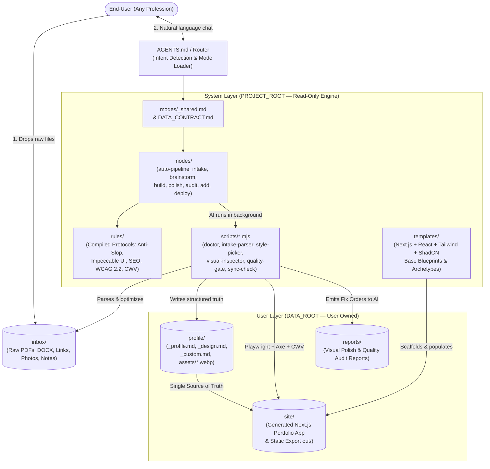
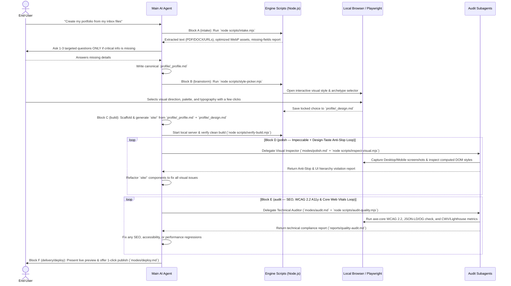

# FolioOps — System Architecture & Design Specification

> **Status:** Builder Check Passed — Ready for Stakeholder Review & Approval  
> **Date:** 2026-10-29  
> **Architecture Pattern:** `career-ops`-Inspired Mode Router + Mandatory Block Protocols + AI-Executed Verification Scripts

---

## 1. Intent & The Why

**FolioOps** exists so that **any professional from any industry** (medicine, law, architecture, design, academia, consulting, engineering, arts, etc.) — including people who have never written a single line of code — can clone this repository, talk naturally to an AI Agent (Claude Code, Antigravity, Cursor, GitHub Copilot, Gemini CLI, Codex), and produce an **award-level, accessible, SEO-optimized, high-performance Web portfolio** ready to publish online.

Most AI-generated portfolios fail in two ways:
1. **High Technical Friction:** They require the end-user to manually configure frameworks, edit JSON/Markdown schemas by hand, or debug terminal build errors.
2. **Generic "AI Slop" Output:** When an AI generates a portfolio in a single unguided prompt, it produces repetitive layouts, generic purple gradients, poor typography, weak visual hierarchy, missing SEO metadata, and broken accessibility.

To solve both problems simultaneously, **FolioOps** models its engine after the proven **`career-ops`** operational architecture:
- **The User Only Talks to the AI:** The human never runs terminal commands or edits code manually. They simply drop their raw files into `inbox/` and converse with the AI.
- **The AI Operates on Steel Rails:** Instead of relying on loose optional skills or LLM memory, the repository enforces a deterministic pipeline of **Modes (`modes/`)**, **Mandatory Rule Blocks (`rules/`)**, and **AI-Executed Helper Scripts (`scripts/*.mjs`)** that inspect the real DOM, screenshots, and Web Vitals before allowing the pipeline to complete.

---

## 2. Goals, Non-Goals & Anti-Goals

### 2.1 Goals
1. **Zero-Friction User Input (`inbox/` → `profile/`):** Allow users to drop raw files (PDF/DOCX resumes, LinkedIn exports, photos, project images, loose `.txt` notes, and URLs) into `inbox/` and have the AI automatically extract, optimize images (`WebP`), and synthesize a structured source of truth in `profile/`.
2. **Interactive Visual Brainstorming (`profile/_design.md`):** Guide the user through a low-friction visual style selection where curated art-direction archetypes (layout, typography pairings, color systems, motion style) are presented visually in the browser for the user to pick with a few clicks.
3. **Top-Tier Portfolio Engineering (`site/`):** Generate the portfolio on a premier modern web stack (**Next.js App Router with Static Export, React 19, Tailwind CSS, ShadCN UI, and Motion**) backed by a rich component ecosystem.
4. **Mandatory Multi-Gate Refinement (`polish` + `audit`):** Enforce automated post-generation passes incorporating:
   - **Visual Polish & Anti-Slop (`impeccable` + `design-taste-frontend` rules):** Real browser rendering via Playwright across Desktop (`1440x900`) and Mobile (`390x844`) viewports to detect and eliminate generic AI aesthetics, contrast failures, clipped elements, and spacing imbalances.
   - **Technical Quality Gate (`seo` + `accessibility` + `performance` + `core-web-vitals` rules):** Automated verification of JSON-LD structured data, Open Graph, `sitemap.xml`, `robots.txt`, WCAG 2.2 AA accessibility (`axe-core`), and Core Web Vitals (LCP, CLS, INP).
5. **Effortless Future Updates (`modes/add.md` & `modes/update.md`):** Decouple content (`profile/`) from presentation (`site/`) so that months later a user can add a new job or case study without losing or regenerating their chosen visual design.

### 2.2 Non-Goals
- Building a SaaS hosted multi-tenant platform with user accounts, billing, or cloud databases (FolioOps is 100% local-first and Git-based).
- Requiring the end-user to learn React, Tailwind, Git CLI, or command-line flags.
- Providing a CMS backend (WordPress/Strapi); all data lives cleanly in versioned local files under `profile/`.

### 2.3 Anti-Goals (What Would Make This a Failure Even If It Works Technically)
- **Shipping "AI Slop":** If the generated site looks like a generic AI template (neon-on-dark gradients, centered 3-card feature grids with Lucide icons for a lawyer's portfolio, or default Inter/Roboto typography everywhere), the architecture has failed.
- **Inventing User Facts (Hallucination):** If the AI fabricates metrics, clients, degrees, or testimonials not present in `inbox/` or confirmed by the user, the system has violated its core contract.
- **Exposing Terminal Complexity to Non-Tech Users:** If the AI asks a non-technical user to "run `npm install --legacy-peer-deps` and fix the TypeScript error in `page.tsx`", the system has failed. The AI must run and self-heal all scripts and builds silently.

---

## 3. Architectural Constraints

1. **Multi-CLI Compatibility:** Must work seamlessly across Claude Code (`CLAUDE.md`), Google Antigravity / Gemini CLI (`GEMINI.md`), Cursor, GitHub Copilot (`.github/copilot-instructions.md`), and OpenAI Codex (`AGENTS.md`).
2. **Single Runtime Dependency (Node.js LTS):** All helper scripts (`scripts/*.mjs`), browser inspectors (Playwright), and the portfolio framework (`site/`) must run on **Node.js** so end-users never have to manage multiple language runtimes (e.g., Python + pip + virtualenv + Node).
3. **Strict Data Isolation (`DATA_CONTRACT.md`):** User data (`inbox/`, `profile/`, `config/profile.yml`, `site/`) must be cleanly separated from system engine files (`modes/`, `rules/`, `scripts/`, `templates/`) so system updates (`modes/update.md`) never overwrite the user's personal portfolio or profile data.
4. **Repository Language Policy:** All tracked engine/architecture files must be in **English (`en-US`)** with a local **Portuguese (`pt-BR`)** mirror in `DOCS-DEV/` (gitignored), while the AI always interacts with the end-user in the user's own language (`config/profile.yml -> language.output`).

---

## 4. Approaches Considered & Selected

| Approach | Description | Trade-offs | Verdict |
| :--- | :--- | :--- | :--- |
| **Approach 1 (Selected): `career-ops`-Style Mode Router + Modular `modes/` + AI-Executed `scripts/*.mjs` + Subagent Delegation** | `AGENTS.md` routes user intent to modular `modes/{mode}.md` files. Mandatory rules (`impeccable`, `design-taste`, `seo`, `a11y`, `cwv`) are compiled into deterministic execution blocks inside `modes/` and `rules/`. The AI executes Node.js helper scripts (`scripts/*.mjs`) and delegates heavy inspection/audit passes to subagents. | Requires careful design of the mode contracts and helper scripts (`intake.mjs`, `style-picker.mjs`, `inspect-visual.mjs`, `audit-quality.mjs`), but keeps context windows sharp and guarantees deterministic execution. | **Selected** — Matches the proven `career-ops` reliability model while keeping user interaction 100% conversational. |
| **Approach 2: Monolithic Single-Context Prompt + Loose Optional Skills** | Keep all instructions in one giant prompt and rely on the AI voluntarily invoking external skill files in the right order. | Suffers from severe context dilution: by the time the AI finishes building the UI, it forgets fine-grained anti-slop typography rules and skips accessibility/SEO checks. | **Rejected** — Unreliable and non-deterministic. |
| **Approach 3: Hybrid Python + Node.js CLI Run Manually by the User** | Require the user to run Python and Node CLI commands manually at each step and paste outputs back to the AI. | Breaks the conversational UX for non-technical users and doubles environment setup failures (Python + Node). | **Rejected** — Violates zero-friction goal. |

---

## 5. System Architecture Overview

### 5.1 High-Level Component & Data Flow Diagram



---

### 5.2 The `auto-pipeline` 6-Block Execution Sequence

When a user drops files into `inbox/` and asks the AI to build their portfolio, the Router triggers `modes/auto-pipeline.md`, which executes 6 sequential gated blocks:



---

## 6. Target Repository Directory Architecture

Once all Infrastructure, DevOps, and Product Sprints are implemented, the repository will follow this strict separation between **System Layer** and **User Layer**:

```text
FolioOps/
├── .github/                  # DevOps Governance, CI workflows, templates & maintenance agents
├── docs/
│   └── architecture/         # System Architecture Spec & Architecture Decision Records (ADRs)
│       ├── README.md
│       └── adr/
│           ├── 0001-career-ops-mode-driven-pipeline-architecture.md
│           ├── 0002-two-stage-user-data-layer-inbox-and-profile.md
│           ├── 0003-portfolio-frontend-stack-nextjs-static-export.md
│           └── 0004-multi-stage-quality-and-anti-slop-verification-gates.md
├── modes/                    # System Layer: Operational Mode Definitions (loaded on demand)
│   ├── _shared.md            # Global context, Data Contract rules, Output Language directive
│   ├── auto-pipeline.md      # End-to-end 6-Block orchestrator (Intake -> Brainstorm -> Build -> Polish -> Audit -> Deploy)
│   ├── intake.md             # Block A: Inbox ingestion, link fetching, asset optimization & gap interview
│   ├── brainstorm.md         # Block B: Interactive visual archetype & art-direction selector
│   ├── build.md              # Block C: Next.js/React/Tailwind/ShadCN portfolio generation
│   ├── polish.md             # Block D: Impeccable + Design-Taste anti-slop browser inspection loop
│   ├── audit.md              # Block E: SEO, WCAG 2.2 Accessibility & Core Web Vitals gate
│   ├── add.md                # Incremental update mode (add new project/role without touching design)
│   ├── deploy.md             # Block F: Zero-cost automated publishing (GitHub Pages / Vercel)
│   └── update.md             # Safe system engine updater (preserves User Layer files)
├── rules/                    # System Layer: Mandatory Compiled Rulebooks (referenced by modes/)
│   ├── anti-slop-design.md   # Distilled from design-taste-frontend (banned clichés, typography/color rules)
│   ├── impeccable-ui.md      # Distilled from impeccable (spacing, visual hierarchy, micro-interactions)
│   ├── seo-schema.md         # Distilled from seo (JSON-LD Person/ProfessionalService, OG, sitemap)
│   ├── wcag-accessibility.md # Distilled from accessibility (WCAG 2.2 AA, keyboard nav, ARIA, contrast)
│   └── core-web-vitals.md    # Distilled from performance & core-web-vitals (LCP, CLS, INP budgets)
├── scripts/                  # System Layer: Deterministic Node.js Helpers (Executed by the AI)
│   ├── doctor.mjs            # Environment & Data Contract health check
│   ├── intake.mjs            # Parses PDFs/DOCX/TXT in inbox/, optimizes images to WebP in profile/assets/
│   ├── style-picker.mjs      # Launches local browser UI for visual brainstorming & writes profile/_design.md
│   ├── inspect-visual.mjs    # Playwright headless inspector (screenshots + computed style anti-slop checks)
│   ├── audit-quality.mjs     # Runs axe-core, SEO/JSON-LD validator, and CWV performance checks
│   └── sync-check.mjs        # Verifies that all facts in profile/_profile.md are accurately reflected in site/
├── templates/                # System Layer: Base Next.js + Tailwind + ShadCN Blueprints & Archetypes
├── inbox/                    # User Layer (Gitignored contents): Dropzone for raw user files (PDFs, photos, notes)
├── profile/                  # User Layer: Canonical Single Source of Truth (_profile.md, _design.md, assets/)
├── site/                     # User Layer: Generated Next.js portfolio application & static build output
├── reports/                  # User Layer (Gitignored): Automated visual & technical audit reports
├── DATA_CONTRACT.md          # Canonical boundary between System Layer and User Layer
├── AGENTS.md                 # Entrypoint & Mode Router for AI Agents
├── CLAUDE.md                 # Claude Code entrypoint (@AGENTS.md)
└── GEMINI.md                 # Antigravity / Gemini entrypoint (@AGENTS.md)
```

---

## 7. Key Decisions Made with the Stakeholder vs. Left to the Builder

### 7.1 Decided by Stakeholder (Locked)
1. **Interaction Model:** The user never manually runs scripts or edits schemas; they drop files in `inbox/` and talk to the AI, which executes a strict `career-ops`-style process (`modes/` + embedded mandatory rules + AI-executed `scripts/`).
2. **Data Flow (`inbox/` → `profile/`):** Two-stage data layer where raw files/links/images in `inbox/` are processed and refactored into `profile/`, separating content from presentation.
3. **Visual Brainstorming:** The AI offers interactive styling options via brainstorming (including a visual browser companion) so the user selects their aesthetic direction with a few clicks before code generation.
4. **Portfolio Stack:** Top-tier modern framework ecosystem (**Next.js App Router with Static Export, React 19, Tailwind CSS, ShadCN UI, and Motion**).
5. **Post-Generation Mandatory Pipeline:** Every generated portfolio must pass through `impeccable` + `design-taste-frontend` (to eliminate any "AI-made" look) followed by `seo`, `accessibility`, and `performance`/`core-web-vitals` verification gates.

### 7.2 Left to the Builder (Implementation Details for Future Sprints)
- Exact JSON/YAML frontmatter field names inside `profile/_profile.md` and `profile/_design.md` (to be specified in `DATA_CONTRACT.md` during the Architecture/Contract milestone).
- Specific NPM library choices for local PDF/DOCX extraction inside `scripts/intake.mjs` (e.g., `unpdf` / `mammoth` / `sharp`).
- Visual layout of the local browser `style-picker.mjs` companion UI.
- Exact scoring thresholds in `scripts/audit-quality.mjs` (defaulting to: `0` critical/serious axe-core violations, `100` SEO checklist score, `CLS < 0.1`, `LCP < 2.5s`).

---

## 8. Architecture Decision Records (ADR Index)

| ADR | Title | Status |
| :--- | :--- | :--- |
| [ADR-0001](./adr/0001-career-ops-mode-driven-pipeline-architecture.md) | Adopt `career-ops`-Style Mode Router, Embedded Mandatory Rules, and AI-Executed Scripts | Proposed |
| [ADR-0002](./adr/0002-two-stage-user-data-layer-inbox-and-profile.md) | Two-Stage User Data Layer (`inbox/` Raw Dropzone → `profile/` Canonical Source of Truth) | Proposed |
| [ADR-0003](./adr/0003-portfolio-frontend-stack-nextjs-static-export.md) | Top-Tier Portfolio Frontend Stack (Next.js Static Export + React 19 + Tailwind + ShadCN UI + Motion) | Proposed |
| [ADR-0004](./adr/0004-multi-stage-quality-and-anti-slop-verification-gates.md) | Multi-Stage Quality Gates (Visual Anti-Slop Polish via Playwright + Automated SEO, WCAG 2.2 & CWV Audits) | Proposed |
