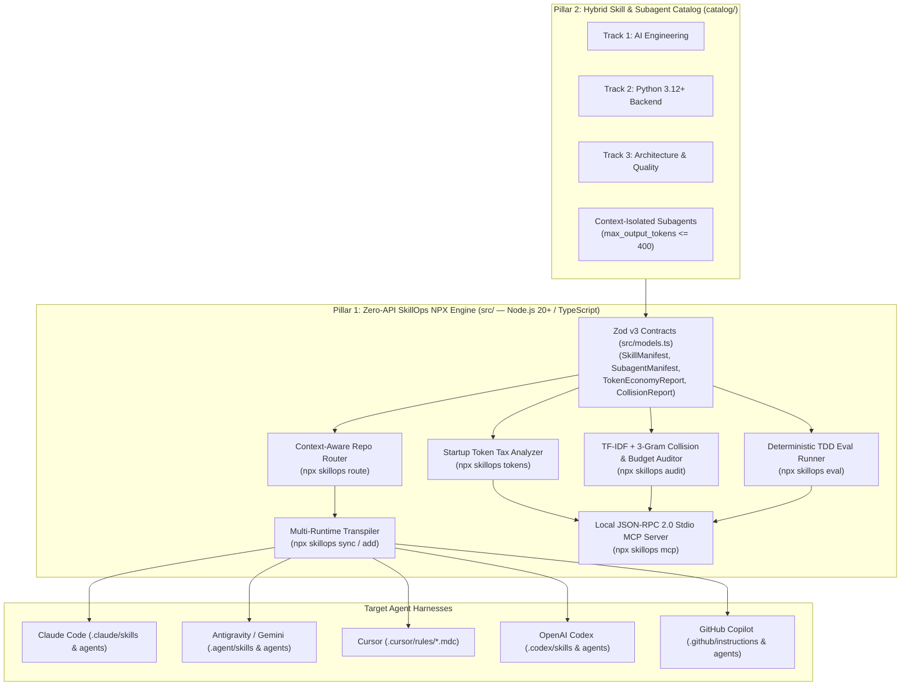

# SkillOps — Architecture Documentation (`v0.5.0` NPX Engine)

Welcome to the architectural documentation for **SkillOps** (`npx skillops@latest`), the **Zero-API Node.js 20+ / TypeScript Engine & Benchmark-Verified Library for AI Coding Agent Skills & Context-Isolated Subagents**.

---

## 1. Architectural Vision & Problem Space

Modern AI coding assistants (Claude Code, Antigravity/Gemini CLI, Cursor, OpenAI Codex CLI, GitHub Copilot) rely on modular **Skills** (`SKILL.md` playbooks, scripts, and references) and **Subagents** to specialize agent behavior. However, as engineering teams scale from 5 skills to 50–100+ skills, two failure modes documented in 2026 AI systems research emerge:

1. **Implicit Routing Collapse (`arXiv:2610.18522` — *Lost in Implicit Routing*):**
   Loading dozens of skills with overlapping natural-language descriptions into the system prompt degrades agent routing recall from **73.6% down to 27.4%** and consumes up to **12,000+ tokens** before the user types a single prompt.
2. **Skill-Induced Failures & Startup Token Tax (`arXiv:2608.11888` — *Agent Skills Can Be Harmful*):**
   Static markdown skills without executable verification tools or comparative `with_skill` vs. `without_skill` benchmarks frequently **reduce** task pass rates while inflating token usage by 30%–200%.

**SkillOps** solves both problems through a **100% Zero-API, Offline-First** two-pillar architecture:
- **Pillar 1 — The `npx skillops@latest` Core Engine (`src/`):** A pure Node.js 20+ / TypeScript CLI and local JSON-RPC 2.0 `stdio` MCP server with **zero external API keys and zero HTTP servers**. It analyzes repository Startup Token Tax (`npx skillops tokens`), audits skill catalogs for semantic collisions and token budgets (`npx skillops audit`), routes optimal `<= 12` skill + subagent bundles per repository (`npx skillops route`), transpiles and syncs artifacts across 5 runtimes (`npx skillops sync` / `npx skillops add`), and runs deterministic AST & subprocess TDD `with_skill` vs. `without_skill` benchmarks (`npx skillops eval`).
- **Pillar 2 — The Benchmark-Verified Catalog (`catalog/`):** Hybrid executable skills across 3 tracks (`ai-engineering`, `python-backend`, `arch-quality`) plus context-isolated subagents (`catalog/subagents/`), where every skill pairs a concise `<= 250`-line `SKILL.md` with a deterministic Python 3.12+ CLI tool (`scripts/*.py --json`) and a TDD evaluation suite (`evals/evals.json` + `evals/benchmark.json`).

---

## 2. High-Level System Architecture



---

## 3. Canonical Skill Contract & ADRs

| Document | Title | Summary |
| :--- | :--- | :--- |
| **[`SKILL_CONTRACT.md`](../../SKILL_CONTRACT.md)** | **Normative Skill, Subagent, Audit & Benchmark Contract** | Defines the hybrid skill layout, 3-level token budgets (`L1 <= 160 tokens`, `L2 <= 250 lines`), subagent caps (`max_output_tokens <= 400`), `evals.json` & `benchmark.json` schemas, and the `npx skillops` CLI interface. |
| **[`ADR-0001`](./adr/0001-hybrid-executable-skills-architecture.md)** | **Hybrid Executable Skills Architecture** | Explains why every skill pairs a concise `SKILL.md` with a deterministic Python 3.12+ CLI tool (`scripts/*.py`) and `evals/`. |
| **[`ADR-0002`](./adr/0002-semantic-collision-auditor-and-token-budgeting.md)** | **Semantic Collision Auditor & Token Budgeting** | Details the zero-API pairwise cosine similarity audit (`>= 0.72` high-risk, `>= 0.85` error) and 3-level progressive disclosure token limits. |
| **[`ADR-0003`](./adr/0003-context-aware-dynamic-router-and-multi-runtime-sync.md)** | **Context-Aware Dynamic Router & Multi-Runtime Sync** | Describes repository stack fingerprinting (`npx skillops route`) and multi-runtime transpilation (`npx skillops sync`). |
| **[`ADR-0004`](./adr/0004-zero-api-tdd-evaluation-and-stdio-mcp.md)** | **Zero-API Deterministic TDD Skill Evaluation Engine & Stdio MCP** | Specifies offline deterministic AST/subprocess `with_skill` vs. `without_skill` benchmarking (`npx skillops eval`) and local JSON-RPC 2.0 `stdio` MCP server (`npx skillops mcp`). |

---

## 4. Source Code Layout (`src/`)

```text
SkillOps/
├── SKILL_CONTRACT.md            # Normative specification for Skills, Subagents, Audits, Routing & Evals
├── package.json                 # Node.js 20+ NPX package (`npx skillops@latest`), scripts & dependencies
├── tsconfig.json                # Strict TypeScript 5.8 configuration
├── tsup.config.ts               # ESM bundle + shebang CLI builder (`dist/cli.js`, `dist/index.js`)
├── vitest.config.ts             # Vitest test runner configuration
├── src/
│   ├── index.ts                 # Public TypeScript library exports
│   ├── cli.ts                   # NPX CLI entrypoint (init, list, add, tokens, audit, route, sync, eval, mcp)
│   ├── models.ts                # Zod v3 strict schemas (SkillManifest, SubagentManifest, TokenEconomyReport, etc.)
│   ├── auditor/                 # Zero-API TF-IDF collision detector, 3-level token budget & Startup Token Tax analyzer
│   ├── router/                  # Repository stack fingerprinter & greedy collision-free bundle compiler
│   ├── sync/                    # Multi-runtime transpilers (Claude, Antigravity, Cursor, Codex, Copilot)
│   ├── eval/                    # Zero-API deterministic TDD with_skill vs without_skill runner
│   └── mcp/                     # Local JSON-RPC 2.0 stdio MCP server exposing 6 SkillOps tools
├── catalog/                     # Benchmark-Verified Hybrid Executable Skills & Subagents
│   ├── ai-engineering/
│   ├── python-backend/
│   └── arch-quality/
└── tests/                       # Vitest unit, contract, token-economy, and stress test suites
```
