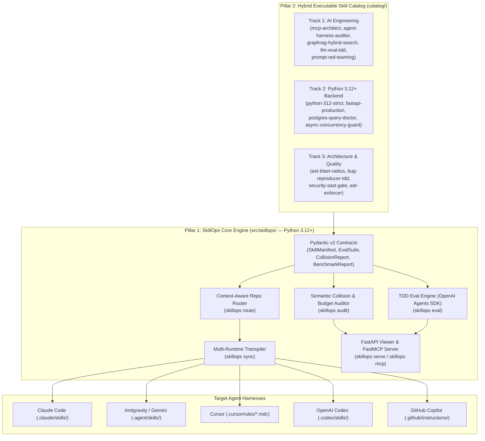

# SkillOps — Architecture Documentation (`v0.2.0`)

Welcome to the architectural documentation for **SkillOps**, the **Python 3.12+ Engine & Benchmark-Verified Library for AI Coding Agent Skills & Subagents**.

---

## 1. Architectural Vision & Problem Space

Modern AI coding assistants (Claude Code, Antigravity/Gemini CLI, Cursor, OpenAI Codex CLI, GitHub Copilot) rely on modular **Skills** (`SKILL.md` playbooks, scripts, and references) to specialize agent behavior. However, as engineering teams scale from 5 skills to 50–100+ skills, two failure modes documented in 2026 AI systems research emerge:

1. **Implicit Routing Collapse (`arXiv:2610.18522` — *Lost in Implicit Routing*):**
   Loading dozens of skills with overlapping natural-language descriptions into the system prompt degrades agent routing recall from **73.6% down to 27.4%** and consumes up to **12,000+ tokens** before the user types a single prompt.
2. **Skill-Induced Failures (`arXiv:2608.11888` — *Agent Skills Can Be Harmful*):**
   Static markdown skills without executable verification tools or comparative `with_skill` vs. `without_skill` benchmarks frequently **reduce** task pass rates while inflating token usage by 30%–200%.

**SkillOps** solves both problems through a two-pillar architecture:
- **Pillar 1 — The `SkillOps` Core Engine (`src/skillops/`):** A strict Python 3.12+ CLI, FastAPI server, and FastMCP server that audits skill catalogs for semantic collisions and token budgets (`skillops audit`), routes optimal 5–12 skill bundles per repository (`skillops route`), transpiles and syncs skills across 5 runtimes (`skillops sync`), and runs TDD `with_skill` vs. `without_skill` benchmarks via the OpenAI Agents SDK (`skillops eval`).
- **Pillar 2 — The Elite Executable Skill Catalog (`catalog/`):** 13 hybrid executable skills across 3 tracks (`ai-engineering`, `python-backend`, `arch-quality`), where every skill pairs a concise `< 250`-line `SKILL.md` with a deterministic Python 3.12+ CLI tool (`scripts/*.py`) and a TDD evaluation suite (`evals/evals.json` + `evals/benchmark.json`).

---

## 2. High-Level System Architecture



---

## 3. Canonical Skill Contract & ADRs

All architectural invariants and design trade-offs are documented in our normative specification and Architecture Decision Records (ADRs):

| Document | Title | Summary |
| :--- | :--- | :--- |
| **[`SKILL_CONTRACT.md`](../../SKILL_CONTRACT.md)** | **Normative Skill, Audit & Benchmark Contract** | Defines the hybrid skill layout, 3-level token budgets (`L1 <= 90 tokens`, `L2 <= 250 lines`), `evals.json` & `benchmark.json` schemas, and the `SkillOps` CLI interface. |
| **[`ADR-0001`](./adr/0001-hybrid-executable-skills-architecture.md)** | **Hybrid Executable Skills Architecture** | Explains why every skill pairs a concise `SKILL.md` with a deterministic Python 3.12+ CLI tool (`scripts/*.py`) and `evals/`. |
| **[`ADR-0002`](./adr/0002-semantic-collision-auditor-and-token-budgeting.md)** | **Semantic Collision Auditor & Token Budgeting** | Details the pairwise cosine similarity audit (`>= 0.78` warning, `>= 0.85` error) and 3-level progressive disclosure token limits. |
| **[`ADR-0003`](./adr/0003-context-aware-dynamic-router-and-multi-runtime-sync.md)** | **Context-Aware Dynamic Router & Multi-Runtime Sync** | Describes repository stack fingerprinting (`skillops route`) and multi-runtime transpilation (`skillops sync`). |
| **[`ADR-0004`](./adr/0004-tdd-skill-evaluation-engine-openai-agents-sdk.md)** | **TDD Skill Evaluation Engine via OpenAI Agents SDK** | Specifies dual-mode (`deterministic` + `live`) `with_skill` vs. `without_skill` benchmarking (`skillops eval`), FastAPI viewer, and FastMCP server. |

---

## 4. Source Code Layout (`src/skillops/`)

```text
SkillOps/
├── SKILL_CONTRACT.md            # Normative specification for Skills, Audits, Routing & Evals
├── pyproject.toml               # Python 3.12+ package, ruff, mypy --strict, pytest config
├── src/
│   └── skillops/
│       ├── __init__.py
│       ├── cli.py               # Typer + Rich CLI entrypoint (audit, route, sync, eval, serve, mcp)
│       ├── models.py            # Pydantic v2 strict models (SkillManifest, EvalSuite, CollisionReport, etc.)
│       ├── auditor/             # Semantic collision detector & 3-level token budget linter
│       ├── router/              # Repository stack fingerprinter & greedy bundle compiler
│       ├── sync/                # Multi-runtime transpilers (Claude, Antigravity, Cursor, Codex, Copilot)
│       ├── eval_engine/         # TDD with_skill vs without_skill runner (OpenAI Agents SDK + deterministic graders)
│       ├── server/              # FastAPI benchmark & audit dashboard (skillops serve)
│       └── mcp/                 # FastMCP server exposing SkillOps tools to AI agents (skillops mcp)
├── catalog/                     # 13 Benchmark-Verified Hybrid Executable Skills
│   ├── ai-engineering/
│   ├── python-backend/
│   └── arch-quality/
└── tests/                       # Pytest unit, contract, and integration test suite
```
