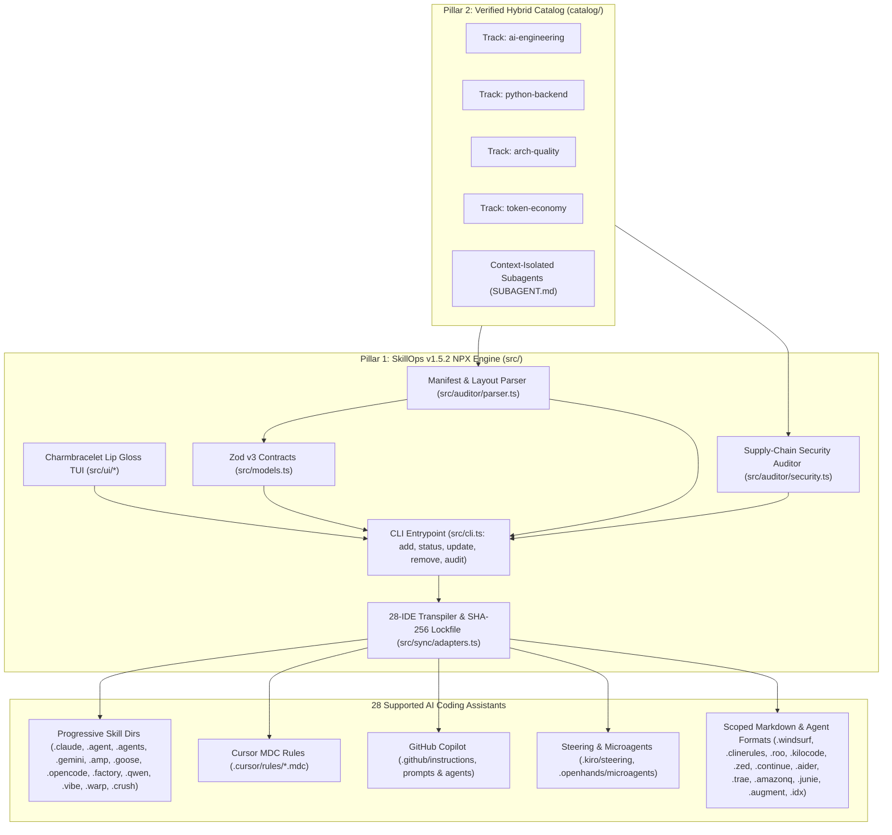

# SkillOps — Architecture Documentation (`v1.5.2` NPX Engine)

Welcome to the architectural documentation for **SkillOps** (`npx skillops-cli@latest`), the **Zero-Bloat Node.js 20+ / TypeScript Multi-IDE Transpiler, Supply-Chain Security Auditor & Verified Library for AI Coding Agent Skills & Context-Isolated Subagents**.

---

## 1. Architectural Vision & Problem Space

Modern AI coding assistants span **28 heterogeneous IDE and CLI harnesses**—including Claude Code, Google Antigravity IDE, Cursor, OpenAI Codex CLI, GitHub Copilot, Windsurf, Cline, Roo Code, Kilo Code, Zed AI, Continue.dev, Aider, OpenHands, Sourcegraph Amp, Block Goose, OpenCode, AWS Kiro, Trae AI IDE, Amazon Q Developer, JetBrains Junie, Google Gemini CLI, Factory AI Droid, Qwen Code CLI, Augment Code, Mistral Vibe CLI, Warp AI Terminal, Charmbracelet Crush, and Firebase Studio (Project IDX). Each harness expects its own directory layout, rule syntax (`.mdc`, `.instructions.md`, `.prompt.md`, `.toml`, `.json`, or progressive `SKILL.md` directories), and YAML frontmatter schema.

At the same time, two empirical failure modes affect community AI skill ecosystems:

1. **Implicit Routing Collapse (`arXiv:2610.18522` — *Lost in Implicit Routing*):**
   Loading poorly scoped or verbose skill metadata into system prompts degrades implicit routing recall from **73.6% down to 27.4%** while inflating Startup Token Tax.
2. **Skill-Induced Regressions & Supply-Chain Risks (`arXiv:2608.11888` — *Agent Skills Can Be Harmful*):**
   Prose-only instructions without deterministic companion scripts waste tokens and lower task pass rates, while unvetted third-party skill repositories expose developer workspaces to Trojan Unicode prompt injection, unsafe shell execution, and path-traversal writes.

**SkillOps (`v1.5.2`)** addresses both challenges through a focused, **100% Local, Zero-API** architecture:
- **Pillar 1 — The `npx skillops-cli@latest` Core Engine (`src/`):** A lightweight Node.js 20+ / TypeScript CLI (`yaml` + `zod` runtime dependencies only) featuring a Charmbracelet Lip Gloss-inspired interactive terminal UI (`src/ui/`), deterministic 28-IDE manifest & companion-file transpilation (`src/sync/adapters.ts`), cryptographic SHA-256 drift protection (`.skillops-lock.json`), and static supply-chain security auditing (`src/auditor/security.ts`).
- **Pillar 2 — The Verified Hybrid Catalog (`catalog/`):** Curated **Hybrid Executable Skills** across 4 tracks (`ai-engineering`, `python-backend`, `arch-quality`, `token-economy`) pairing concise `<= 250`-line `SKILL.md` playbooks with stdlib-only Python 3.12+ CLI tools (`scripts/*.py --json`) and TDD benchmarks (`evals/evals.json` + `evals/benchmark.json`), alongside least-privilege **Context-Isolated Subagents** (`catalog/subagents/*/SUBAGENT.md`).

---

## 2. High-Level System Architecture



---

## 3. Canonical Skill Contract & ADRs

| Document | Status | Summary |
| :--- | :--- | :--- |
| **[`SKILL_CONTRACT.md`](../../SKILL_CONTRACT.md)** | **Active (`v1.5.2`)** | Normative specification for Hybrid Executable Skills, Context-Isolated Subagents, 28-IDE transpilation, `INV-SKILL-01`..`INV-SKILL-06`, `.skillops-lock.json`, `evals.json`, `benchmark.json`, and CLI exit codes (`0`–`5`). |
| **[`ADR-0001`](./adr/0001-hybrid-executable-skills-architecture.md)** | **Accepted** | Establishes three-level progressive disclosure (`SKILL.md` + zero-context-token `scripts/*` + `references/*`) and `<= 400`-token Context-Isolated Subagents. |
| **[`ADR-0002`](./adr/0002-semantic-collision-auditor-and-token-budgeting.md)** | **Superseded by ADR-0005** | Historical TF-IDF pairwise similarity and repository token-tax analyzer design consolidated into `SkillManifestSchema` & `SubagentManifestSchema` budget enforcement. |
| **[`ADR-0003`](./adr/0003-context-aware-dynamic-router-and-multi-runtime-sync.md)** | **Superseded by ADR-0005** | Historical 5-runtime dynamic router replaced by explicit/auto-detected 28-IDE transpilation (`detectInstalledHarnesses` + interactive TUI). |
| **[`ADR-0004`](./adr/0004-zero-api-tdd-evaluation-and-stdio-mcp.md)** | **Superseded by ADR-0005** | Historical bundled MCP server and runtime eval runner replaced by declarative Zod evaluation schemas (`EvalSuiteSchema`, `BenchmarkReportSchema`) and zero-bloat CLI distribution. |
| **[`ADR-0005`](./adr/0005-multi-ide-transpiler-and-security-auditor.md)** | **Accepted (`v1.5.2`)** | Defines the 28-IDE manifest transpiler, companion-file path rewriting, SHA-256 `.skillops-lock.json` drift engine, Charmbracelet Lip Gloss TUI, and `INV-SKILL-06` supply-chain security auditor. |

---

## 4. Source Code Layout (`src/`)

```text
SkillOps/
├── SKILL_CONTRACT.md            # Normative v1.5.2 specification for Skills, Subagents, Security & Lockfiles
├── AGENTS.md                    # Maintainer & AI agent engineering governance rules
├── .skillops.yml                # Declarative workspace defaults validated by SkillOpsConfigSchema
├── package.json                 # Node.js 20+ NPX package (`skillops-cli` v1.5.2)
├── tsconfig.json                # Strict TypeScript configuration
├── tsup.config.ts               # ESM bundle + CLI builder (`dist/cli.js`, `dist/index.js`)
├── vitest.config.ts             # Vitest test runner configuration
├── src/
│   ├── index.ts                 # Public ESM library exports
│   ├── cli.ts                   # NPX CLI entrypoint (add, status, update, remove, audit)
│   ├── models.ts                # Zod v3 contracts, 28 RUNTIME_HARNESS_SPECS, ExitCode & lockfile schemas
│   ├── auditor/
│   │   ├── parser.ts            # Skill directory & Subagent file discovery and layout validation
│   │   ├── security.ts          # AST/static supply-chain & Trojan-Unicode security scanner (INV-SKILL-06)
│   │   └── index.ts             # Auditor module exports
│   ├── sync/
│   │   ├── adapters.ts          # 28-IDE transpilers, companion path rewriting & SHA-256 lockfile engine
│   │   └── index.ts             # Sync module exports
│   └── ui/
│       ├── lipgloss.ts          # Charmbracelet Lip Gloss TrueColor palette & pill primitives
│       ├── prompt.ts            # Interactive keyboard multi-select & confirmation TUI prompts
│       ├── terminal.ts          # Compact (< 78 cols) tree, badge, and status report formatters
│       ├── help.ts              # Structured global & per-command CLI help specs
│       └── index.ts             # UI module exports
├── catalog/                     # Verified Hybrid Executable Skills & Context-Isolated Subagents
│   ├── ai-engineering/
│   ├── python-backend/
│   ├── arch-quality/
│   ├── token-economy/
│   └── subagents/
└── tests/                       # Vitest contract, transpiler sync, security, and TUI test suites
```
