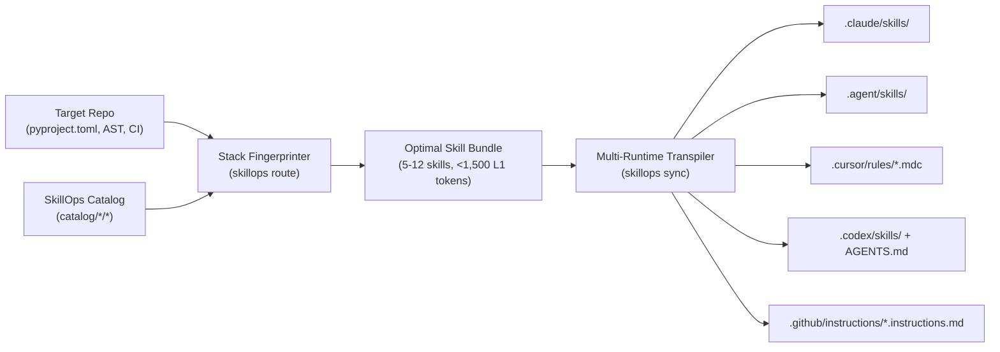

# ADR-0003: Context-Aware Dynamic Router and Multi-Runtime Sync (`skillops route` & `skillops sync`)

- **Status:** Accepted
- **Date:** 2026-10-29
- **Deciders:** `@OdevMatheus`
- **Issue / Epic:** `#44` (Part of `#43` — Milestone `#10`: `v0.2.0`)

---

## Context and Problem Statement

Even when an organization maintains a well-tested catalog of 20–50+ AI coding skills, loading the entire catalog into every repository causes severe **Implicit Routing Collapse** (`arXiv:2610.18522`) and wastes `Level 1` system-prompt token budget (see [`ADR-0002`](./0002-semantic-collision-auditor-and-token-budgeting.md)). A Python/FastAPI/PostgreSQL backend service has zero need for React/Next.js or Kubernetes skills during daily coding sessions, and vice versa.

Furthermore, modern engineering teams operate across heterogeneous AI coding harnesses that each expect different directory layouts, configuration schemas, and file formats:
1. **Claude Code:** `.claude/skills/<skill-id>/SKILL.md` + `scripts/`
2. **Antigravity / Gemini CLI:** `.agent/skills/<skill-id>/SKILL.md` + `scripts/`
3. **Cursor IDE:** `.cursor/rules/<skill-id>.mdc` (YAML frontmatter with `description`, `globs`, `alwaysApply`)
4. **OpenAI Codex CLI:** `.codex/skills/<skill-id>/SKILL.md` + `AGENTS.md` routing index
5. **GitHub Copilot Coding Agent:** `.github/instructions/<skill-id>.instructions.md` (`applyTo` frontmatter) + `.github/prompts/<skill-id>.prompt.md`

Maintaining 5 separate copies of each skill across repositories leads to immediate configuration drift.

---

## Decision Drivers

- **Zero-Config Stack Detection:** Developers should be able to run `skillops route --repo /path/to/project` and immediately receive an optimal, collision-free bundle of **5 to 12 skills** tailored to that repository's stack.
- **Single Source of Truth (`catalog/`):** Skills are authored once in the canonical `SkillOps` format ([`SKILL_CONTRACT.md`](../../../SKILL_CONTRACT.md)) and transpiled deterministically to all 5 target runtimes via `skillops sync`.
- **Collision-Free Sub-Bundle Guarantee:** Any routed bundle must pass the `ADR-0002` collision and token budget checks (`<= 1,500 tokens` total `Level 1` footprint and `< 0.78` pairwise cosine similarity).

---

## Considered Options

1. **Option A: Static Monolithic Copy (Copy all skills to all runtimes)**
   - *Pros:* Trivial shell script.
   - *Cons:* Causes Implicit Routing Collapse (`arXiv:2610.18522`), exceeds Cursor/Copilot instruction budgets, and does not adapt frontmatter (`globs` vs `applyTo`).
2. **Option B: LLM-Based Repo Routing at Session Startup**
   - *Pros:* Flexible natural-language reasoning over repository structure.
   - *Cons:* Non-deterministic, adds API latency/cost on every sync, and requires network access.
3. **Option C: Deterministic Stack Fingerprinting + Greedy Collision-Free Bundle Compiler + Multi-Runtime Transpiler (`skillops route` & `skillops sync`)**
   - *Pros:* 100% deterministic, offline-capable, sub-second execution, mathematically bounded by `max_skills` (`<= 12`) and `max_l1_tokens` (`<= 1,500`), and generates native artifacts for all 5 agent runtimes.
   - *Cons:* Requires maintaining deterministic stack detectors and transpiler adapters in `src/skillops/`.

---

## Decision Outcome

Chosen option: **Option C — Deterministic Stack Fingerprinting + Greedy Collision-Free Bundle Compiler + Multi-Runtime Transpiler**, implemented in `src/skillops/router/` and `src/skillops/sync/`.

### 1. Repository Stack Fingerprinting (`skillops route`)
The router inspects the target repository without executing untrusted code:
- **Manifest & Lockfile Detectors:** `pyproject.toml`, `requirements*.txt`, `uv.lock`, `package.json`, `Cargo.toml`, `go.mod`, `Dockerfile`, `docker-compose.yml`, `.github/workflows/*.yml`.
- **AST / File-Extension Sampling:** Scans tracked files (`git ls-files` fallback to directory walk) to detect frameworks and libraries (`fastapi`, `pydantic`, `sqlalchemy`, `asyncpg`, `openai-agents`, `mcp`, `pytest`, `mypy`, `ruff`).
- **Scoring & Greedy Selection:**
  1. Each catalog skill declares `triggers.files`, `triggers.dependencies`, and `triggers.keywords` in its `SKILL.md` frontmatter.
  2. Each skill receives a relevance score $S(k) \in [0, 100]$ based on matched repository signals.
  3. Skills are sorted descending by $S(k)$ and added greedily to the bundle $B$ subject to:
     - $|B| \le \text{max\_skills}$ (default `12`),
     - $\sum_{s \in B} \text{tokens}_{L1}(s) \le 1,500$,
     - $\forall s_i \in B, \text{sim}(s_{\text{candidate}}, s_i) < 0.78$.

### 2. Multi-Runtime Transpiler (`skillops sync`)
Given a selected bundle $B$ and target runtimes (`--targets claude,antigravity,cursor,codex,copilot`), `skillops sync` compiles each canonical skill into the target runtime's native representation and writes a `.skillops-lock.json` manifest with SHA-256 checksums for idempotent updates and clean uninstalls.

---

## Consequences

- **Positive:**
  - Teams can adopt `SkillOps` across mixed IDE/CLI environments with zero manual file copying.
  - Every target repository receives only the exact skills relevant to its tech stack, preserving high routing recall.
  - `.skillops-lock.json` detects local modifications and prevents accidental overwrites unless `--force` is passed.
- **Negative / Trade-offs:**
  - Changes to vendor rule formats (e.g., Cursor `.mdc` frontmatter conventions) require updating the corresponding transpiler adapter in `src/skillops/sync/adapters/`.
