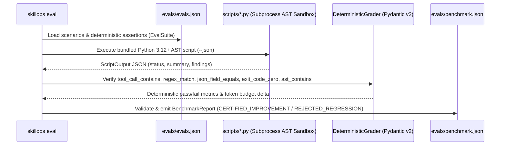

# ADR-0004: Zero-API Deterministic TDD Skill Evaluation Engine & Stdio MCP (`skillops eval`, `skillops mcp`)

- **Status:** Accepted (Updated to 100% Zero-API Architecture)
- **Date:** 2026-10-29
- **Deciders:** `@OdevMatheus`
- **Issue / Epic:** `#44` (Part of `#43` — Milestone `#10`: `v0.2.0`)

---

## Context and Problem Statement

Recent empirical research (*Agent Skills Can Be Harmful*, `arXiv:2608.11888`) demonstrates that unverified AI agent skills frequently **degrade** task success rates compared to an unassisted baseline (`without_skill`), while inflating token consumption by 30%–200% and introducing regressions on edge cases.

At the same time, open-source developer tools and CI pipelines should **never** depend on paid external LLM API keys (`OPENAI_API_KEY`) or persistent HTTP web servers (`FastAPI` / `Uvicorn`) just to audit, route, sync, or evaluate skills.

---

## Decision Drivers

- **100% Zero-API & Offline-First Execution:** `SkillOps` must run with **zero external API keys**, **zero cloud LLM calls**, and **zero HTTP server dependencies**.
- **Empirical Proof of Value ($\Delta\text{PassRate} \ge +15\%$):** Every skill in `catalog/` must prove positive lift over a baseline run without the skill via deterministic AST, regex, JSON-schema, and exit-code assertions.
- **Native Local Agent Consumption:** AI coding agents (Claude Code, Antigravity, Cursor, Codex, Copilot) consume `SkillOps` directly via CLI or over a zero-API **Model Context Protocol (MCP)** `stdio` pipe (`skillops mcp`).

---

## Considered Options

1. **Option A: Cloud LLM-as-a-Judge + FastAPI Server (`openai-agents`, `fastapi`, `uvicorn`)**
   - *Pros:* Can grade free-form prose using remote LLMs.
   - *Cons:* Introduces paid API key dependencies (`OPENAI_API_KEY`), non-deterministic grading variance, network latency, and unnecessary HTTP server dependencies.
2. **Option B: 100% Zero-API Deterministic AST & Subprocess TDD Evaluation Engine + Native JSON-RPC 2.0 `stdio` MCP Server**
   - *Pros:* Runs in milliseconds in any offline developer workstation or GitHub Actions runner; requires only `pydantic`, `typer`, `rich`, and `pyyaml`; produces 100% reproducible `evals/benchmark.json` verdicts and Rich terminal / Markdown / JSON reports.
   - *Cons:* Requires every catalog skill to bundle a deterministic Python 3.12+ tool (`scripts/*.py`) and concrete programmatic assertions (`evals/evals.json`).

---

## Decision Outcome

Chosen option: **Option B — 100% Zero-API Deterministic AST & Subprocess TDD Evaluation Engine + Native JSON-RPC 2.0 `stdio` MCP Server**.

### Architecture of `skillops eval`

---

## Consequences

- **Positive:**
  - **Zero external API dependencies:** Only 4 core Python libraries (`pydantic`, `typer`, `rich`, `pyyaml`).
  - **Instantaneous CI & local execution:** Runs completely offline in milliseconds with 100% determinism.
- **Negative / Trade-offs:**
  - Every catalog skill must provide deterministic verification assertions rather than relying on subjective LLM-as-a-Judge prose rubrics.
