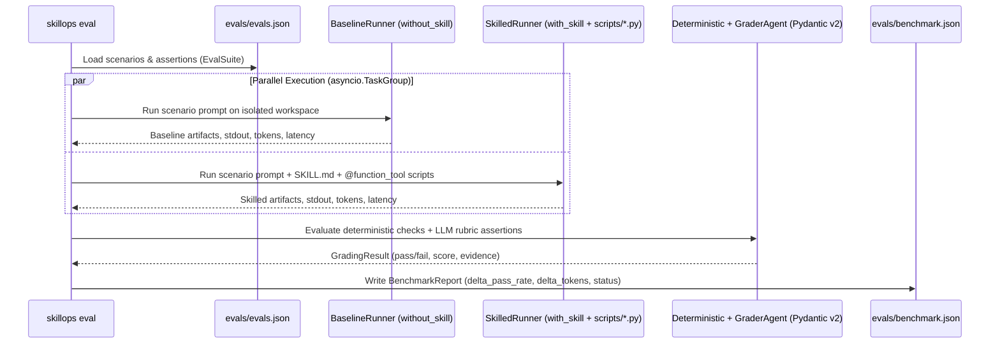

# ADR-0004: TDD Skill Evaluation Engine via OpenAI Agents SDK (`skillops eval`, `skillops serve`, `skillops mcp`)

- **Status:** Accepted
- **Date:** 2026-10-29
- **Deciders:** `@OdevMatheus`
- **Issue / Epic:** `#44` (Part of `#43` — Milestone `#10`: `v0.2.0`)

---

## Context and Problem Statement

Recent empirical research (*Agent Skills Can Be Harmful*, `arXiv:2608.11888`) demonstrates that unverified AI agent skills frequently **degrade** task success rates compared to an unassisted baseline model (`without_skill`), while inflating token consumption by 30%–200% and introducing regressions on edge cases.

Nearly all open-source skill repositories today treat skills as static markdown essays with zero automated testing. Without a rigorous **Test-Driven Development (TDD) Evaluation Harness** that executes comparative `with_skill` vs. `without_skill` runs against realistic coding scenarios, there is no empirical proof that a skill helps rather than harms.

---

## Decision Drivers

- **Empirical Proof of Value ($\Delta\text{PassRate} \ge +15\%$):** Every skill in `catalog/` must prove positive lift over a baseline agent without the skill.
- **TDD Workflow (Red $\rightarrow$ Green $\rightarrow$ Refactor):** Following the `writing-skills` discipline, skills must be developed against failing baseline pressure scenarios before writing `SKILL.md`.
- **Deterministic Offline CI Mode + Live LLM Mode:** GitHub Actions CI must be able to validate `evals/evals.json` schemas, run deterministic assertions, and verify `benchmark.json` regressions offline (`--mode deterministic`), while supporting live comparative execution via the **OpenAI Agents SDK** (`--mode live`).
- **Interactive Observability & Native Agent Consumption:** Engineers need a visual dashboard (`skillops serve` via FastAPI) to inspect side-by-side diffs, token overhead, and grader rationales, plus a native **Model Context Protocol (MCP)** server (`skillops mcp` via FastMCP) so any MCP-capable agent can query, audit, and invoke `SkillOps` tools directly.

---

## Considered Options

1. **Option A: Manual Ad-Hoc Prompt Testing in Chat UIs**
   - *Pros:* Zero code to write initially.
   - *Cons:* Unreproducible, subjective, unversioned, and impossible to gate in CI.
2. **Option B: Raw `httpx` / Custom LLM Loop from Scratch**
   - *Pros:* Few dependencies.
   - *Cons:* Reinvents tool calling loops, structured output parsing, tracing, and session state already solved by the `openai-agents` Python SDK.
3. **Option C: Dual-Mode TDD Evaluation Engine powered by `OpenAI Agents SDK` + `FastAPI` Benchmark Viewer + `FastMCP` Server**
   - *Pros:* Uses production-grade `Runner.run` / `Agent` / `@function_tool` / `AgentOutputSchema` (Pydantic v2 Structured Outputs) from `openai-agents`, supports deterministic offline grading (`regex_match`, `ast_check`, `script_exit_code`, `json_schema`) alongside LLM-as-Judge rubric grading, and exposes results via both a FastAPI web UI and an MCP server.
   - *Cons:* Requires well-defined Pydantic contracts (`EvalSuite`, `EvalScenario`, `BenchmarkReport`) so offline and live modes share identical schemas.

---

## Decision Outcome

Chosen option: **Option C — Dual-Mode TDD Evaluation Engine powered by `OpenAI Agents SDK` + `FastAPI` Benchmark Viewer + `FastMCP` Server**.

### Architecture of `skillops eval`

### Key Components
1. **Deterministic & Hybrid Graders (`src/skillops/eval_engine/graders.py`):**
   - `DeterministicGrader`: Evaluates `regex_match`, `ast_check`, `script_exit_code`, and `json_schema` assertions in pure Python with zero LLM calls.
   - `RubricGraderAgent`: An `OpenAI Agents SDK` agent configured with `output_type=GradingVerdict` (Pydantic v2 model) that grades `llm_rubric` assertions with structured citations when `--mode live` is active.
2. **FastAPI Benchmark Dashboard (`src/skillops/server/app.py` — `skillops serve`):**
   - Serves REST endpoints (`/api/v1/catalog`, `/api/v1/benchmarks`, `/api/v1/audit`) and an interactive dark-mode dashboard visualizing $\Delta\text{PassRate}$, token overhead, and pairwise similarity heatmaps.
3. **FastMCP Server (`src/skillops/mcp/server.py` — `skillops mcp`):**
   - Exposes `audit_catalog`, `route_repository`, `inspect_skill`, and `run_skill_script` over MCP `stdio`/`SSE` transport so agents can self-diagnose skill routing and execute catalog micro-tools on demand.

---

## Consequences

- **Positive:**
  - Every skill in `SkillOps` is backed by reproducible empirical data (`evals/evals.json` + `evals/benchmark.json`).
  - CI pipelines can enforce quality gates in milliseconds without requiring live API keys on every pull request, while maintainers can re-run full live evaluations before cutting releases.
- **Negative / Trade-offs:**
  - Authoring a new catalog skill requires creating both an executable `scripts/*.py` tool and at least 3 TDD pressure scenarios in `evals/evals.json`.
